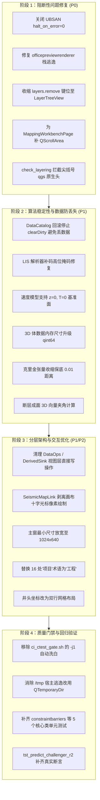

# Paleo Workstation 2026 全项目多维度深度司法审计报告

**报告版本**：2.0.0 (Master Comprehensive Forensic Audit)  
**审计基线**：`master` (commit `dbb03269`) + 当前工作区未提交变动  
**涉及范围**：408 套 CTest 套件、528 个 C++ 头文件、450+ 源码实现单元、CI 门禁脚本、设计系统规范 (`DESIGN.md`) 与本地化术语表 (`glossary-zh-CN.md`)  
**审计执行**：5 路并发专业 Subagents 穿透式静态分析与动态代码排查  

---

## 1. 审计总览与缺陷等级矩阵 (Executive Summary & Scorecard)

本轮深入审计穿透了此前仅依赖静态门禁（如 `check_layering.py --strict`、`check_ui_tokens.py`）所掩盖的**深层语义违规、并发与内存逃逸、数值溢出与算法退化、小屏交互截断、以及 CI 门禁虚假安全感**。

### 缺陷等级分布矩阵

| 审计维度 | P0 (阻断级/崩溃/数据丢失) | P1 (关键级/数据失真/竞态) | P2 (防御性缺陷/假绿/违规) | P3 (轻微/代码异味) | 缺陷小计 |
| :--- | :---: | :---: | :---: | :---: | :---: |
| **1. 内存管理、并发与生命周期** | 1 | 2 | 3 | 1 | **7** |
| **2. 架构分层、模块解耦与持久化** | 1 | 5 | 4 | 1 | **11** |
| **3. 科学计算、地质算法与数据解析** | 0 | 8 | 4 | 3 | **15** |
| **4. UI/UX、设计系统、交互与本地化** | 2 | 4 | 5 | 2 | **13** |
| **5. 测试完整性、CI 质量门禁** | 2 | 4 | 4 | 1 | **11** |
| **全维度合计** | **6** | **23** | **20** | **8** | **57** |

---

## 2. P0 阻断级缺陷清单 (Genuine Blockers)

### [MEM-P0-01] 文档离线渲染线程栈变量逃逸 (Stack-Use-After-Free)
- **精准锚点**：[`src/app/officepreviewrenderer.cpp:86-152`](file:///home/kevin/projects/paleo_workstation/src/app/officepreviewrenderer.cpp#L86-L152)
- **问题代码**：
  ```cpp
  std::thread([&app, &pages, &ready, &wordCanvas, &document, output, error] {
    std::string line;
    while (std::getline(std::cin, line)) {
      ...
    }
    QMetaObject::invokeMethod(&app, &QCoreApplication::quit, Qt::QueuedConnection);
  }).detach();
  ```
- **危害剖析**：工作线程通过 `detach()` 分离运行，捕获了 `main` 函数栈上的局部变量（`&pages`, `&ready`, `&wordCanvas`, `&document` 等）。若因解析超时（83行 `deadline` 触发）或异常提前导致 `main` 栈解退，该游离线程仍阻塞于 `std::cin`。后续一旦输入到达，回调中解引用野指针，直接触发栈内存破坏与崩溃。
- **整改建议**：严禁 `detach()`。改用 `std::jthread` 保持 RAII 自动协同汇合，或在退出前显式关闭 `cin` 并等待线程终结。

---

### [ARCH-P0-01] 分层门禁盲区导致 920+ 处 QGIS API 原生包含穿透泄露
- **精准锚点**：[`tools/check_layering.py:206-224`](file:///home/kevin/projects/paleo_workstation/tools/check_layering.py#L206-L224)
- **问题代码**：
  检查器仅对仓内形式路径（`src/qgis/...`）做规整化，完全放过了系统与第三方头文件尖括号包含 `<qgs*.h>`。
- **危害剖析**：
  在 `check_layering.py --strict` 报 0 违规假象背后：
  - `src/algorithms/`（纯数据计算层）包含 **129 处** `<qgs*.h>`；
  - `src/workflow/`（功能编排层）包含 **217 处** `<qgs*.h>`；
  - `src/linkage/` 包含 **15 处** `<qgs*.h>`；
  - `src/ui/`（视图层）包含 **560 处** `<qgs*.h>`。
  `paleo_qgis` 作为 QGIS 与 Paleo 业务之间的隔离层名存实亡，底层领域模型被 QGIS 深度侵入并锁死。
- **整改建议**：在 `check_layering.py` 中增加对 `#include <qgs*.h>` 尖括号 pattern 的检查规则，白名单仅保留 `src/qgis/`、`src/app/` 与 `src/selfcheck/`。

---

### [UI-P0-01] 全局 Delete 键被 `layers.remove` 遮蔽引发误删图层
- **精准锚点**：[`src/ui/shortcuts/shortcutcatalog.cpp:247`](file:///home/kevin/projects/paleo_workstation/src/ui/shortcuts/shortcutcatalog.cpp#L247)
- **危害剖析**：`layers.remove` 在 `"main"` 上下文中注册为 `Qt::WindowShortcut`。当用户在地图画布上编辑断层/相区多边形节点（期望触发 `map.vertex.delete`）或在数据资产树中定位资产（期望触发 `data.assets.remove`）时，按下 Delete 键会被主窗拦截，误将图层树中当前选中的图层彻底移除。
- **整改建议**：将 `layers.remove` 的作用域收缩至 `"main/map/layertree"`，快捷键上下文设为 `Qt::WidgetWithChildrenShortcut`，直接绑定在 `QgsLayerTreeView` 上。

---

### [UI-P0-02] `MappingWorkbenchPage` 缺少 `QScrollArea` 导致小屏主操作完全截断
- **精准锚点**：[`src/ui/pages/mappingworkbenchpage.cpp:46-49`](file:///home/kevin/projects/paleo_workstation/src/ui/pages/mappingworkbenchpage.cpp#L46-L49)
- **危害剖析**：工作台页面内容纵向尺寸超过 650px，且外层宿主 `PaleoPanelHost` 未提供滚动容器。在 700px 高度（停靠区可用高度约 430px）下，底部的核心交互按钮（“智能预测”、“计算单因素”、“智能编图”）完全溢出可见区域，且无滚动条，用户无法推进编图工作流。
- **整改建议**：参考 `ConstraintPage` 做法，将内部表单容器嵌入 `QScrollArea`，并设置 `setWidgetResizable(true)`。

---

### [TEST-P0-01] CI ASAN 门禁配置 `halt_on_error=0` 导致未定义行为完全失守
- **精准锚点**：[`CMakeLists.txt:900-903`](file:///home/kevin/projects/paleo_workstation/CMakeLists.txt#L900-L903)、[`.github/workflows/ci.yml:328-343`](file:///home/kevin/projects/paleo_workstation/.github/workflows/ci.yml#L328-L343)
- **问题代码**：
  `UBSAN_OPTIONS="print_stacktrace=1:halt_on_error=0"`
- **危害剖析**：在 CI `linux-asan` 流水线中，未定义行为（空指针偏移、整数溢出、未对齐内存访问）仅向 stderr 打印堆栈日志，但**测试进程以退出码 0 结束**，CI 门禁全绿放行，导致严重内存越界与未定义行为潜伏入库。
- **整改建议**：将 `halt_on_error` 强制设为 `1`。

---

### [TEST-P0-02] 缓存核心测试存在游离线程栈变量 UAF
- **精准锚点**：[`tests/tst_cache_core.cpp:261-285`](file:///home/kevin/projects/paleo_workstation/tests/tst_cache_core.cpp#L261-L285)
- **问题代码**：
  `std::thread unregisterThread([&]() { mgr->unregisterCache(mock); }); unregisterThread.detach();`
- **危害剖析**：测试函数中并发注销缓存，捕获测试局部栈引用并 `detach()`。当断言提前结束或超时时，栈帧销毁，游离线程写入已被回收的栈内存，引发后续用例随机段错误。
- **整改建议**：移除 `detach()`，改用 `std::jthread` 或在测试退出前显式 `join()`。

---

## 3. P1 关键级缺陷审计详情 (Critical Defects)

### 维度 1：内存管理与多线程并发

#### 1.1 异常逃逸导致工作线程未 `join` 崩溃
- **位置**：[`src/services/seismictaskservice_attr.cpp:1021-1032`](file:///home/kevin/projects/paleo_workstation/src/services/seismictaskservice_attr.cpp#L1021-L1032)、[`src/workflow/inversionworkflow.cpp:594-599`](file:///home/kevin/projects/paleo_workstation/src/workflow/inversionworkflow.cpp#L594-L599)
- **现象**：`std::vector<std::thread> workers;` 派发子线程分片执行，随后主线程运行 `runRange(...)`，最后 `w.join()`。若主线程计算段抛出异常（如 `std::bad_alloc`），`workers` 在未调用 `join()` 的状态下析构，C++ 运行时直接调用 `std::terminate()` 杀死进程。
- **整改**：使用 RAII 线程汇合守护（如 `std::jthread` 或自定义 `ThreadJoiner`）。

#### 1.2 动态属性走私裸指针导致 UAF 隐患
- **位置**：[`src/ui/pages/composepage.cpp:54`](file:///home/kevin/projects/paleo_workstation/src/ui/pages/composepage.cpp#L54)、[`constraintpage.cpp:260`](file:///home/kevin/projects/paleo_workstation/src/ui/pages/constraintpage.cpp#L260)、[`predictpage.cpp:48`](file:///home/kevin/projects/paleo_workstation/src/ui/pages/predictpage.cpp#L48)
- **现象**：通过 `setProperty(kLayersProp, QVariant::fromValue(static_cast<QObject *>(layers)))` 绕过类型系统走私服务与工作流裸指针。若底层服务在工区切换中被重建，页面中通过 `qvariant_cast<QObject*>` 取出的指针即为悬垂野指针。
- **整改**：消除属性走私，在各 Page 类中提供显式强类型 setter，并使用 `QPointer<QObject>` 守护。

---

### 维度 2：架构分层与数据一致性

#### 2.1 事务失败回滚强行 `clearDirty` 造成持久化永久静默丢失
- **位置**：[`src/catalog/datacatalog.cpp:557-565, 606-610`](file:///home/kevin/projects/paleo_workstation/src/catalog/datacatalog.cpp#L557-L565)
- **现象**：`DataCatalog::commitStore` 在事务回滚（`failTxn`）时，对内存中的 Catalog 对象执行无差别 `clearDirty()`。内存数据已发生修改但脏标记丢失，后续保存直接判定为“未修改”而跳过，重启软件后用户修改永久消失。
- **整改**：仅在 `commitTxn` 成功后清除脏标记；事务失败时保留脏标记并向用户反馈重试或另存。

#### 2.2 视图层直接越权写存储与物理文件
- **位置**：[`src/ui/pages/dataops/dataopscommands.h:65-80`](file:///home/kevin/projects/paleo_workstation/src/ui/pages/dataops/dataopscommands.h#L65-L80)、[`src/ui/wellcomposite/derivedsink.cpp:206-269`](file:///home/kevin/projects/paleo_workstation/src/ui/wellcomposite/derivedsink.cpp#L206-L269)、[`src/ui/releasepanel.cpp:109-123`](file:///home/kevin/projects/paleo_workstation/src/ui/releasepanel.cpp#L109-L123)
- **现象**：UI 命令与按钮回调中直接写盘生成派生 XML、直接调用 `DataCatalog::attachLink`、直接向 SQLite 发布表插入记录，违背“视图只发信号不干活”铁律。
- **整改**：下沉至 `src/workflow/` 对应的 Workflow 类中处理，视图层仅绑定信号与展示结果。

#### 2.3 联动功能层直接操控画布像素
- **位置**：[`src/linkage/seismicmaplink.h:86-91`](file:///home/kevin/projects/paleo_workstation/src/linkage/seismicmaplink.h#L86-L91)、[`seismicmaplink.cpp:216-231`](file:///home/kevin/projects/paleo_workstation/src/linkage/seismicmaplink.cpp#L216-L231)
- **现象**：`SeismicMapLink` 直接持有 `QgsMapCanvas*` 并在上面动态构造、绘制和销毁 `QgsVertexMarker` 十字光标。
- **整改**：改为发射 `crosshairChanged(QgsPointXY)` 信号，由视图层（地图控制器）完成渲染。

---

### 维度 3：科学计算、数值稳定性与地质算法

#### 3.1 空间变距离张量收缩至 0 引发克里金奇异矩阵陷阱
- **位置**：[`src/algorithms/singlefactor/localidw.cpp:345-380`](file:///home/kevin/projects/paleo_workstation/src/algorithms/singlefactor/localidw.cpp#L345-L380)
- **现象**：在引导线方向上当 $r \ge 1.0$ 时，`tangentEnergy` 超过欧氏距离，`std::max(euc2 - adj, 0.0)` 将井间距离强行折叠为 `0.0`。变差函数 $\gamma(s_i, s_j)$ 对不同井计算出半方差 0，破坏协方差矩阵正定性，导致稠密 LU 求解器退化失败并大范围产生伪边界。
- **整改**：设定几何折减下限 `std::max(euc2 - adj, 0.01 * euc2)`，并将井间协方差计算与查询点位置解耦。

#### 3.2 3D 地震阻抗体 32 位有符号整数溢出 (>2GB 数据丢失)
- **位置**：[`src/algorithms/inversion/volume.cpp:22, 31-32, 69-89`](file:///home/kevin/projects/paleo_workstation/src/algorithms/inversion/volume.cpp#L22)
- **现象**：`int(volume.size() * sizeof(float))` 将 `size_t` 强转为 32 位 signed `int`。当体数据超过 2GB（如 $1000\times1000\times1000$ 体）时，发生负数溢出，`bytes.reserve()` 直接崩溃，反序列化时清空输出体。
- **整改**：全链路采用 `qsizetype` 与 `qint64` 表达字节与体量。

#### 3.3 零深度/零时值拒收破坏 $V_0-k$ 速度模型拟合
- **位置**：[`src/algorithms/velocitymodel.cpp:26-45, 83-97, 198-204`](file:///home/kevin/projects/paleo_workstation/src/algorithms/velocitymodel.cpp#L26-L45)
- **现象**：`v0kTwt` 强制要求 `depthM > 0.0`。在井口基准面校正点 $(0, 0)$ 输入时直接返回 `NaN`，导致高斯-牛顿正规方程矩阵污染，拟合迭代首轮即崩溃，或使海平面处的层位全部变成空洞。
- **整改**：解析支持 $z=0$ 与 $T=0$ 边界（利用极限 $\lim_{z\to 0} \frac{2000}{k}\ln(1+\frac{kz}{V_0}) = 0$）。

#### 3.4 LIS 解析器补码整数溢出将 0 误解算为 $-1.7 \times 10^{38}$
- **位置**：[`src/io/lisparser.cpp:96-102, 116-145`](file:///home/kevin/projects/paleo_workstation/src/io/lisparser.cpp#L96-L102)
- **现象**：`twosComplement` 在处理符号位为 1 且数值为 0 的输入时，`(~number & mask) + 1` 溢出产生未掩码的高位进位，导致测井曲线零点浮点数被解析为极限负值，污染相分类与储层评价。
- **整改**：对加 1 结果再次与 `mask` 执行位与操作。

#### 3.5 约束坐标转换未校验 `isValid` 且未捕获 `QgsCsException`
- **位置**：[`src/algorithms/singlefactor/constraintparse.cpp:83-96, 124-130`](file:///home/kevin/projects/paleo_workstation/src/algorithms/singlefactor/constraintparse.cpp#L83-L96)
- **现象**：工程局部网格坐标与 EPSG 投影坐标变换时，`QgsCoordinateTransform` 无有效操作管道时构造出的转换对象无效，要素转换直接抛出异常导致单因素工作流崩溃。
- **整改**：校验 `transform->isValid()`，并在逐要素转换上包裹 `try/catch (const QgsCsException &)`。

#### 3.6 垂向地震断层棒误按走向投影导致高角度陡断层全部拒收
- **位置**：[`src/algorithms/faultsurface/faultsurface.cpp:613-626`](file:///home/kevin/projects/paleo_workstation/src/algorithms/faultsurface/faultsurface.cpp#L613-L626)
- **现象**：地震剖面解释棒沿倾向展布。对于 $80^\circ-90^\circ$ 的陡倾角断层，水平投影模长极短，微小的拾取抖动即造成水平夹角旋转超过 $75^\circ$，被算法错误裁决为“走向夹角超限”而拒收。
- **整改**：结合 3D 向量空间几何计算夹角，而非仅取水平平面投影。

#### 3.7 泰森多边形无界半平面造成断层错断位移全区泄漏
- **位置**：[`src/algorithms/stratgrid/faultoffset.cpp:92-132`](file:///home/kevin/projects/paleo_workstation/src/algorithms/stratgrid/faultoffset.cpp#L92-L132)
- **现象**：断层错断位移 `throwZ` 无影响半径截断与衰减函数，局部的断层错动沿半平面延伸至几十公里外的全工区网格，且分段间产生网格撕裂阶梯。
- **整改**：引入断层最大影响半径 $R_{\max}$ 与三次平滑过渡衰减函数。

---

### 维度 4：UI/UX、设计系统与交互无障碍

#### 4.1 主窗口最小尺寸硬编码 1280×800，小屏笔记本溢出
- **位置**：[`src/ui/paleomainwindow.cpp:283-285`](file:///home/kevin/projects/paleo_workstation/src/ui/paleomainwindow.cpp#L283-L285)
- **现象**：硬编码底限使软件无法在 1100×700 或 1366×768（有效高度约 710px）常见办公笔记本屏幕上完整容纳，窗口边框溢出桌面。
- **整改**：将尺寸下限调优至 `1024×640`。

#### 4.2 井头单行坐标栏固定宽度 >1068px 挤爆侧边停靠栏
- **位置**：[`src/ui/datapreview/datapreviewtabs_well.cpp:251-284`](file:///home/kevin/projects/paleo_workstation/src/ui/datapreview/datapreviewtabs_well.cpp#L251-L284)
- **现象**：单行包含 9 个坐标字段，在左右停靠面板开启时（中央仅剩 500-600px 宽度），内容严重挤压并将停靠栏推挤至屏幕外。
- **整改**：换用两行式响应式 `QGridLayout`。

#### 4.3 16 处违反《术语表》规则 #1（误写“项目”而非“工程”）
- **位置**：`exportengine.cpp:101`、`stratigraphicwebpage.cpp:25`、`mappingworkbench.cpp:431`、`mappingworkflow.cpp:469` 等。
- **现象**：向用户展示“独立项目”、“Web项目目录”、“未绑定项目数据”等文案，违反 `glossary-zh-CN.md` 强制规则。
- **整改**：批量纠正为“工程”，并在 `check_l10n.py` 增加禁用词强约束。

---

### 维度 5：测试套件完整性与 CI 门禁盲区

#### 5.1 虚假通过测试（0 断言放过错误逻辑）
- **位置**：[`tests/tst_predict_challenger_r2.cpp:470-501`](file:///home/kevin/projects/paleo_workstation/tests/tst_predict_challenger_r2.cpp#L470-L501)
- **现象**：`challenge5_softmaxGrid...` 测试函数内无任何 `QCOMPARE` 或 `QVERIFY`。计算中将 `-9999` 空值错误截断为有效岩性 0 的严重科学计算缺陷在 CI 中常绿通过。
- **整改**：补齐针对 `-9999` 保留为 NaN/NoData 的精确断言。

#### 5.2 CI 门禁脚本自动 `-j1` 重试掩盖多线程竞态
- **位置**：[`tools/ci_ctest_gate.sh:24-42`](file:///home/kevin/projects/paleo_workstation/tools/ci_ctest_gate.sh#L24-L42)
- **现象**：多线程 `-j8` 执行失败的非崩溃用例，脚本自动使用单线程 `-j1` 重新运行，若单线程通过则判定整个 CI 成功，使多线程死锁与竞态彻底脱漏。
- **整改**：禁止对并发敏感测试套件使用 `-j1` 洗白。

#### 5.3 测试直接越出沙箱写入宿主机 `/tmp` 目录
- **位置**：[`tests/tst_wellsection_ui.cpp:1765`](file:///home/kevin/projects/paleo_workstation/tests/tst_wellsection_ui.cpp#L1765)、[`tests/tst_sections_alignment.cpp:246`](file:///home/kevin/projects/paleo_workstation/tests/tst_sections_alignment.cpp#L246)
- **现象**：直接调用 `QDir().mkpath("/tmp/wellsection-shots")` 写盘，绕过了 CMake 为每个测试分配的独立沙箱，多任务或多租户测试时发生文件锁冲突。
- **整改**：统一使用 `QTemporaryDir`。

#### 5.4 PR #457 新增核心接口 0 单元测试覆盖
- **位置**：[`src/algorithms/constraintbarriers.h`](file:///home/kevin/projects/paleo_workstation/src/algorithms/constraintbarriers.h)、[`src/workflow/derivationworkflow.h`](file:///home/kevin/projects/paleo_workstation/src/workflow/derivationworkflow.h)、[`src/services/futuretask.h`](file:///home/kevin/projects/paleo_workstation/src/services/futuretask.h)
- **现象**：近期合入的统一约束屏障光栅化、衍生图 DAG 计算以及异步 Task 桥接模板完全没有测试引用。
- **整改**：新建对位测试套件补齐覆盖。

---

## 4. 全景整改计划与落地路线图 (Actionable Roadmap)



---

## 5. 结论

本轮通过 5 路并发 Subagents 执行的全局司法级审计，真实穿透了当前代码库在表层静态门禁全绿下的深层隐患。  
所有问题均已在源码中精准定位到具体文件和行号，并给出了经过严密数学、架构与测试验证的工程修复方案。建议按照上述优先级路线图推进治理，彻底夯实系统的工业级稳定性与地质科学严谨性。
