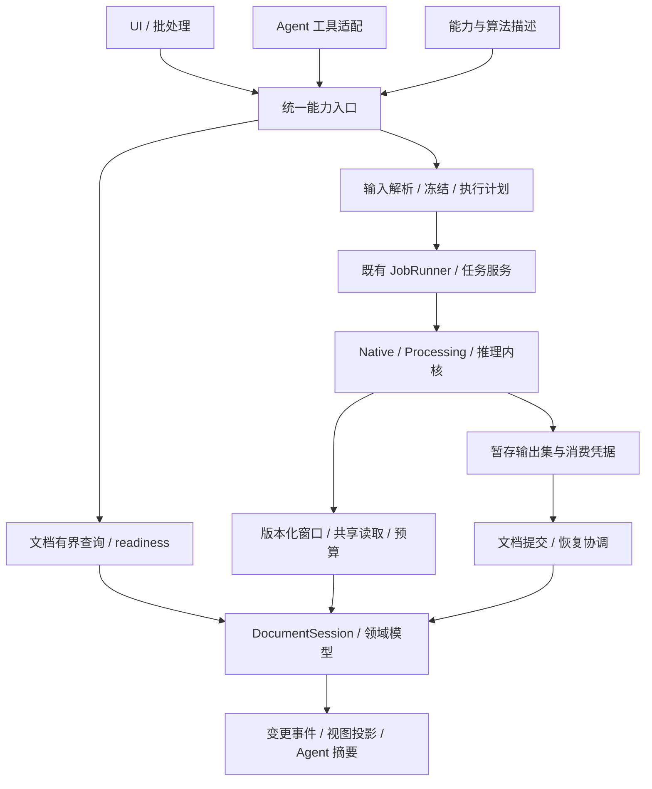

# 原子能力、算法组合与 Agent 调用契约

状态：2026-11-06 目标设计。本页仍是目标，不是实现清单。试点接线见
[algorithm-atomic-20261106](../progress/algorithm-atomic-20261106.md)：时深批转换、地震属性组和约束 IDW
参数契约已接到现有核上；其余能力保持 internal / legacy-adapter / unavailable。
本页扩展[统一文档模型](UNIFIED_DOCUMENT_MODEL.md)、
[文件到模型接口](FILE_MODEL_IO_CONTRACTS.md)与[迁移验收](MODEL_MIGRATION_AND_VALIDATION.md)。
现有算法接线见[算法原子契约](../designs/algorithm-atom-contract.md)；其已交付能力保持，
本页新增的 CapabilitySpec、执行计划、持久操作和成组发布不能从旧 Spec.complete 推定为已实现。

## 1. 目标与原子边界

尽量让每个业务能力可描述、可独立调用、可测试、可组合。UI、批处理和 Agent 共用领域
查询、校验、算法与文档命令；Agent 不依赖点击界面，也不另建一套读文件/保存结果的捷径。

“原子”有三个不同含义，不能互相替代：

| 层级 | 原子单位 | 示例 | 不承诺 |
|---|---|---|---|
| 计算内核 | 有明确数值/语义输入输出的可复用算子 | 一批完整道的解析信号、一个有限支持域的相干计算 | 每个内核都成为外部工具；计算本身是数据库事务 |
| 业务能力 | 一项可校验、可跟踪的用户意图 | 指定体/窗口计算一组属性、按选定时深转换一组曲线 | 每样点一次工具调用；由模型逐块搬运数组 |
| 持久提交 | 维持领域不变量的一次可见变化 | 切换同槽位主选、发布主结果与必需质量报告 | 跨数据库/文件/外部系统天然全局原子 |

一个业务能力可以包含多个内核与提交步骤。必须共同成立的变化保留为一个领域命令，
例如取消旧主选与确认新主选不能拆成两个公开工具；多段时深接点/单位校验不能留给 Agent
自行拼接。鼠标拖动、像素绘制、内部循环等可留内部实现，但底层地质编辑应有命令入口。

## 2. 与现有工程的关系



沿用 `AlgorithmSpecRegistry`、Processing/NativeCppAdapter、JobRunner/PaleoTaskService、
DerivedAssetRegistrar 和文档会话。AtomicJob 目前是同步胶合助手，不把所有异步任务改写成
一个巨型模板。QGIS 调用继续在现有封装内按线程约定执行，不把 QgsLayer/SQL 连接传给 Agent。

新增能力描述放数据服务层，编排与适配放功能层，入口接线在 app；遵循层契约。
宿主可以继续用 Qt DTO，SDK 公共 ABI 仍为标准 C++ 值类型，序列化只发生在工具/进程边界。
本阶段不引入额外 HTTP 服务、通用脚本执行器或第二套任务调度系统。

## 3. 单一能力目录

### 3.1 AlgorithmSpec 与 CapabilitySpec

AlgorithmSpec 描述计算：端口、参数、算法版本、执行形状和引擎。
CapabilitySpec 描述可调用业务契约：查询、命令、计算或复合工作流；计算能力引用准确的
AlgorithmSpec，不能再复制一套参数默认值。复合工作流引用有版本的能力节点。

注册描述同时生成参数校验、UI 表单依据、Agent 工具 schema 与参考文档。
模型可见的是有界、按类别检索的能力目录；不把全部内部算法、字段和源码塞进每轮上下文。
工具别名转换须检测冲突，名称翻译和工具提供方的命名限制不改变内部 capabilityId。

| 描述字段 | 契约 |
|---|---|
| 身份 | capabilityId、contractVersion、实现/算法版本；名称稳定，版本不能复用给不同语义 |
| 类别 | query / command / compute / workflow；compute 可写私有暂存，但不暗中发布 |
| 输入输出 | 强类型端口、基数、对象种类、轴/单位/基准、精度、mask、coverage、集合边界 |
| 参数 | 类型、范围、必填项、条件约束、默认值与 schema 版本；有效默认值进入计划 |
| 前提 | 所需文档/领域能力、readiness profile、已确认身份/语义、引擎/模型依赖 |
| 依赖 | 消费 facet、范围/halo、成员资格和负依赖；对应绑定模式 |
| 效果 | 读模型、受管暂存、文档写入、工程表现变化、外部导出/传输；效果可组合 |
| 执行形状 | scalar / batch / finite-halo / whole-trace / reduction / global；最小工作集与资源估计 |
| 一致性 | 输入冻结策略、读写集合、expected heads、提交分组和结果当前性策略 |
| 生命周期 | 同步/长任务、取消/恢复/重试能力、幂等期限、进度单位和终态定义 |
| 可复现性 | deterministic / tolerance / nondeterministic；seed、模型权重、数值精度与实现指纹 |
| 暴露状态 | internal / legacy-adapter / callable / unavailable；原因、替代入口和迁移条件 |

Spec.complete 只说明已有描述完整，不等于预算、取消、多输出提交和 Agent 调用均合格。
静态支持与当前可运行也分开：可枚举的能力可能因原件离线、语义未定或缺少 ORT 不可运行。
未登记算法不能经 `runById` 的兼容回退路径自动暴露给 Agent。

### 3.2 演进与扩展

破坏端口/含义/默认值兼容的变化发布新 contractVersion；旧计划继续引用旧版本，缺失时
明确 UnsupportedVersion，不能悄悄调用最新版。新增可选字段也要证明不改变旧默认语义。
算法实现、参数 schema、领域数据 schema 分别版本化；版本迁移为显式 adapter。
外部扩展只注册允许的类型/能力及执行适配，必须通过同一校验/预算/提交接口。
JSON 中不透明 ID 和可能超过精确整数范围的计数使用约定的字符串编码；数值 NaN/缺测
使用 mask/状态表达，不输出非法 JSON。必填/可空/缺省分别定义，旧字符串转数字兼容
只能在版本化 adapter 中进行。嵌套 items、输出 schema 与范围都要校验，不能只校验顶层类型。

## 4. 输入必须来自文档模型

公开输入使用 DocumentRef、完整 ContextKey、ObjectValueRef/BindingRef、UnitScope、
WindowSpec、ModelArtifactRef 与受控导出目的地引用。文件路径由 SourceAccessDescriptor
解析，算法 adapter 可接收后台句柄/私有路径；Agent 不用文件名、井名或当前选中层代替身份。

运行前解析计划必须显式固定：

1. 文档会话世代、一致 ReadCut、对象和用途绑定；名称搜索只返回候选卡片。
2. 井筒归属、多体系单元/occurrence、时深本体或分段组合及各自修订。
3. 实际轴、单位、基准/时间零点、变换路径、质量/缺测/范围/LOD 策略。
4. 参数有效值、算法与模型版本、预算、发布目标和所有需要的前置能力。

三种绑定模式沿用文档契约：pinned-value、follow-object-head、follow-selection。
计划冻结本次真实值；跟随模式另校验所跟随的可变边。旧修订无法读取时须物化消费窗口或
明确拒绝，不能把 revision counter 当成历史数据。新注册的模型也必须携带特征 schema。

UnitScope 可能返回 0..N 个离散区间；窗口类型保留 occurrenceId、间断和边界包含规则。
算法若只支持连续窗须明确拒绝多区间或由编排分批，不能 MIN/MAX 合并后掺入其他地层。
成员很多时保存分页 SelectionManifest 与覆盖依赖；不把百万 ID 内联到工具参数/计划 JSON。

## 5. 调用协议与任务状态

以下为目标逻辑入口，可由本地 API、CLI 或工具协议适配；不是预定网络 URL。

| 入口 | 结果 | 保证 |
|---|---|---|
| `capabilities.list/describe` | 卡片页 / 精确版本描述 | 有界查询；不扫描载荷来枚举可用工具 |
| `capability.prepare` | PreparedPlanRef、有效参数、依赖、成本估计、缺失前提 | 不发布领域变化；必要的冻结/暂存明确报告并计预算 |
| `capability.execute` | 小查询结果或 operationId + Accepted | 校验计划、授权范围、输入与预算；Accepted 不表示计算/提交成功 |
| `operation.get/events` | 持久状态、进度、receipt、结果引用页 | 重连可取；不依赖某个聊天回调仍存在 |
| `operation.cancel` | 请求已收、真实提交状态 | 取消可撤回的工作；不把已提交伪装成未发生 |
| `operation.resume` | 旧操作进展或已有 receipt | 原输入摘要不变，先查提交事实再决定重试 |
| `result.describe/read` | 摘要/覆盖/有界页面/受控预览 | 大数组走数据访问层，不回灌语言模型 |

轻量 query/小型命令可由入口内部完成 prepare+execute，避免人为增加两次往返。
有成本的长计算可暴露可审查计划；同一次用户授权覆盖范围内的确定操作直接执行，
不要求每个原子步骤重新确认。缺少关键身份/语义或超出授权效果时返回结构化需求。

operationId 由宿主持久分配，映射聊天 tool_call_id、clientRequestId、planId 和规范输入摘要。
接受执行前，按 `(documentId, callerScope, clientRequestId)` 唯一持久记录 operationId 与
输入摘要。首次响应丢失、尚未知 operationId 时也可按这个键重试/查询：同摘要返回原操作，
异摘要报冲突。callerScope 来自宿主且可跨重连稳定，不由模型冒名指定；去重保留期显式化。
重传沿用原 operationId；有意再运行用新 ID。不同 operationId 即使输入相同也不自动当作
同一次业务写入；确定性计算缓存可以复用，但文档提交与授权仍须独立核对。
缓存指纹包含实际消费版本/语义、有效参数、算法实现、模型权重、seed 和影响数值的执行
配置；纯路径或会话世代不改变数值缓存身份。非确定性运行没有可固定凭据时不自动复用。
operationId 的幂等与计算缓存不同：即使不能重算相同数值，也能返回原已提交 receipt。

状态分为执行、提交、投影/呈现三个维度。典型过程为：

```text
Prepared -> Queued -> Running -> OutputsPrepared -> Validating
         -> Committing -> CommittedNeedsProjection -> Succeeded
```

这是要求发布的过程；纯查询/compute-only/prepared-output-set 可以执行成功且提交为
NotRequested，不必进入 Committing。返回暂存输出引用与保留期限，不能为达到 Succeeded 暗中发布。

执行还可为 WaitingForInput、Failed、CancelledBeforeCommit；恢复可为 RecoveryRequired。
取消请求与实际取消分开。失去响应、进程重启或图层呈现失败后先查询 receipt，不自动重跑
已提交计算。对固定历史输入，head 改变只按其模式影响 currentness，不改写冻结值。

JobRunner 的会话世代用于丢弃过期 UI 回包；持久操作由文档协调器拥有，不能因为关闭视图/
聊天而删除提交事实。已提交操作继续恢复；尚未提交、只属于旧会话的工作按明确所有权取消。
QGIS/SQL 句柄维持所属线程；owner 回调不承担整文件 hash、全库扫描或大数组序列化。

错误使用可机器处理的 code、detailsRef、retryability、requiredInputs、operationId、
commitReceipt。StaleRevision/Conflict 不能通过自动改成最新头后悄悄重试；BudgetExceeded
可提出更小批次或显式近似方案，但不得静默降低精度或换分层/时深。

## 6. 多输出与组合工作流

### 6.1 输出集是一等模型

OutputSetManifest 将 portId 映射到类型化 ArtifactRef/ValueRef、成员页、schema、coverage、
校验结果和依赖 receipt。端口定义 required/optional、基数与缺失策略；不能将 artifacts.first()
视为全部成功。克里金主栅格+方差、预测值+质量 mask、相图+QA 报告都须有明确分组。

必需输出全部准备、校验、持久化后，才提交可见 ResultVersion/输出集引用。同库内的主选/
结果关联用一个事务；跨库沿用日志/receipt/水位协议，不承诺文件与多个 SQLite commit 原子。
跨 store 成组产物先以 operation/group 为 staging 标记，所有文档查询及相关 SDK 读入口
都遵守可见性规则，最终小型发布记录切换为 Ready。尚未迁移而会泄露中间行的旧读口不得
宣称支持跨 store 成组原子可见性。部分提交返回恢复状态，不笼统返回失败并删除已引用文件。
最终 Ready 发布记录归 Catalog 文档控制面；SDK 保存 staged facts 和组提交证明，不维护
第二份主选/发布决定。协调器据此产生/校验 ReadCut 中的 PublicationFence，向领域读口
传递可见代次/组引用的值；SDK 不反向打开 Catalog。私有暂存读由相应操作的 lease 授权，
不能凭客户端自造 fence 将未发布数据混入普通查询。

数据发布与“添加到当前视图”分开。结果已提交而图层声明失败，应保留结果并返回
presentation-pending，重试呈现；不能为重试图层再生成一个数据版本。
暂存输出属于操作；被运行计划、发布结果或下游持有的块按既有 GC 根保留。

### 6.2 组合由程序执行

WorkflowPlan 是有版本、有类型端口的有向无环图，节点引用能力及固定参数，边引用输出端口。
保存规范计划和执行 receipt，可在不重新询问语言模型的情况下执行、恢复和追踪。
校验有环、端口类型/基数、轴/语义、发布冲突、预算、未知能力；全局迭代算法作为单个
声明了迭代/收敛上限的能力，不把任意循环交给工具调用回路。

批量采用有界 map/reduce 与批级 SelectionManifest，不为百万道展开百万 plan 节点。
共享前置读取、冻结输入和确定性子计算可合并；调度只并行无冲突节点，写冲突按对象/槽位
和版本条件串行或拒绝。大成员集合的展开与依赖遍历也受节点数、队列和存储预算约束。

WorkflowRun 汇总子 operationId、每步 receipt 和发布组；总任务失败不抹掉已提交步骤。
纯计算中间值默认不发布为目录资产。需要全结果一起出现时只在末端发布组切换；导出/
外部提交等不可纳入同库事务的节点明确报告单步结果及可用补偿，不承诺整图回滚。

## 7. 地震性能：原子化不能增加读取成本

数值运算粒度由执行器选择。Agent 请求“这个范围的 RMS、包络和相干”，只提交一份计划；
程序规划真实道键、支持域、I/O ranges 和算法批次，共享页目录、解码缓冲及可复用中间值。
内核之间通过有所有者的不可变缓冲/块引用连接，不经过 JSON、目录登记或临时整文件往返。

| 执行形状 | 允许的拆分 | 必须声明/验证 |
|---|---|---|
| 点式/有限滑窗 | 按空间/采样块，含 halo | halo 大小、边界/缺测策略、输出有效内区 |
| 完整道 FFT/Hilbert | 按完整道批次 | FFT padding/长度、整道需求；不能任意切样点后声称等价 |
| 统计归约 | 有界局部统计 + 合并 | 合并规则、精度、稳定顺序；近似分位数另作能力 |
| 克里金/SGS/追踪/全局求解 | 按算法真实邻域或全局阶段 | 邻域、随机序列、边界传播、收敛/检查点；不得假装独立 tile |
| 文件转换/LOD 构建 | 带 checkpoint 的块任务 | 父来源与 generation、partial coverage、恢复验证和写入预算 |

融合只限语义、精度、mask、LOD 和绑定版本相容的算子。与未融合的参考路径做等价/容差
比较，并保留每个逻辑算子的 provenance；融合不能绕过单算子的依赖/预算或隐式降采样。
WholeTrace 输入比请求输出大时，代价估计和 ConsumptionReceipt 记录实际整道支持域。
串联局部算子的支持域按坐标变换/重采样和各自邻域合成，不能简单取最大的 halo。
仅消费时间域振幅的能力不附加无关 TD/井轨迹依赖；需要深度输出时才解析相应变换。

最小原子工作集也必须能容纳，不能以“至少一条 inline”为由穿透硬预算。按 HY 已知 shape，
`3241 × 4096 × 4B` 单 inline 约 50.64 MiB；当前属性路径的 8/32 MiB 目标块不能单靠
`max(1,blockIl)` 保证硬上限。有限 halo 算法可沿 XL/采样继续切，整道算法改为道批；
不能分解且超限时返回预算不足或使用明确支持的外存算法。这里是结构性估算，非 RSS 实测。

全局资源协调器同时计入 reader、目录、halo、FFT scratch、模型/GPU、输出、pin 与待发布
队列；重复工具调用不能各自领取完整缓存额度。GPU/远端在宿主预算之外的费用/额度也显式
计入请求政策。先保留最小可运行额度，等待更多资源时不无限占住其他任务必需的缓冲。
single-flight 的取消按 claim 处理；共同输入不随其中一个 Agent/视图退出而被误关闭。

## 8. Agent 边界与小结果协议

Agent 负责选能力、提供用户意图和解释结果；服务端负责 schema、领域语义、预算与提交。
调用者身份、授权效果/目的地范围由宿主注入，不能信任工具参数中的 actor 或“已批准”字段。
同一用户授权可覆盖整份计划；授权不是每步都弹确认，缺失授权也不能靠计划字符串自授。

源文件文本、附件内容和工具描述中的外部数据不成为可执行指令。操作接口不接收任意 SQL、
shell、输出路径覆盖请求或自由代码；导出目的地经受控引用解析。远程推理/外部传输须在
能力效果和既有授权范围内显式声明，凭据由宿主管理，不进入计划、缓存 key 或模型上下文。

远端计算持久记录请求摘要、模型凭据与 remote job ID；若远端支持幂等键，则在发送前固定。
超时后先按凭据查询，不能盲目重复提交；不支持去重/查询的远端在结果未知时返回
ExternalOutcomeUnknown，不能承诺 exactly-once。本地取消等待不等于远端已停止。
模型版本/权重不可固定时，如实声明“输入可重放，远端数值不可保证复现”。

模型工具返回小型合法 JSON：status、operationId、版本引用、summary、coverage、issues、
resultRefs、nextCursor。候选初值为 64 KiB/次，超限分页或返回报告引用；不得截断字符串
制造非法 JSON。前文 8 MiB 数值窗口上限属于数据传输层，不是语言模型回包额度。
小样本/图像预览按明确请求输出，不能为了让 Agent 判断而默认发送整井曲线或整块地震体。

计划调用示意（名称和 ID 均为拟议示例，不代表已有接口）：

```json
{
  "capabilityId": "seismic.attributes.compute",
  "contractVersion": 1,
  "documentRef": "doc:example",
  "context": {"id": "ctx:interpretation-a", "revision": 3},
  "inputs": {
    "volume": {"objectRef": "store:s/volume:v", "valueRevision": "v7", "bindingMode": "pinned-value"},
    "windowRef": "selection:window-17"
  },
  "parameters": {"attributes": ["rms", "envelope"], "missingPolicy": "preserve"},
  "executionPolicyRef": "policy:interactive-analysis",
  "publishIntent": "prepared-output-set"
}
```

prepare 从精确版本描述补齐 RMS 窗长等允许的默认参数，并列入有效参数摘要；必要参数无
默认则返回缺项。Envelope 计划显示整道读取需求，不能承诺只读最终输出样窗。
执行返回 operationId；后续通过 resultRefs 查看结果。若要发布，再用文档命令提交输出集，
或在授权的复合能力内完成该步骤。未发布输出有明确保留期限，不能变成永不回收的孤儿。

## 9. 现有功能的迁移面

下面是能力族和代码接缝，不是所有 API 已接线清单。每个功能还需登记当前消费者、输入/
输出、效果、预算/取消/历史能力及缺口，再判定可否向 Agent 暴露。

| 能力族 | 当前接缝 | 目标粒度 |
|---|---|---|
| 文档/来源/血缘 | `documentsession*`、`aichattoolrunner`、`derivationgraph` | 索引查询、来源登记/重定位、身份/用途命令；返回引用卡片 |
| 文件导入 | `folderimport`、`projectsetup_area`、SDK 导入 | probe/plan/prepare/commit；语义声明和原始值分开 |
| 时深/层段取数 | `projectdata_relation`、`depthconversionworkflow` | 固定语义的变换计划、批转换、候选输出集；读文件留 adapter |
| 地层解释 | `stratigraphyworkflow*`、`boundaryeditrules` | 预览候选、拓扑编辑命令、校验提交；不拆开必要拓扑不变量 |
| 测井相/预测 | `wellpredictionservice`、`wellfaciesworkflow*`、`ai/wellfaciesservice` | 多源输入计划、特征/推理批次、质量报告及发布 |
| 地震读窗/属性/追踪 | `seismictaskservice*`、`NativeCppAdapter`、`algorithms/seismicattr` | 有界窗口/属性组/追踪任务，候选解释另提交 |
| 反演 | `inversionworkflow`、`inversionnative*` | 固定道/波子/背景与校正输入、批反演、体输出集 |
| 插值/单因素/综合相 | `constraintfactorjobs*`、`compositionworkflow`、`faciesmappingworkflow` | 约束解析、计算、质量与多端口发布；沿用 Processing/Native |
| 多实现/不确定性 | `realizationworkflow`、geostat/SGS | 固定 seed/模型的成员集任务，成员 manifest 与摘要分开 |
| 选井/诊断 | `wellsitingworkflow`、`NativeCppAdapter` | 可重放的诊断输入与报告，选择/采用结果用独立命令 |
| 图件/剖面/导出 | `wellsectionworkflow`、`dataexportworkflow`、QGIS 封装 | 固定数据计划、布局/导出任务、目标/产物凭据；显示为后置表现 |
| 交互编辑 | 现有视图信号与 workflow 编辑栈 | 临时手势留 UI，保存后的领域编辑可由命令复现 |

已有只读聊天工具和三条推理工具可逐一适配；井名提供者、隐含活动层位、共享最后结果等
遗留上下文须在迁移时改成显式请求/operation 输出。完成之前保持既有串行约束，不能只给
工具列表加“可并行”标记。所有公开调用都进入同一校验/提交路径，不能 Agent 路径漏 gate。

## 10. 分批落地与验收

原模型 M0 优先级不变，本设计与 M1–M5 配套推进，不要求先重写全部算法再改模型。

| 批次 | 与模型批次关系 | 完成条件 |
|---|---|---|
| A0：盘点与描述 | 可立即做，配合 M0/M1 | 复用已有 Spec；每个业务入口归类，现状/缺口明确；描述与真实 adapter 对齐 |
| A1：统一读与命令 | 依赖对应 M1/M2 能力 | 引用/ReadCut/预算统一；首先开放已合格查询与现有文档命令，旧无界读口不伪装升级 |
| A2：计算和输出集 | 配合 M2/M3 | 先试点时深批转换与地震属性组；数值/语义一致，最小工作集及真实消费依赖可测 |
| A3：可靠发布与恢复 | 依赖 M1 的持久日志/凭据；历史引用按 M4 能力推进 | 多必需输出成组可见；进程重启/丢响应/提交后取消不重发结果；不能固定历史则先物化所需值 |
| A4：组合与消费者收口 | 配合 M3–M5 | UI/批量/Agent 共用能力；有界 DAG、旧入口路由归一、功能覆盖台账逐项验收 |

不得用“函数数量减少/工具数量增加”衡量完成度。每个面向用户的功能均应有已合格能力，
或明确标注 internal/interactive-only/legacy/unavailable 及理由；缺少参数、语义或运行时
能力的条目不能算 callable。内部数值辅助函数不要求逐个注册 Agent 工具。

必须覆盖的验收：

- 同一输入从 UI、批处理和 Agent 调用，取得同一有效参数、语义判断和数值结果。
- schema/adapter/工具文档一致；未知版本、错误端口/单位、同名异井、无效 Context 明确拒绝。
- 三种绑定模式及多体系/多时深互不串用；负依赖、halo、完整道支持域如实登记。
- 同 op 重发、不同输入复用 op、CAS 冲突、提交成功但响应丢失、重启恢复及投影落后。
- 首次 Accepted 响应丢失后仍按 clientRequestId 找到原操作；只计算不暗中发布，跨 store fence 不泄露暂存行。
- 多输出缺一、坏块、磁盘满、SDK 已提交后 Catalog 失败、图层声明失败，不产生假成功。
- 融合/非融合黄金比较；有限 halo 的接缝正确，整道 FFT 不被误切，缺测与精度保持。
- 一条 inline 已超块目标、慢消费者、多 Agent 同窗、共享取消，实际资源仍受总额度约束。
- 大集合/循环/过长计划受预算；模型回包合法且有界；未授权效果不可通过参数绕过。

本批仍是设计交付；没有把现有算法全部重新接线，也没有把真实 HY 大体读入新执行器。
