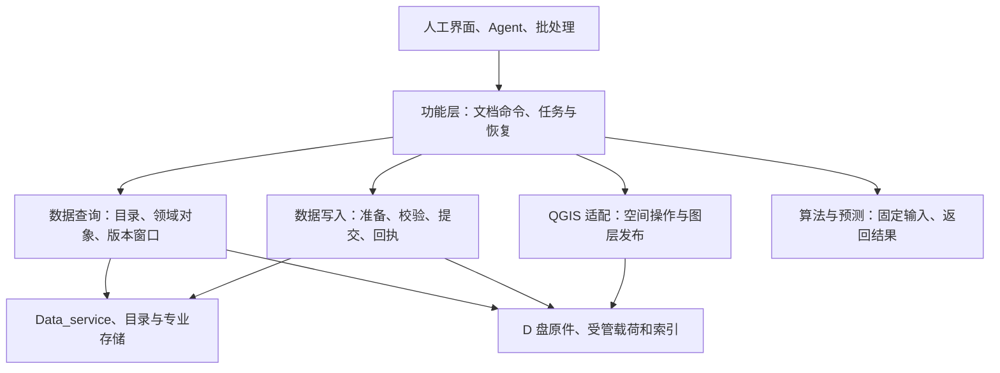

# 工区数据模型、文件 I/O 与功能分层实施方案

**状态：分批实施中。** 方案基线为工作站 `6e155291`、Data_service `905b5c1b`、参考字段表及 Windows 上的 D 盘资料目录。下文是各批目标和放行条件。已交付的入口、实际 Windows 验证及尚待对接的部分见[本轮实施记录](../progress/data-model-io-20261125.md)。

## 1. 决策与范围

1. **工区数据保留在 D 盘。** 现有原件原位只读。工程数据库、受管文件、工作副本、接收文件和大容量暂存使用 D 盘可写工程空间。代码、构建工具与用户偏好可留在原位置。
2. **数据层回答“是什么、在哪里、能读到哪个版本”，功能层决定“要做什么、何时确认、失败后怎样继续”。** 导入、编辑、计算、发布和交换各只有一条业务命令路径，人工、Agent 和批处理共用。
3. **LAS 和 SEG-Y 原件按字节直传。** 接收并校验原件、解析、绑定井筒或测区、发布解释成果，分别记录结果。参考字段只参与结构化数据和可选描述的映射。
4. **按业务链分批切换。** 复用现有 SDK、QGIS、目录库和工程存储。每批迁移一条从入口到持久化再到重新打开的完整链；旧工程在逐批验收前保留可读性。现有 GIS/地质分工和工程分层继续生效。[总架构](../PALEO_QGIS_PLAN.md) · [分层规则](../../AGENTS.md) · [统一文档模型](UNIFIED_DOCUMENT_MODEL.md)

## 2. 起点与需要解决的四个问题

| 已核实的现状 | 本次动作 |
|---|---|
| 工区目录导入已通过 SDK 建模，支持井、曲线、层段、样品、时深及地震资料；另有单文件建模、旧工程兼容读口和 QGIS 空间资料入口。SDK 已有曲线、数值表、层位窗口查询 | 统一描述、版本定位和读取契约，分别保留批量发现、补充文件和空间专业适配器；按业务族替换仍自行找文件的消费者。[工区集成](../DATA_SERVICE_INTEGRATION.md) · [工区导入](../../src/io/areamodel_import.cpp) |
| 模型发布已有预期修订检查、旧库保留与恢复；目录已有变更重放和投影水位。文档会话已有来源绑定、方案选择和重定位，部分人工决定随目录版本保存 | 继续用现有写入点；为缺失的对象身份、完整摘要、交换回执和成果历史补存储。迁移人工决定时先对照读取，再移交写权限。[模型发布](../../src/io/areamodelpublication.h) · [目录投影](../../src/catalog/areasourceprojection.h) · [文档会话](../../src/workflow/documentsession.h) · [文档状态](../../src/metadata/documentsourcestore.h) |
| 整工区导入的 SEG-Y 可能记录 `quick:` 快速指纹，原件导出却将目录指纹直接与完整 SHA-256 比较。旧文档中还存在使用这个来源修订令牌的关系 | 第一批修通原件往返。保留旧令牌及其算法；新传输完整摘要另存。验收既检查原件字节，也检查旧时深选择和来源绑定在重开后仍有效。[指纹类型](../../src/domain/documentsource.h) · [目录来源](../../src/catalog/areasourceprojection.cpp) · [现有导出](../../src/services/dataexport.cpp) · [关系消费](../../src/services/projectdata_relation.cpp) |
| 地震预览会从原件路径拼接 SF3P 路径，部分测井快照用系统临时目录；岩石物理数据服务还编排多井任务，地图保存工作流直接处理部分保留日志 | 将物理路径和写入细节集中到数据侧，把任务策略提到工作流；利用这四处检验分层是否真正落地。[地震预览](../../src/ui/datapreview/datapreviewtabseismic.cpp) · [测井快照](../../src/io/dataimport_file.cpp) · [岩石物理批任务](../../src/services/petrophyscomputeservice.h) · [地图编辑保存](../../src/workflow/mappingeditsave.cpp) |

## 3. 目标数据模型与写入归属

以一份多井工作簿为例，**一份文件版本可有多次解析，一次解析可产生多个对象，一口井可关联多份来源**。一处手工修改产生解释或成果修订，继续引用当时使用的原件、曲线、地层方案和来源关系。文件名、井名、工作表名和本机路径都保留为定位或显示信息。

| 数据对象和关系 | 标识与必须保留的语义 | 唯一写入归属（目标） |
|---|---|---|
| 工程、来源文件、位置、解析批次 | 工程 ID；文件逻辑 ID／版本；位置修订；指纹类型；适配器版本、列映射及导入参数。同一文件换映射可重新解析；移动位置保留历史来源引用 | 宿主目录管理文件资产、位置和版本。SDK 管理解析批次、来源成员与解析事实。两者以现有来源引用和提交凭据相连 |
| 工区、井、井筒、地震调查／二维线／三维体 | 工程内稳定对象 ID；井到井筒为一对多。对象可有多个来源声明及外部标识；已确认、候选、冲突分别保留。计划井保持独立类型 | SDK 保存领域对象和观测；工作站目录保留业务关联及人工选择。当前 SDK 井内只有一个井筒槽，旧井迁移为一个保留原归属的井筒；有侧钻证据才另建 |
| 测斜站、时深点、曲线、分层点／穿层记录、解释层段、样品／测量 | 一井筒对多对象；对象含数据修订、深度轴、单位、参考面、质量、来源。曲线有轴、空值、原值／处理值；同井重复穿层可分别出现；照片关联样品或深度段 | SDK 为类型化事实和数值的写入点。大曲线支持分窗／按块；原始 LAS 独立保留。厚度、位移和时深转换值携带方法与输入修订 |
| 地震采样、层位拾取、断层与图件几何 | 采样区分线／道／体，解释点标注时间域或深度域。断层棒、断层面与层位切割多边形分别建模。相带保留要素身份、字典、环、孔洞、多部件及编辑谱系 | SDK／共用地震引擎管理源与窗口；QGIS 负责几何和 CRS 操作；现有专业 Store 或版本化图层管理编辑成果。每类几何指定一个写入点 |
| 地层方案、解释上下文、证据、派生资产及发布 | 方案／修订／子层段、对象用途、输入版本、使用窗口、算法与参数、父版本。当前修订令牌与可回读的历史数值能力分别声明 | 地层方案延用 SDK；人工主选和解释上下文经文档命令写入。目录维护资产／父版本，专业 Store 维护图件与发布记录。数据修订触发受影响成果复核 |
| 外部对象绑定、交换文件与回执（新增） | 对端系统＋项目／对象／资源身份＋外部版本 ↔ 本项目对象／资产版本；批次、文件长度、完整摘要、传输和解析状态。一个对象可关联多个系统 | 在宿主目录侧增加带版本的交换记录和唯一约束。外部平台适配器翻译字段，传输服务落回执，SDK 保持独立可用 |

**工程内继续沿用** `project.paleo` 作为入口、`.qgz` 保存 QGIS 工程、`artifacts/metadata/area-model/data.sqlite` 保存工区模型、`artifacts/metadata/catalog.sqlite` 保存资产目录、`<工程名>.qgz.project.sqlite` 和 GeoPackage 保存现有专业状态及空间数据。旧 `catalog.json` 走原迁移入口；独立版本的 native-model 继续按原绑定读取。专业 Store 先通过版本引用接入，暂时不能重放的历史明确标记能力。具体键与既有方案对齐。[工程清单](../PROJECT_FILE_DESIGN.md) · [资产与版本](../../src/catalog/datacatalog.h) · [地层方案](../STRATIGRAPHIC_SUBINTERVALS.md) · [统一标识与历史](UNIFIED_DOCUMENT_MODEL.md)

### 字段参考与对接优先级

[逐项对照表](DATA_EXCHANGE_REFERENCE_20261125.csv)保留 14 个业务组、1 个交换管理组，以及 115 个原编号和两行无编号字段，共 117 行。实施时从中为每个对端生成独立的映射版本，记录字段、单位、字典、方向、缺值策略和支持程度。外部对象类型、必填字段及回执名称以实际协议为准。

| 类型 | 首轮用途 | 后续扩展 |
|---|---|---|
| LAS 59–65、地震体 80–86 | LAS、SGY/SEGY 原件交付；本地按需读取头、轴、样点或振幅 | 65 的处理后曲线独立成版；索引、SF3P、振幅展开或可选头字段均不作为原件交付前提 |
| 井头、分层、测斜、时深 | 先接井身份、分层点和一张时深表；单位与基准未知可留待核对 | 多井筒、轨迹方位基准与垂向基准，显式区分地面海拔、补心海拔、设计垂深和完钻测深 |
| 取心／物性、测井解释、岩性、单井相 | 走样品／测量或解释层段接口，照片随关联交付 | 约定实验指标单位、岩相字典、方案修订和资料来源优先级 |
| 解释层位、断层、相带 | 先接一个与原 SGY 独立的层位成果；三维时间层位声明调查和时间轴 | 分开约定二维线／道身份、深度域层位、断层棒／切割面与相带完整几何。数值面可用 GeoTIFF，相带可用 GeoPackage |
| 交换管理 110–117 | 建本地绑定与幂等回执；文件接收和解析结果分开 | 对端确认 `bo/bot`、`typeId`、`resourceId`、`fileId` 等的含义和分配方；本地工区不依赖该平台注册 |

## 4. 模块改造与调用方向

| 涉及模块 | 具体改动与边界 |
|---|---|
| `vendor/Data_service` | 公共头保持标准 C++ 值类型。解析器负责发现和解码，`flow` 管单文件导入及事务，`store` 管持久化，`services` 管领域查询，`adapters` 访问共用地震引擎。先补井筒身份、必要修订与导入来源归属；分窗接口沿用已存在的方法。地层核心、地层组合服务和通用数据 SDK 仍可分别构建 |
| `src/domain`、`src/algorithms` | 前者定义类型、身份、引用、坐标／深度／时间语义与校验；后者只接受明确数值、几何或已固定的窗口，返回计算结果。地质业务规则可单元测试，无需打开工程或运行界面 |
| `src/catalog`、`src/metadata` | 目录接收资产、版本、角色、血缘、来源投影与交换记录；元数据存储接收工程、解释、编辑会话及发布状态。沿用 `paleo_store` 和现有写队列；专业 Store 提供带修订的读写口 |
| `src/io`、`src/services` | I/O 负责文件发现、可读位置、探测、解码／编码适配、流复制、摘要、暂存和已准备成果的物理提交；服务提供工程查询、版本窗口和结果描述。将跨井任务策略、交互确认和发布决策移至工作流 |
| `src/qgis` 与仓管的 QGIS/GDAL、SBM/SEG-Y 依赖 | QGIS 封装处理 Provider、空间文件、CRS、几何、栅格及图层。地震采用宿主与 SDK 共用的引擎。数据契约只交换类型化描述或端口；需要空间实现时由 app 注入，保持编译依赖单向 |
| `src/workflow` | 编排建工程、扫描、复核、导入、编辑、计算、发布、导出、接收与恢复。工作流携带项目／会话及预期修订，调用数据端口；路径拼接、SQL、编码和文件摘要下沉 |
| `src/linkage`、`src/ai` | 联动消费对象选择、坐标定位和窗口状态；Agent 将文件投放／自然语言转为与人工相同的查询或命令。返回资料类别、写入结果、待确认项和原因 |
| `src/ui`、`src/app`、`src/selfcheck` | UI 提交意图和显示结果；新向导与预览逐步限缩 SDK 直连。app 绑定服务、工程根与生命周期；selfcheck 使用正常公开入口验证部署与读写。三个模块均纳入迁移清单 |
| 构建、工具与回归 | SDK 独立构建及 Windows 宿主钉版联编；沿用分层静态库、原子内核边界和源码门禁。测试夹具、导出审计、迁移报告及数据量计数与代码同批交付 |

首个职责切分示例是岩石物理批处理。功能层选井、处理取消并决定已完成井的提交；算法层算曲线，I/O 编码派生 LAS，目录登记父版本。保持当前部分成功的语义。矢量保存用同一原则，功能层决定保存或放弃，专业存储写工作副本和日志，QGIS 负责几何；说明可空或后台补充，保存完成后再到达的说明绑定到原编辑修订。[岩石物理服务](../../src/services/petrophyscomputeservice.h) · [矢量编辑方案](../progress/vector-editing-interaction-20261125.md) · [模块构建](../../cmake/paleo-modules-data.cmake)

入口接线优先复用 `DocumentSession`（工程身份、来源和人工决定）、`ProjectDataFacade`（工程查询）、`DataOpsCommandService`（业务修改）与 `CapabilityGateway`（Agent／批处理能力）。批次 0 的调用清单分别标记“仅引用值类型、读取业务值、写入事实、直接操作物理文件”；逐批清零的是绕过目标端口的读写。数据模块以无 UI 的契约测试证明能力，工作流通过替换数据端口验证确认、取消、部分成功和重试策略。[工程查询](../../src/services/projectdata.h) · [修改命令](../../src/workflow/dataopscommandservice.h) · [能力入口](../../src/workflow/capabilitygateway.h)

## 5. D 盘布局与 I/O 契约

已只读核对 `D:\HY测试数据`，其首层含单井与井坐标、岩心、时深转换、地震、层位、属性及沉积相图。地震数据目录中一份 SGY 约 196 GiB，另有约 132 GiB 的 SF3P 和一个部分生成的文件。以下用“D 盘工程根”表示用户已有或选定的可写工程目录，具体目录名由项目配置；资料根和可写工程根独立。

| 区域 | 存放与生命周期 |
|---|---|
| 既有资料根 | 原件保持原路径和原字节；扫描不写索引、临时文件或配准信息到源目录。已存在的相邻 SF3P 仅在来源和覆盖可核实时用于加速；现有 `.partial` 不作为成果，也不由工程清理 |
| D 盘工程根 | 保存 `.paleo`、QGIS 工程、SQLite、GeoPackage 和现有 `artifacts` 布局。受管位置存工程相对路径；外链存可重定位的定位信息。来源目录扫描排除本工程和明确登记的受管目录 |
| D 盘工程暂存与缓存 | 为每次导入、导出、接收、转码、反演及大附件预览分配私有目录；索引、SF3P、LOD 按来源版本和构建代次复用。缓存可按引用与配额回收，工作副本、已收原件、恢复日志、发布版本分别管理 |
| D 盘接收与交付 | 接收流先写同卷私有临时文件，校验后原子就位为持久原件，再登记并解析；发送端按版本从原件流式读取。导出目录保持现有同卷暂存再发布的做法。预算按实际临时副本数计算，首轮原件直传以最多一份文件大小的新增载荷为目标 |

新工程创建和数据型临时文件都由同一位置策略解析。检查规范路径、Windows 重解析点和实际所在卷，防止暂存或清理越过工程边界。D 盘空间不足时在写入前报告所需与可用空间，运行中还需处理写满。只有资料根不可用时可展示已有目录和已持久化的值；工程根本身不可用时中止写入，恢复挂载后按操作日志继续。两种情况都不把工区数据回退写入 C 盘。已有非 D 盘工程先识别并提供只读预检，迁移到选定 D 盘新目录后核对再切换；保留旧工程恢复入口。[工程路径保护](../../src/metadata/managedpath.h) · [来源重定位](../../src/workflow/documentsession_relocation.cpp) · [同卷导出](../../src/services/dataexport.cpp)

### 数据端口和失败语义

下表描述目标行为。示意操作名用于界定调用边界，实施时优先扩展已有端口。

| 操作 | 输入 → 输出 | 必须通过的契约 |
|---|---|---|
| 探测、准备、提交导入 | 来源版本／文件句柄＋预算＋解析配置 → 类型候选／准备结果 → 来源、对象及导入回执 | 探测只读且有上限。准备可取消，工作线程不直接改可见库；每文件协调提交。重试键包含来源版本、解析器与映射修订。多对象来源保留工作表、成员、行或字节定位 |
| 查询与窗口读取 | 工程上下文＋对象／版本＋字段、范围、游标 → 页或窗口、单位、覆盖范围、实际修订 | 复用 SDK 的 `describeDataObject`、`readCurveWindow`、`readNumericTableWindow`、`readSeismicHorizonWindow` 及地震窗口。大体打开只读头和必要索引；游标绑定修订，代次变化后返回过期。预算计源读取、解码、输出、队列和暂存 |
| 编辑、派生与发布 | 业务意图＋预期修订＋冻结输入 → 新成果版本、父版本、证据与提交回执 | 单库内事务发布；跨文件、工区库、目录或专业库则持久记录意图、分步提交、按水位重放。取消清理本次未发布暂存；对已提交部分返回真实状态。换工程后丢弃过期回调 |
| 原件收发 | 版本＋字节流＋文件名、长度、完整摘要 → 持久文件和传输回执 | 接收核对长度与完整 SHA-256；发送以同一稳定读取期间的字节为准，遇源文件改变则中止。既有快速指纹按原算法复核，完整摘要单列；未知井、未知 CRS 不阻断已验证原件的交付。大文件分块续传须绑定同一版本和已确认偏移 |
| 结构化／成果交换 | 对端映射版本＋领域对象或成果清单 → 校验结果、本地绑定和平台回执 | 区分原件已收、解析结果、对象是否已绑定、成果是否已发布。同一对端版本和摘要重放只返回原结果；同版本不同内容产生冲突。受管格式回读时检查字段、几何和单位。对端离线可导出包，传输协议确定后复用同一契约 |

首轮交换约定用三个可独立测试的返回结果。**文件回执**给出收件 ID、字节数、摘要算法与完整摘要；同一内容可供不同业务绑定复用。**解析回执**给出本次适配器／映射版本、对象引用及逐项问题；允许“已收件、解析失败”。**对象绑定**另记来源系统、对象类型、外部键及本地对象修订。对方权威维护的井头资料可以拉入，工作站审定的层位和相带可以发布；双方都改过的记录进入冲突处理。旧快速指纹可验证原记录的快速证据，本次流算完整摘要仅证明实际收发的字节。

物理语义保留来源原值、声明、确认状态与计算值；明确 MD／TVD／TVDSS、测斜方位基准、经纬与投影坐标、OWT／TWT、秒／毫秒、时间零点和符号。缺少转换依据时保留并报告未知。分块读取、强弱指纹和 SDK 公共边界详见[文件 I/O 契约](FILE_MODEL_IO_CONTRACTS.md)。模型、类别选择与发布决定的读写通过[既有能力入口](ATOMIC_CAPABILITIES_AND_AGENT.md)。

## 6. 实施批次、依赖与回退

每批交付一组可单独合并和回退的更改。涉及 SDK 公共模型时，先在 SDK 完成向后可读的变更及测试，再在主仓更新固定提交并验证真实调用方。以下编号为本次交付顺序，既有 M0–M5 的基线约束仍按能力适用。[既有迁移与验收](MODEL_MIGRATION_AND_VALIDATION.md)

| 批次及依赖 | 首要负责模块与交付物 | 放行证据 |
|---|---|---|
| 0　冻结基线 | 主仓＋SDK。为下节每族标记当前入口、读口、写权威、物理位置、历史兼容与测试。建立 D 盘隔离测试工程、旧工程只读基线和小型交换样本；记录原件清单、数量、数值／几何抽样与读取量 | 手动和 Agent 均能定位同一资料；可重现 SGY 快慢摘要差异、源旁创建 SF3P 和系统临时目录写入路径。真实样本缺少须报告 |
| 1　D 盘位置与原件往返；依赖 0 | `io/services/catalog/workflow`。统一位置解析，先接 LAS/SEG-Y 导入、源旁转码路径、导出及接收。补指纹类型、完整摘要、原件回执和同卷就位。交付本地文件包收发供联调 | LAS 与两条导入路径的 SGY 逐字节一致；修改、少字节、取消、重试有明确结果；旧 `quick:` 绑定重开有效。大文件走流、仅落 D 盘且源目录无新增 |
| 2　身份、修订与存储升级；依赖 0，与 1 可并行开发 | SDK＋`domain/catalog/metadata`。建立井筒与外部声明、解析批次、外部映射和结果版本关联；迁移旧别名、链接、主选、分层方案和保留规则。旧 API 经过适配 | 同名异井、侧钻、多表一源、同源换映射、无井号样品均有确定结果。人工主选与旧版本回读对照通过；并发、未来 schema 和只读打开符合预期 |
| 3　井资料纵向切换；依赖 1、2 | SDK 公共接口＋`services/workflow`。迁移井列表、曲线、分层、测斜、时深、岩性／样品、岩石物理和连井剖面的查询、修改及派生发布；先影子读后切换一种写入点 | 一井多井筒、多套时深及重复穿层有独立结果；窗口不全读；手工与 Agent 导入得到相同归属；单井成功后的批量取消保持可恢复 |
| 4　地震、GIS 与制图；依赖 1、2，可与 3 并行 | 地震 SDK 适配、`qgis/metadata/services/workflow`。迁移道线窗口、井震标定、拾取、属性／反演、断层、单因素、栅格和矢量编辑。图件库、离线底图、剖面及发布走对应端口 | 地震小窗与旧值相符；井震联动用已确认关系；面分割／合并保留身份、孔洞、层位、父版本；无 Agent、无说明也能保存和重开 |
| 5　对外适配及消费方收口；依赖对应业务族通过 1–4 | 实现按对端配置的结构化映射与收发适配。先接一口井、一份分层表、一个测区及一个解释层位；随后按表扩至样品、断层、相带。UI、Agent、批处理、导出与自检切到同一端口，给旧调用点记数 | 本地环回通过且对端联调结果单列；同批重复发送复用回执，身份或修订冲突可复核。最后一个消费者切换并完成旧工程回归后，才移除相应兼容入口 |

**迁移和回退。** 对每一类写入先固定旧库代次和工程快照，在 D 盘独立暂存中升级副本。对照对象、来源关系、人工主选、真实数值、空值、几何及历史发布记录；一致后在单一写入点切换。复用现有预期修订比对、模型备份、提交凭据和投影水位。若准备期间有新编辑，停止切换并重做基线。切换前失败丢弃本批暂存；切换后若尚无新写入，可恢复旧读路由和匹配的旧库；已有新写入时先保留日志与新版，重放或完成经验证的逆向迁移，再恢复旧写入口。清理只针对本操作拥有且无引用的受管文件，原始资料和未完成恢复项始终保留。

**第一轮可拆成三个审查单元。** 第一项用小型 SGY 固定“目录快速指纹 → 原件导出 → 重开旧绑定”回归样本，修复读取与摘要比较。第二项统一 D 盘工程位置和暂存，先迁移大文件接收、测井快照及地震转码，记录每项原路径和新路径。第三项在两个隔离工程间完成原件收发、重复提交及中断恢复，提供无需对端服务的文件包联调样例。这三项完成后即可演示直传，再扩大到结构化数据。

## 7. Windows 验收与交付

每批同时验证数据值、磁盘位置和实际用户入口。表内为仓库已有的回归入口；实施时另补该批特有的故障和契约断言。列出测试不表示已通过本次重构验收。

| 功能覆盖 | Windows 现有回归入口（代表项） | 本次新增核对 |
|---|---|---|
| 工程创建、资料设置、导入、Agent 附件、资料树、报告与预览 | `tst_area_model_publication`、`tst_area_source_delta`、`tst_agentattachmentimport`、`tst_document_sources_hy`、`tst_officepreview` | 路径含中文、空间不足、资料离线／工程盘离线、只读资料根、跨工程失效、取消重试 |
| 井筒、测井、时深、地层、综合井道、岩石物理、交会图、连井剖面 | `tst_dataservice_curve_windows`、`tst_document_relation_session`、`tst_welllog_consumers`、`tst_crossplot_controller`、`tst_petrophysbatch`、`tst_wellsection_workflow` | 同名井筒、分层方案历史、合法负值、缺失与实零、单位及时间零点、处理后曲线父版 |
| 测区、体、SF3P、拾取、断层、属性融合与反演 | `tst_seismic_reads`、`tst_seismic_budgets`、`tst_seismic_interpret`、`tst_seismicattributefusion`、`tst_inversion_workflow` | 小窗与读取量、部分覆盖、同路径换源、拒用过期资料；完整接收与原件解析各有状态 |
| 古地理图库、单因素、地统、模型预测、计划井、矢量编辑和成果发布 | `tst_paleomaplibrary`、`tst_geostat_workflow`、`tst_p4_onnx_prediction`、`tst_domain_wellsitingplan`、`tst_faciesmapping_workflow`、`tst_mapping_async_explanation` | 空间基准、NoData、要素身份与编辑谱系、人工证据、迟到说明、无 Agent、素材原件与正式发布分别校验 |
| 导出、图册、迁移、来源重定位、存储治理、任务恢复与对接 | `tst_dataexport`、`tst_document_relocation`、`tst_storagegovernance`、`tst_mapbook_delivery`、`tst_capability_recovery` | 完整 SHA 与弱指纹、跨库断点、D 盘受管边界、SHP 配套文件、幂等回执、批次部分成功和断点续传 |

**首个可演示交付。** 在 D 盘隔离工程 A 导入小型 LAS 和 SGY，分别走补充文件和工区目录入口；按原始版本交付到 D 盘隔离工程 B。比较两端文件字节和完整摘要，验证 B 在尚未关联井筒时仍可回执，随后补绑并查询曲线窗口／地震道。再传一份处理后曲线或解释层位，检查其父版本及独立身份。断开、重复发送和“同版本不同内容”分别验收。工程 B 重新打开后，已收 SGY 仍有可用的持久位置。

**实施验证环境。** Windows 原生构建使用项目管控的依赖，构建并行度不超过 8，Windows 测试串行。小样本用仓库的 [LAS](../../tests/fixtures/io_robustness/unit_metre.las) 和 [SEG-Y](../../testdata/segy/synthetic_4x5.sgy)。实数测试用 `PALEO_HY_SOURCE_ROOT` 指向 D 盘只读资料，工程与进程临时目录指向独立 D 盘测试区，确认用例未跳过。约 196 GiB 原件用于按窗读取与源目录零写入验收，大文件全量收发单独安排空间和窗口。每批记录读写字节、峰值内存、暂存峰值、恢复结果；跨系统实测须记录真实对端与回执。各批在对应提交运行受影响测试、源码闸门和带显式 `QGIS_PREFIX` 的传递依赖检查。[构建规则](../../AGENTS.md) · [实数测试入口](../../tests/tst_document_sources_hy.cpp)
