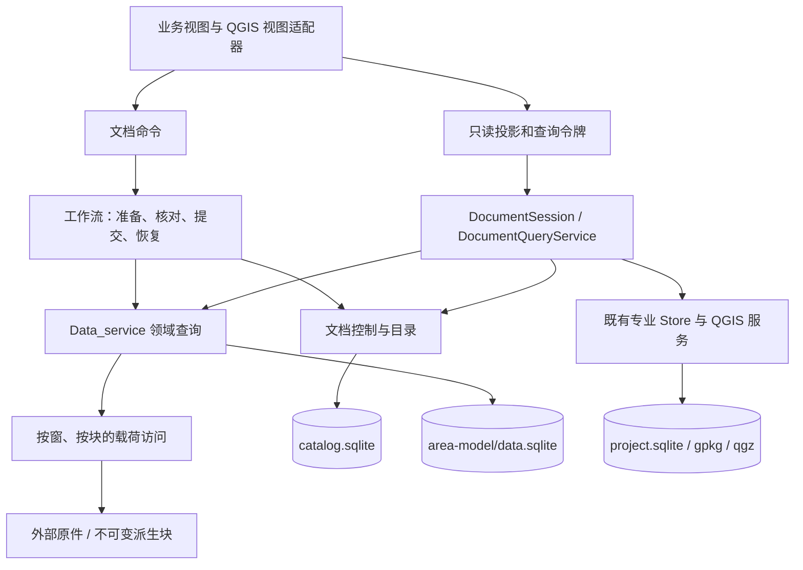
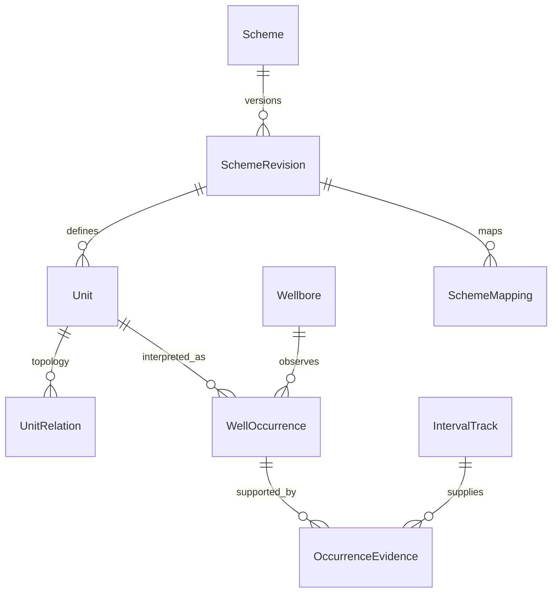

# 统一文档与领域数据模型重设计

状态：目标设计，待分批实现。日期：2026-11-06。代码依据：主仓 `0f63a222`、
Data_service `f892ed1`。本轮交付设计与验收契约，不表示下文拟议类型、表和接口已经实现。
总架构仍遵循 [PALEO_QGIS_PLAN](../PALEO_QGIS_PLAN.md)：QGIS 管 GIS，Paleo 管地质语义。

配套：[文件到模型的接口契约](FILE_MODEL_IO_CONTRACTS.md)、
[迁移与验收](MODEL_MIGRATION_AND_VALIDATION.md)、
[实数据与源码依据](../progress/data-model-redesign-20261106.md)。

## 1. 结论与适用范围

Document 是工程的语义状态、引用关系与操作边界。页面从 DocumentSession 获取按用途组织的
只读投影，再经统一命令修改持久状态。Document 不装载所有曲线、地震振幅、Office 内容，
也不要求把所有专业存储搬进一个数据库。

采用四类相互关联的模型：

1. **原始观测**：文件版本、导入记录、原始单元格、曲线、分层记录、时深点、地震采样。
2. **解释与选择**：井身份裁定、物理约定确认、分层体系、对应关系、关系用途、处理参数。
3. **冻结计算输入**：实际消费的对象版本、语义、窗口、数值或不可变载荷，以及算法版本。
4. **视图与派生结果**：按查询生成的投影、索引、LOD、预览缓存与成果版本。

原始值保留来源；确认和修订单独记录；可重建投影不成为第二份可写事实源。
现有 SourceRef、SourceBinding、ModelObjectRef、InterpretationContext 和 DocumentSession
保留，通过适配器逐步扩展。新代码不再围绕路径、井名或整个 DataCatalog 快照增加长期依赖。

## 2. 由实际数据推导的要求

HY 清单为 2,051 文件、381,389,185,015 字节，约 355.2 GiB。
3 个地震文件占字节数 92.36%；岩心目录占文件数 95.61%。这意味着“大文件按窗读取”和
“大量小附件按需发现”必须采用不同读法。详细统计及取证范围见实数据依据。

| 实际情况 | 模型要求 | 性能要求 |
|---|---|---|
| 约 210 GB SEG-Y、约 142 GB SF3P、一个未完成 LOD | 原始体、派生体、父来源、构建代次和范围覆盖分开 | 打开文档不读振幅；切方案不重建原始索引 |
| 两份时深文件有 9 组重名井标记 | 保留身份候选；确认为同井筒后，来源和关系仍独立 | 查指定对象，不列全库后按名称筛 |
| 同文件含多井、多工作表和多类记录 | File、Import、Object 是一对多关系 | 一次解析，多业务共用已入库事实 |
| 文件名与表内身份冲突 | 保存独立声明和裁定依据 | 发现阶段不为消除冲突扫描整个文件 |
| 多套分层及同名道 | 层序、单元、井上出现和对应关系分开 | 按体系固定修订查询，不依赖全局层名 |
| 时间单位、零点、Z/MD 等不总是明确 | 原始声明、有效解释、确认状态分别保存 | 返回未解决状态，不靠试算猜测 |
| 图片、报告、压缩包、专有格式、空文件共存 | 通用附件登记与类型化数值能力分开 | 无解析能力仍可登记，不展开全部附件 |

## 3. 组件与存储边界

下表为目标逻辑归属，路径沿用既有布局；不在本批改数据库文件位置。

| 存储 | 权威内容 | 不承担 |
|---|---|---|
| `artifacts/metadata/catalog.sqlite` | 既有实体/资产/版本/关联；拟议 `doc_*` 文档控制、文件位置、用途选择、依赖、提交凭据与投影水位 | 曲线和振幅全量数组、QGIS 空间编辑 |
| `artifacts/metadata/area-model/data.sqlite` | SDK 领域对象、导入事实、语义/数据修订、块清单、领域变更日志 | 应用页面状态、第二套文档主选规则 |
| 当前 `<qgz>.project.sqlite` 及既有专业 Store | 图件/断层/发布等现有专业状态；经版本引用接入文档 | 复制所有文件来源、接管领域大数组 |
| 外部原件与受管载荷目录 | SEG-Y、原始附件；版本化数值块、索引、SF3P、冻结输入 | 决定当前主选或成果是否有效 |

领域校验属于 Paleo 的数据/功能层。SDK 公共边界使用标准 C++ 值类型；宿主做 Qt 适配。
`doc_*` 是拟议规范化表，不用 QVariantMap/JSON 承担高频关联、筛选和唯一性约束。
JSON 适合小参数、证据和扩展字段，须有 schema 与大小上限。

跨库通过提交凭据、各库变更日志和持久投影水位协调，不能把多次 SQLite commit 说成一次
跨库原子事务。catalog 当前采用 WAL，而 project.sqlite 当前不采用 WAL；不统一更改模式。

## 4. 身份、修订与物理位置

以下名称均为拟议契约，不预先增加 C++ 实现。

| 概念 | 稳定身份/修订 | 含义与约束 |
|---|---|---|
| Document | `documentId`、`controlRevision` | 一个工程的语义控制边界，不等于窗口、目录路径或 qgz 文件名 |
| ModelStore | `storeId`、`generation`、`changeSeq` | storeId 跨搬迁稳定；目录整体替换必须改变 generation |
| File | `fileId` | 一份被跟踪的资料，可有多个位置；同名文件不合并 |
| FileVersion | `fileVersionId`、验证证据 | 一次固定的内容声明；弱指纹不证明字节相同 |
| FileLocation | `locationId`、`locatorRevision` | 当前可访问 URI、文件属性、可用性；位置变化不改领域修订 |
| ImportRun | `importId`、`parseKey` | 文件版本、适配器版本、解析选项、模板/列映射修订共同确定 |
| SourceMember | `importId + memberId` | 工作表、记录组、包成员等；位置只在该文件/导入修订内有效 |
| Object | `storeId + kind + objectId` | 实际领域对象；数据库自增 ID 只是有命名空间的兼容别名 |
| ObjectVersion | `objectKey + revision` | 数值、语义、质量等已声明修订；历史可读能力另行声明 |
| Scheme / Unit | `schemeId + revision + unitId` | 名称、排序和子层数不参与身份 |
| Context / RelationUse | `contextId + revision`、`useId + revision` | 用途、体系、井和目标体之间的选择隔离 |
| Payload / Build | `payloadId + generation + manifestRevision` | 块、页布局、编码和构建来源；不能只按路径缓存 |
| ResultVersion | `resultId + revision + inputManifestId` | 固定实际输入，版本追加，不被当前视图状态改写 |

`parseKey = digest(fileVersionId, adapterId, adapterVersion, options, mappingRevision)`，
摘要只计算小型规范化参数。当前 SDK 的“相同来源指纹已导入”不能代替这个完整幂等键。
更换模板或列映射后，应允许生成新的导入解释，而不是错误返回 AlreadyStored。

现有 SourceRef.fileRevisionId 同时承载 SHA 和 quick 指纹；迁移时保留原值和算法，建立到
FileVersionId 的映射，不能把 quick 值转写为强内容哈希。完整哈希是显式工作或正式导入
顺序读取时的附带产物，不是工程打开的前置条件。

文件重解析后，只有可信外部 ID 或显式映射才能延续旧对象身份。工作表同名、行顺序相同、
井名接近都不足以自动认定同一对象。无法确定时新增对象并保留待裁定关联。

## 5. 必要数据、可选数据与扩展

“必要”按操作能力定义：资料登记、数值预览、井震换算和成果发布有不同前置条件。
缺少换算语义不应妨碍保存原始观测，也不应被默认值掩盖。导入的解释表也是有出处的
解释声称，分类区分 measured / imported-interpretation / computed / reviewed；
“人工批准”不把推导结果变成实测值。

| 对象 | 登记/定位必须 | 相关计算必须 | 可选或按需加载 |
|---|---|---|---|
| Well / Wellbore | 稳定 ID、归属、来源或人工创建依据 | 操作实际使用的井筒映射、深度轴/基准；空间计算再要求有效坐标约定 | 显示名、别名、KB、井底坐标、标签、完整历史 |
| Curve | 对象/来源、井筒引用或待裁定来源声明、字段与载荷引用 | 量纲/单位、轴、空值与质量策略、请求范围；跨对象关联再要求唯一井筒裁定 | 全曲线统计、显示样式、其他曲线值 |
| IntervalTrack | 对象/来源、井筒引用或待裁定来源声明、记录身份 | 使用的顶底、轴/单位/基准、解释修订和未钻穿语义；井上解释要求唯一井筒裁定 | 备注、岩性词表说明、未选其他解释道 |
| TimeDepthRelation | 对象/来源、井筒引用或待裁定来源声明、点或分段引用 | 换算要求唯一井筒裁定、输入输出域、单位、深度基准、时间类型/零点、符号、有效域及规则 | 方法、采集时间、误差、人工校正说明 |
| SeismicVolume | 对象/来源、访问与载荷描述 | 采样轴、道定位/几何、域/单位；参与井震换算时再核对基准和符号 | 直方图、全体道头、振幅统计、所有 LOD |
| Horizon | 对象/来源、点集或栅格引用 | 所属体/测网、轴与时间/深度约定、点/几何修订、缺测策略 | 显示色、全域导出、未消费层位 |
| Attachment | 文件版本与成员引用、媒体类型、关联证据 | 对应能力所需的配准/深度锚/页号 | 缩略图、全文、OCR、Office 编辑会话 |

Well 表达地质井身份，Wellbore 表达具体井筒/分支；轨迹、测井、分层、时深优先归井筒。
旧 `wellId` 的含义须逐来源核对，不能一律当作已区分井筒；迁移可保留 `legacy-unspecified`
井筒状态，并在涉及分支选择时要求裁定。既有按名归井不追认为人工确认。
未裁定对象以 SourceEntityClaimRef 保留来源声明，可以登记、查看原值和解决身份冲突，
不必先按名字合井。计算所需的已裁定井筒映射由 readiness profile 明确要求。

通用字段使用 `Declaration<T>{value, basis, provenance, status}`。basis 区分来源声明、
工程平面默认、人工确认与算法推导。未知保持 unknown，NaN/空值/缺测与有效负数分开。
项目平面 CRS 默认可以形成带依据的有效坐标约定，不能据此确认 MD 起算面或时间零点。
Datum 是带 owner/scope 和修订的引用；W1 的 KB 与 W2 的 KB 不是同一基准实体。
MD 差值、垂向厚度和真地层厚度分别表达，不能仅凭单位都是米就当同一种量。

对象种类通过版本化 capability/descriptor 注册；查询条件和热路径字段仍为强类型。
未知扩展保存原始描述和载荷引用，返回 UnsupportedCapability，不能伪造空成功。
新格式适配器不修改 DocumentSession 的大 switch，也不让视图识别文件后缀。

## 6. 多分层体系与多时深关系

### 6.1 分层体系

SchemeRevision 固定单元及关系；UnitRelation 明确父子、相邻、先后或其他受 schema 校验的
关系。父子关系禁止环；同一体系可按其类型允许复合/多父关系，不能强制所有关系成为一棵树。
名称相同不是同一个 Unit。业务特定的层序规则由 schemeType 的校验器决定。

WellOccurrence 保存井筒、单元引用、顶底和各自深度约定、未钻穿/缺失/不整合及创建依据。
OccurrenceEvidence 以可选多对多关联固定实际分层道/记录修订；同一出现可由多来源佐证，
人工或算法创建也可暂无线索道，但必须有创建者/算法和决定 provenance，不能伪造原始道。
同一井筒可重复遇到同一单元，每次有独立 occurrenceId；
不把 `(well,unit)` 设成唯一槽位。井上出现不把全局单元的顶底深写成一份全井公共值。
取数返回 0..N 个离散 OccurrenceRange；多命中而未指定 occurrence/聚合策略时返回歧义。
不能首条取代，也不能用 MIN(top)/MAX(bottom) 把断层或 gap 中的其他单元包进结果。
所用 occurrenceId 和边界进入 wellRange 依赖分区。
SchemeMapping 独立版本化，允许一对多、多对多、缺失与待确认，禁止按同名自动映射。

当前 S1–S4 四分层作为 `four-part-seismic` 策略适配器保留；通用层序没有固定四个子单元。
现有数组形状、数据格式和历史结果不会被直接改写为可变层数。算法工作区间与地层单元
分开：UnitScope 可引用单单元、显式聚合、occurrence 集或有限范围表达式，执行前编译为
有预算的固定成员/范围清单。尖灭零厚、未钻穿、侵蚀缺失、未解释与无采样采用不同状态。

BoundaryDefinition 表达地质界面；井中 marker 与地震 SurfaceRepresentation 是它的不同
观测/解释表达。SurfaceRepresentation 可为时间或深度域，明确调查测网、所用体和变换；
相同 IL/XL 或同名界面不自动证明跨体坐标/采样相容。

### 6.2 时深关系

TimeDepthRelation 独立于分层体系。关系本体可以被多个 Context 引用，无需复制点数组。
RelationUse 记录井筒、用途、所选引用及 bindingMode、适用域、目标体/语义、插值方法、外推策略、
显式静校正与确认依据；选择不能作为关系对象的一个全局 preferred 布尔值。

Context 的结构身份与运行时取数版本分开：目标体用稳定 ObjectKey 和本用途需要的语义
引用定位，振幅新块或纯位置变化不自动删除时深主选。FrozenInputManifest 再固定实际
振幅/层位/关系值版本。当前 Context v1 的整体修订隔离保留为兼容策略，不能直接抹掉。
Context 槽位必须包含 contextId 和 revision，不能用局部版本号单独识别用途。

同一文件或同名表可同时存在多条关系。分段关系另建 CompositeRelation，记录每段的
输入域、所用关系修订、接点、重叠/间隙规则和输出约定；跨段拼接、外推和逆变换均须
明确能力。非单调、多值或零斜率关系不自动提供单值逆变换。

输入域和输出域统一用 AxisDescriptor 表达：MD/TVD/TVDSS/时间、单位、参考面/零点、
方向和单双程类型。Z 列独立保存，不能仅据名称当作 MD/TVD；时深文件有 TWT 列名也
不代表时间单位、符号和零点均已确认。单位/单双程换算与参考面平移是不同操作。

## 7. 状态、更新与依赖

### 7.1 状态分面

| 维度 | 典型状态 | 维护者 |
|---|---|---|
| 文件可达 | unknown / present / missing / unreadable | SourceAccessService，带观测时间与属性证据 |
| 身份验证 | unverified / fast-match / strong-match / changed / failed | 验证任务；强弱与算法分别记录 |
| 模型 | absent / importing / available / review / failed | SDK 提交与文档投影水位 |
| 语义 | unknown / declared / confirmed / conflict | 领域声明和人工裁定命令 |
| 用途选择 | candidate / confirmed / rejected / ambiguous / stale | 文档选择命令与依赖校验 |
| 派生可用 | missing / building / partial / ready / stale / failed | 构建 manifest 与按请求覆盖检查 |
| 成果 | current / review-required / superseded / missing-input | 实际输入依赖；历史数值仍保留 |
| 任务/提交 | preparing / committed / projection-pending / succeeded 等 | 操作凭据；不与数据就绪混为一谈 |

统一 `readiness(profile, request)` 计算本次能力，例如“登记”“幅度预览”“指定层位取窗”
“井震深度换算”“发布”。返回所需能力、缺失字段、覆盖和理由，禁止一个 ready 布尔值
授权所有操作。原件离线但已入库数值仍可用；已选对象但语义冲突仍不能换算。

### 7.2 消费依赖与精确失效

每次正式查询产出 ConsumptionReceipt，记录真实消费的对象、facet、修订、范围和有效规则。
例如 `samples`、`sampling`、`xyGeometry`、`depthConvention`、`timeConvention`、
`wellRange`、`unitTopology`、`selection`、`quality`。先按粗 facet 实现，实测证明需要时再加
分块修订；不能为精确失效每次计算整个大对象哈希。

SDK 同一事务提交对象变化和 `change_log(seq, objectKey, facets, before, after, operationId)`。
日志保存可重放的元数据 after-image/不可变引用与删除证据；仅当前表加计数无法恢复被
下一次提交覆盖的投影。该能力与历史数值分开，细则见 I/O 契约 §8。
文档持久维护依赖反向索引，从受影响对象/facet 找到直接消费者，再遍历实际下游；查询成本
与相关依赖数有关。只给出 scope/partial receipt 的旧成果使用保守复核策略，不能假装已精确。

还须记录查询集合/覆盖的负依赖：原先无点、无关系或无有效邻井的支持域，后来新增记录也
可能改变结果。依赖包括插值核的外扩支持域、成员资格及旧/新空间位置；不能只记录上次
读到的对象 ID。初期可保守失效该对象/集合的消费者，不能漏失效，也不应扩大到全工区。

| 变化 | 需要失效 | 保持有效 |
|---|---|---|
| 纯路径重定位、显示名 | 定位/列表投影 | 数值缓存、原始索引和没有 locator 依赖的成果 |
| W1 的选用分层范围 | 消费该井该单元范围的成果及下游 | W2、其他方案或未消费该范围的结果 |
| 时深点、单位/零点、用途主选 | 实际消费该关系或该用途选择的对齐/深度结果 | 纯振幅查询、仅用 MD 范围的井预测 |
| 同 ID 层位点/几何/时间约定 | 该层位窗口、层段特征与相关成果 | 不依赖该层位的其他层段 |
| 地震采样值 | 对应振幅缓存和实际消费者 | 不消费振幅的目录与附件 |
| LOD 构建代次 | 该派生 manifest/页缓存 | 原始体、其他独立 LOD 和已冻结历史输入 |

本表的更新失效针对跟随当前对象/选择的消费者；固定输入的历史值按下述 bindingMode 判断。

工作流任务开始先 FreezeInputPlan，固定 Context/选择、所需 facet 与数值读取计划。
提交时复核这些实际依赖及会话世代，代替“任何目录变动都使所有任务失败”。结果查询在
失效日志尚未消费完时显示 pending-validation，或批量校验自身依赖；不能继续声称 current。
涉及主选和身份裁定的并发写仍用 expectedRevision 作 CAS，不接受静默覆盖。

依赖声明 bindingMode：pinned-value、follow-object-head、follow-selection。
前者只固定指定版本；第二种跟随指定对象的 head；第三种跟随指定 Context 的用途选择及
其实际对象修订。Freeze 都保存本次固定数值，后两种另保留可变边的提交/新鲜度校验依赖。
固定旧值的运行不因 head 推进或主选变化而失去值有效性；仅后两类订阅相应可变边。
成果分别报告“固定输入是否有效”“与当前选择是否一致”“旧输入能否复现”，不能把这三项
压成一个 stale 布尔值。输入实际损坏/缺失与单纯已被较新解释取代也分别表达。

## 8. 一致读、历史值与视图

ReadCut 包含文档控制修订、各 store 的 generation/changeSeq、投影水位及具体版本引用。
它是可跨线程传递的值；每个 worker 在所属线程打开自己的 ReadLease。目录水位未追上
领域日志时明确返回 CatchingUp 或只读的旧一致切面，不拼接“新模型 + 旧选择”的半份状态。

当前 epoch:counter 只检测对象已变化，不保存历史值。过渡期的 `readAtRevision` 只能校验
当前值；需要复现时须冻结实际消费数值或复用真正不可变的版本化载荷。
目标存储追加 ObjectVersion 和 PayloadManifest，编辑只替换 head 引用，小改动使用新块或
补丁块。尚未完成这一步的对象必须返回 `HistoricalReadUnsupported`，不能回退当前头。

冻结输入按实际消费窗口保存数值或可重建的不可变引用，记录算法、参数、语义与验证证据。
涉及预测时还固定模型权重/检查点、代码与运行依赖版本、随机种子、数值精度和非确定性
说明；可按容差复现与逐位一致是不同承诺。
外部文件的快速指纹和 mtime 不是不可变字节快照；若原件已变化且没有受管输入，返回
MissingPinnedInput。不要为每次小编辑复制完整工区数据库或 210 GB 原始体。

视图获得的拟议投影有：SourceListView、WellSummaryView、WellTrackView、
RelationChoiceView、SeismicWindowView、ResultStatusView。投影带 queryId/contextRevision/
ReadCut/coverage；只包含请求字段、摘要和载荷句柄。大表使用游标和增量更新。

展开/滚动、临时悬停、未提交表单、当前标签属于 ViewState；可共享的地质主选、裁定、
解释修订属于 Document。切换视图上下文不自动改写持久主选。视图关闭释放订阅和自己的
请求，不能误取消其他视图共享的底层读取。视觉规范继续使用 DESIGN.md。

每条数据命令独立事务持久化；工程 Save 协调专业 store、QGIS 工程和文档 checkpoint，
不能把运行中半份结果当已保存输入。脏状态至少区分未提交草稿、已提交待投影、QGIS 未保存
与未发布成果。Undo/Redo 采用有 expected heads 的新命令或补偿版本，不覆盖 RAW 或
无条件倒退其他并发写者；不支持无损撤销的操作明确声明能力。

### 8.1 会话查询与命令边界

DocumentSession 持有 documentId/sessionEpoch、查询/订阅和操作协调器，不持有所有对象数组。
重开工程或切换会话递增 epoch；异步结果带 queryId、epoch、完整 ContextKey 和 ReadCut，
接收方核对后才能更新当前投影。数据库已提交但原视图关闭的操作仍由持久恢复器收尾。

统一命令信封包含 commandType/schema、operationId、规范输入摘要、actor/provenance、
documentId、expectedControlRevision/对象 heads 及预算/取消。小型控制决定在 Catalog
事务提交；领域数据准备和提交遵循 I/O 契约，不能拿全局文档锁等待文件读取/解码。

| 命令族（目标契约） | 持久变化 | 返回与通知 |
|---|---|---|
| RegisterSource / ImportSource | 文件/位置/声明，或新的导入与领域对象 | receipt、身份候选、投影进度；登记不等于可计算 |
| RelocateSource / VerifySource | 位置修订/验证证据；内容变化则进入新版本处理 | 位置 ChangeSet；不能凭新路径改写旧值版本 |
| ResolveIdentity / UpdateSemantics | 裁定或语义新修订，固定所用证据 | 受影响对象/facet 与 readiness 变化 |
| SelectBinding / RejectBinding | 完整 Context 槽位内的候选/主选决定 | 同事务维护唯一性，返回新 controlRevision |
| EditInterpretation / CommitResult | 解释新版本或带冻结输入的成果版本 | 值引用、依赖 receipt、历史/当前状态 |
| ResumeOperation / Compensate | 完成旧操作投影，或创建独立补偿版本 | 原操作真实提交状态；补偿有新 operationId |

订阅事件携带文档修订、受影响键/facet 和水位；事件队列有上限。断线、溢出或检测到缺口
返回 ResyncRequired，按有界查询重建当前投影；不无限积压每行信号，也不丢事件后继续
声称状态最新。视图提交相同 operationId 的重试遵循幂等契约，不能重复导入或重复生成成果。

## 9. 扩展和取舍

| 决策 | 获益 | 成本与重新评估条件 |
|---|---|---|
| 保留三个既有 store，增加稳定引用与日志 | 可逐批迁移，避免重写全部专业模块 | 必须维护 ReadCut/恢复；若实测跨库协调成为主要成本再评估合库 |
| 数值按对象/块不可变，元数据规范化 | 小范围读写、历史可复现、较低写放大 | manifest、GC 与碎片管理复杂；先曲线和地震验证再泛化 |
| 粗 facet 起步，按需要细化范围 | 可先关闭同 ID 更新缺口 | 部分保守失效；只在实际过度失效明显时增加块级依赖 |
| 单协调写者、有界解析与读取池 | 顺序确定、内存和并发容易控制 | 写吞吐存在上限；先测批量事务和索引，再考虑拆库 |
| 本地 C++ 接口为主 | 复用现有 Qt/SDK，减少序列化和运维 | 远程数据以后增加 provider/capability，不先引入常驻服务 |

WAL 读写并发与跨库边界依据 [SQLite WAL 文档](https://www.sqlite.org/wal.html)；
连接线程约束依据 [Qt SQL 线程文档](https://doc.qt.io/qt-6.10/threads-modules.html#threads-and-the-sql-module)。
这些约束不构成升级依赖或更改现有驱动的指令。

实施顺序与每批停止条件见[迁移与验收](MODEL_MIGRATION_AND_VALIDATION.md)。
