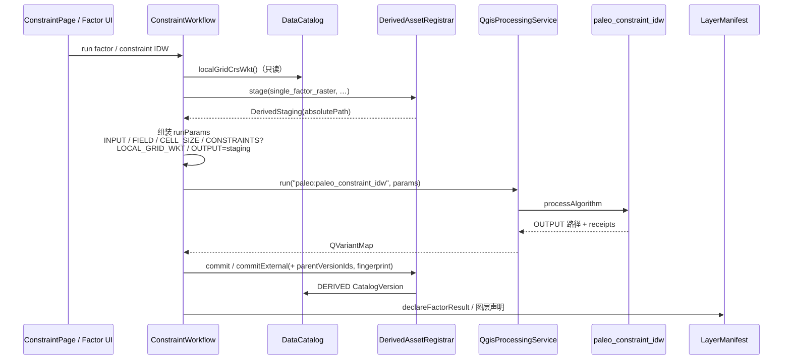

# 算法原子契约（Algorithm Atom Contract）

> 状态：P0 规格钉板 + **P1 publishArtifacts**（constraint_idw 收口）  
> 日期：2026-10-20（Asia/Shanghai）  
> 切片：`algo-atom-p0-spec-constraint-idw`  
> 相关：`docs/DATA_FABRIC_ADOPTION.md`（typed RunPort **defer**）→ 本契约是该递延项的 Paleo 裁剪落地，**不**引入对方整套 data-fabric。

## 1. 目标

把每个登记算法钉成机器可读的 **AlgorithmSpec**：显式 inputs / outputs / params / engine，与数据管理协调一致——

- **算法核**只认路径/缓冲 + `AlgorithmRunContext`，**零** `DataCatalog` / UI。
- **workflow** 只做：选 Spec → 解析 EntityView/Facade 到 bindings → 执行 → `publishArtifacts` → 图层声明。
- **产出唯一推荐登记口**：`DerivedAssetRegistrar`（DERIVED 版本 + `parentVersionIds` + sha256）。

P0 **不改运行时**：本文件与 `src/services/algorithmspec.*` / `tests/tst_algorithm_spec.cpp` 只钉契约；`QgisProcessingService`、workflow、`processAlgorithm` 本体不动。

## 2. 类型（概念 = 代码）

落点：`src/services/algorithmspec.h`（与 `AlgorithmParamSchema` 同层，复用 `AlgorithmParamField`；不用 `domain/` 以免依赖环——`paleo_services` 已链 `paleo_domain`，反向不可）。

| 类型 | 职责 |
|------|------|
| `AlgoPort` | 端口：`id`（Processing 参数名）、`kind`（raster/vector/table/scalar/file/string）、`role`（可选，对齐 RoleRegistry）、`required`、`hidden`、`constraints` |
| `AlgorithmSpec` | `id`、`displayName`、`engine`（processing \| native_cpp \| onnx）、`inputs`、`outputs`、`params`（`QVector<AlgorithmParamField>`）、`complete` |
| `AlgorithmRunContext` | `projectDir`、`localGridWkt`、`cancelled`、`progress`（P1+ 执行面使用；P0 只声明形状） |
| `AlgorithmOutputArtifact` | `portId`、`absolutePath`、`suggestedAssetType`、`suggestedDisplayName`、`extra` |
| `AlgorithmRunResult` | `ok`、`error`、`artifacts`、`diagnostics`（P1 `publishArtifacts` 入参） |

`AlgorithmSpecRegistry::spec(id)` / `knownIds()`：静态表；P0 至少完整登记 `paleo:paleo_constraint_idw`。

### 2.1 与 AlgorithmParamSchema 的关系

- `AlgorithmParamSchema`：PredictPage 动态表单用的 **标量**词表（刻意排除图层型 INPUT/OUTPUT）。
- `AlgorithmSpec.params`：同一套 `AlgorithmParamField`，但以 **完整契约**为目标——可含 schema 尚未登记的标量（例如 `ANISO_RATIO`）。
- P3 目标：schema 从 Spec 生成或与 Spec 合并为单一事实源。P0 测试断言：**schema 字段 ⊆ Spec.params ⊆ initAlgorithm 参数名**。

### 2.2 `LOCAL_GRID_WKT`（隐藏约定）

`initAlgorithm` **不**登记该参数；workflow 注入 `DataCatalog::localGridCrsWkt()`，算法经 `PaleoRasterOut::canonicalWktFromParameters` 读取（见 `rasterout.h`）。Spec 把它列为 **hidden** 输入端口，**不**进入「params ⊆ initAlgorithm」集合。

## 3. 原则（与数据管理协调）

1. **无工程不落盘**：catalog 未 open / `refusesWrites()` → 不登记。
2. **产出 = DERIVED**：`artifacts/derived/...`，经 `DerivedAssetRegistrar::stage` → compute 写盘 → `commit` / `commitExternal`。
3. **CRS 由编排注入**：`LOCAL_GRID_WKT`；核不查 catalog。
4. **图层对象不跨线程**：prepare 冻 URI；compute 自建层（PredictionJob / Constraint 同纪律）。
5. **bindings 优先 `CatalogVersion.id`**：禁止私自约定「某子目录文件名即输入」。
6. **失败/取消无幽灵资产**：延迟 `addAsset` 纪律保持（现有 registrar 行为）。

P1 已提供（`src/workflow/algorithmpublish.h`）：

```cpp
AlgorithmRunResult runResultFromProcessingOutput(const QVariantMap &results,
                                                 const QString &portId = "OUTPUT");

bool publishArtifacts(DerivedAssetRegistrar &reg,
                      const DerivedStaging &staging,
                      const AlgorithmRunResult &result,
                      const QStringList &parentVersionIds,
                      const QString &sourceUri,
                      const QVariantMap &extra,
                      QString *error = nullptr,
                      const DerivedFileFingerprint *fingerprint = nullptr);
```

相对概念草案多了 `staging` / `sourceUri` / `extra` / `fingerprint`——与现网
`DerivedAssetRegistrar::commitExternal` 对齐（prepare 已 stage，publish 只登记）。
行为等价于对主 `OUTPUT` 工件调用 `commitExternal`。constraint_idw 两条路径
（`generateFactor` 默认 IDW、`runConstraintIDW`）已改走此单函数。

## 4. 执行样板：PredictionJob 三段式

`src/workflow/workflows.h` 中 `PredictionJob`（#277）是事实标准原子作业：

```
prepare  (catalog/GUI 线程)  → stage + 冻 INPUT URI + parentVersionIds + params
compute  (worker)            → 只写 staging.absolutePath；不碰 catalog / GUI 图层*
publish  (owner 线程)        → commitExternal → addVersion → 图层声明 → 信号
```

约束单因素（`constraintfactorjobs_factor.cpp`）与此同构，只是尚未抽成共享 `AtomicJob<Spec>`（P2）。

## 5. 序列：`paleo:paleo_constraint_idw`（现网路径）

对照 `ConstraintWorkflow` / `constraintfactorjobs_factor.cpp`（如 `runConstraintIDW` / factor 生成路径）：



P0 Spec 端口与现网参数名对齐：

| 端口 / 参数 | 种类 | 必填 | 备注 |
|-------------|------|------|------|
| `INPUT` | vector (point) | 是 | 输入点层 |
| `CONSTRAINTS` | vector (line) | 否 | 约束线 |
| `FIELD` | scalar string | 是 | Z 字段（schema 有） |
| `FACIES_CODE` | scalar int | 否 | 元数据（schema 有） |
| `CELL_SIZE` | scalar double | 是 | 网格单元（schema 有） |
| `ANISO_RATIO` | scalar double | 否 | 各向异性比；**initAlgorithm 有，schema 暂缺**（P0 Spec 已列，P3 补 schema） |
| `OUTPUT` | raster | 是 | 插值栅格目的地 |
| `LOCAL_GRID_WKT` | string / hidden | 否 | 编排注入；不在 initAlgorithm |
| `CONSTRAINT_RECEIPTS` | string out | — | 诊断 JSON |
| `SAMPLE_RECEIPTS` | string out | — | 诊断 JSON |

## 6. 阶段与验收

| 阶段 | 内容 | 本切片 |
|------|------|--------|
| **P0** | Spec 静态表 + 文档 + `tst_algorithm_spec` | ✅ |
| **P1** | `publishArtifacts` 收口；constraint_idw 走统一发布面 | ✅ |
| **P2** | Processing / NativeCpp adapter；AtomicJob | 后续 |
| **P3** | Schema ← Spec；UI 只读 Spec | 后续 |

P0 验收：

- `AlgorithmSpecRegistry` 对 `paleo:paleo_constraint_idw` 返回 `complete == true`。
- Spec 声明的 Processing 参数名 ⊆ 冻结的 `initAlgorithm` 名集（见测试内常量，源自 `paleoalgorithms.cpp`）。
- `AlgorithmParamSchema::fieldsFor(id)` 的 key ⊆ Spec.params。
- 层闸门通过；**不**改 `processAlgorithm` / workflow 运行时。

P1 验收：

- `paleo::publishArtifacts` 存在且层闸门允许（功能层，链 DerivedAssetRegistrar）。
- `constraint_idw` 的 `commitExternal` 调用点改经 `publishArtifacts`（`generateFactor` 默认分支 + `runConstraintIDW`）。
- **不**改 `processAlgorithm` 本体；catalog 指纹/只读纪律与直调 `commitExternal` 一致。
- `tst_algorithm_spec` + `tst_derivedassets`（含 publish 用例）绿。

## 7. 回链

- 调研：`/workspace/algo-atom-survey.md`（§6.6 首切片）
- DATA_FABRIC RunPort defer：`docs/DATA_FABRIC_ADOPTION.md` 表行「working-copy / trash / typed RunPort」
- 派生产出契约：`src/workflow/derivedassets.h`
- 统一发布面：`src/workflow/algorithmpublish.h`
- 单因素原生集成：`docs/designs/single-factor-native-integration-plan.md`
