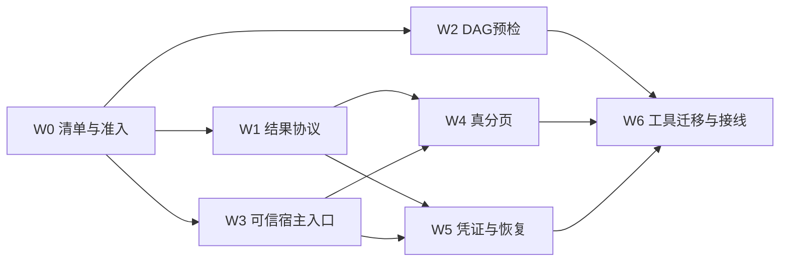

# Agent 调用可靠性整改计划

日期：2026-11-13。源码基线：master `dd7baa1f`（#934）。
状态：**W0–W6 已实现、分批验收并合入 master `4fee95dd`（2026-11-14）**；
批次、PR 与实际编译/测试/门禁证据见[实施记录](../progress/agent-readiness-20261113.md)。
下文类型、接口、错误码和新增用例在对应批次完成验收前仍为拟议契约。
PR #935 的结构整理独立处理，不是本计划已完成的前置；实施分支须重新 fetch/rebase。

本计划细化[原子能力与 Agent 目标设计](../architecture/ATOMIC_CAPABILITIES_AND_AGENT.md)，
沿用[统一文档模型](../architecture/UNIFIED_DOCUMENT_MODEL.md)、
[架构](../PALEO_QGIS_PLAN.md)与[分层约束](../../AGENTS.md)。
需求状态由 [TODOS](../../TODOS.md) 管理；此页定义实施顺序、接口边界和验收。

## 1. 问题、范围与成功条件

| 用户问题 | 已核实的现状 | 对应工作包 |
|---|---|---|
| 工具结果截坏 JSON | controller 对所有工具结果执行 `left(4000)` 并拼文本，再发给模型 | W1 |
| 组合任务校验不完整 | `checkPlan` 将非空 fromPort 直接视为有效；未知端口绕过类型/单位检查 | W2 |
| 宿主入口和上下文分流 | 聊天、Dispatcher、DocumentSession 各自执行；HostBinder 未生产接线，UI 用工程路径充当 documentId | W3 |
| 查询截断、恢复不闭环 | 列表全量读/排序后截条数，血缘先构全图；publishing 重传只报 uncertain | W4、W5 |
| 效果和可运行性不明确 | tile 会登记三件套并声明图层；trace/facies provider 和精确模型接线缺失 | W0、W3、W6 |

基线是 8 个聊天工具、94 条命令、6 项 Capability，其中 4 项声明 Callable；
这些数量不是同一层，也不作为交付完成度。首批按明确的入口迁移清单验收。

成功条件：

1. 每个发给模型的工具应答均为合法、版本明确、受字节预算约束的 JSON；引用可实际读取。
2. 无效 DAG 在任何节点计算、创建子操作或产生副作用前拒绝；不会隐式覆盖输入。
3. UI、聊天、批处理使用同一可信文档身份、就绪性、效果、版本与执行校验。
4. 指定查询可续页且不先全量扫描；修订变化有明确失效结果，不混合不同快照。
5. 单 Catalog 发布在丢响应/重启后能核对提交事实；不会因此重算或生成第二份版本。
6. 工具描述反映真实效果和当前可运行性；缺 provider/模型/语义在启动前给出缺项。

对应用户故事：地质人员能继续取完整查询结果；重连后能查原操作而不重复发布；
只读或资料缺失时能知道原因；同一业务意图从 UI、批处理和 Agent 获得相同判断。

本轮范围限上述五项整改及其必要接缝。沿用现有调度、QGIS 封装、数据存储和数值核。
不同时开展 94 条命令全部 Agent 化、任意脚本/SQL/shell 工具、新 HTTP 服务、
通用 Agent 调度器、全局 MVCC、跨 store 全局原子提交或企业 RBAC 改造。
未满足契约的能力明确保持 legacy/internal/unavailable。

## 2. 实施顺序与依赖

P0 表示扩大相应 Agent 暴露前的准入条件，不改写 TODOS 的业务优先级。
工作量 S/M/L 是相对规模；本计划不把环境准备或运行预算当成已完成的排期。

| 包 | 优先级/规模 | 交付 | 前置 |
|---|---|---|---|
| W0 基线与入口清单 | P0/S | 8 工具的路由、实际绑定、效果、当前可用性和迁移状态清单 | 无 |
| W1 小结果协议 | P0/M | 合法 JSON、可读 resultRef、整轮预算和旧会话兼容 | W0 |
| W2 DAG 预检 | P0/M | 精确端口/适配校验、结构化执行计划、反例矩阵 | W0；可与 W1 并行 |
| W3 可信宿主入口 | P0/L | app 装配的共用 facade；prepare/execute/commit 分别核验 | W0；模型边界与 W1/W2 并行冻结 |
| W4 真分页 | P1/L，分两批 | 目录索引页、版本父引用页、模型井投影页、血缘续遍历 | W1、W3 |
| W5 提交凭证与恢复 | 发布准入 P0/L，分两批 | 同事务提交证明、工程写所有权、恢复协调与崩溃矩阵 | W1、W3 |
| W6 效果迁移与 provider | P1/L，分 tile/trace/well | tile 三阶段；生产取数与模型绑定；入口等价验证 | W3；tile 发布依赖 W5，查询依赖 W4 |

建议 PR 顺序：W0/W1 → W2 → W3 → W4a/W4b → W5a/W5b → W6 分能力交付。
W4/W5 在共同宿主契约稳定后可并行；先保持已校验图串行执行，不顺带开放并行 DAG。

## 3. 共用契约与所有权

- `AlgorithmSpec` 唯一持有算法端口、参数默认值及实现契约；`CapabilitySpec` 描述业务
  能力、效果、适配与曝光；`CommandSpec` 描述命令/入口/上下文。工具 schema 为边界适配，
  不再增加一张复制默认值的注册表。
- 数据层定义值类型、结果协议、有界查询及存储；功能层解析计划、执行和恢复；
  `src/app` 装配服务。视图提供意图/呈现，不成为 Agent 的业务执行总线。
- 拟议 `HostCallContext` 从 DocumentSession/AppContext 捕获：canonical documentId、
  epoch、catalog revision/mutation sequence、必要的 SDK store/generation/head、解释上下文、
  输入/绑定引用、调用者身份、效果/目标范围和资源政策。工程路径、目录指针、持锁能力与
  operation/staging 根只在宿主内部使用。
- 调用者身份及稳定 callerScope 由宿主创建，不接受模型填写的 actor、approved、路径、
  current_head 或 `agent:` 前缀作为授权。模型提供意图、候选引用、参数和重试请求号。
- documentId、epoch、输入值修订、follow 绑定修订和输出目标 CAS 分别表达；不能互相替代。
  已冻结历史值可读时，不因无关 head 前进强制重算；无法读取历史值时明确拒绝或物化。
- 旧工程缺持久文档身份时走既有身份补全流程。只读会话不能为补 ID 偷写工程；若只有
  会话级身份，明确限制为该会话查询，拒绝要求持久身份的发布/恢复。
- 原用户授权已覆盖的计划步骤直接执行；重新核验状态不等于重复弹确认。新增效果、
  目标越界或关键身份缺失时，返回结构化缺项，不由计划字符串自授权限。

## 4. W0：先冻结迁移清单与准入

清单至少列：内部能力/契约版本、工具别名、实现路由、输入来源、效果、provider/模型、
取消/恢复语义、结果契约、当前缺项和对应测试。首批范围如下：

| 当前入口 | 迁移要求 |
|---|---|
| `paleo.query_project` / `paleo.asset_lineage` | 统一小结果、真分页、版本/覆盖范围；去掉模型不需要的宿主绝对路径 |
| depth / seismic / constraint 三个聊天工具 | 保留已有受限意图、任务中心和会话取消；迁入可信 facade |
| `singlefactor.contours` | 目前无独立聊天工具；仅在规格/适配/结果引用合格后纳入组合验证 |
| `paleo.tile_classification` | 明示 ProjectWrite/Presentation 等效果；迁移前只保留具备宿主效果授权的受控 legacy 入口 |
| tracking / well-facies | 未绑定时标 unavailable，不能仅因路由存在就向模型宣称可运行 |

静态支持、当前就绪性、授权效果分别检查。目录可描述不可用能力及原因；实际可调用集合
只包含当前合格项。旧聊天仍请求已不可用工具时，也要在启动任务前明确拒绝。
只读查询可运行；compute-only 若仍写工程 operation/staging，保留既有写约束，
不能为“只计算”直接移除只读闸门。

## 5. W1：合法小结果、可读引用与整轮预算

### 5.1 协议

拟议 `ToolResultEnvelope@1` 在发给模型的边界统一编码：

| 字段 | 含义 |
|---|---|
| `contractVersion/status/code` | 传输契约及真实业务结果；缺结果不能冒充成功 |
| `payloadContract/data/summary` | 原领域结果的准确版本、小型值或摘要 |
| `coverage/issues` | 完整性、已返回范围、缺项/裁剪原因 |
| `transport` | 编码/缓存/预算状态，与业务 execution/commit 状态分离 |
| `operationId/commitReceiptRef` | 存在持久操作时返回；不与临时聊天引用混同 |
| `resultRefs/nextCursor` | 可实际读取的后续结果引用/页游标 |

原生能力 v1 schema 和 runner 原始结果信号保持各自契约；在 controller 的模型边界
引入明确版本的 envelope，并同步工具结果 schema/解码测试。不得向 strict v1 对象偷偷
加字段。UI 卡片摘要与模型应答分开；不再对成品 JSON 使用 `left()` 或拼自然语言尾缀。
原领域 schema 校验 runner 原始值，模型结果 schema 校验 envelope，`data` 引用对应领域
schema；拆清目前 `AiToolSpec.resultSchemaJson` 的用途，不让两份契约互相误验。

预算初值：compact JSON 的 UTF-8 硬上限 64 KiB；默认页目标 8 KiB、摘要目标 2 KiB，
均由宿主政策允许向下收紧。计算字段、转义、游标与引用本身；按完整业务条目组页，
最后实际序列化复核。ID 永不裁切；标签分段按 Unicode 码点，显式标记裁剪。
未知总数用 null/unknown，不以页长冒充总数。

6000 token 目前是近似历史预算。不得把 4000 简单替换成 65536：最新完整工具轮会保留，
多工具结果会叠加。“整轮”定义为同一用户请求到最终答复/失败/取消，涵盖现有最多五次
自动工具往返，累计 assistant 工具实参及所有工具应答；给历史、最小应答和最终答复预留额度。
初始准入上限为单次模型应答 8 个调用、整轮 16 个调用，单调用实参 compact UTF-8 不超过
16 KiB；参数及最小应答按剩余上下文预算核验，宿主可进一步收紧。
准入在执行及加入可重放工具轮之前完成；超限模型应答整体拒绝，记录诊断，不执行其中
任意调用，也不把未配对应答的 assistant tool_calls 放进后续请求。已接受的调用预留
最小合法 envelope；运行中额度不足则补齐最小结果并停轮，不发下一次模型请求。
实际结果预算取单条硬上限与整轮余额的较小值，不丢 tool_call_id，不截断 JSON。
token 仍是估算值；字节限制及调用数是硬约束，不宣称精确 tokenizer 保证。

### 5.2 引用及兼容

拟议本地只读 `paleo.read_result`，实际注册后才能返回新的 `chat-result-v1` 句柄；
句柄仅指宿主保存的不可变结果值，不携带路径、catalog 指针或可执行代码。
与既有 operation/resultRef 使用不同 kind 和解析器。读取也受相同预算，禁止自动
“引用的引用”递归。大样点/振幅仍走数据访问层，不能为了分页把全部数值塞进聊天缓存。

读取请求固定为 `result_ref`、JSON Pointer `selector`（默认根）、可选 `cursor`、
`page_size/max_bytes`。数组按完整元素页、对象按成员页读取；超大子树返回同一引用内的
类型/selector 描述，由显式后续读取展开，不另造引用。字符串可用 `text_parts` 模式，
按 Unicode 码点推进，返回片段标志、偏移、总码点数与 nextCursor，重组后等于原字符串，
每片仍是合法 JSON；不能把片段当完整领域值。过长对象键/不可分页值明确报预算缺项，
不裁切键或 ID。游标绑定不可变值、selector、模式及排序版本；不能换 selector 续读。

临时聊天缓存由 runner/会话拥有：初始单结果上限 1 MiB、总量 8 MiB、128 个句柄、
TTL 30 分钟；容量不足不签发引用，也不提前淘汰仍在承诺 TTL 内的结果。
换聊天/工程、epoch 失效、过期分别返回明确错误；持久 operation 的结果凭证另由 W5 管理。
只读查询的临时缓存不写工程领域状态；不能要求为查询获取工程写锁。

历史 clamp 文本无法还原：磁盘聊天历史保留原文，再发模型时转换成合法的
`legacy_result_unavailable`，保持调用配对；不伪造历史 resultRef。
原始 JSON 无法解析时返回 `invalid_tool_result`；缓存失败、结果过大、引用过期均有独立码。
这些属于 transport/coverage，不能覆盖已知业务 execution/commit 事实。尤其提交成功后
缓存失败仍返回 committed、原 operationId/凭证与不完整覆盖，禁止诱导重新执行发布。

触点：`aichatcontroller.*`、`aichattoolrunner.*`、`ai/chat/domaintools.*`；
数据层拟抽 `toolresultprotocol.*`。引用生命周期/取页由功能层持有，避免数据层依赖 UI。

## 6. W2：DAG 预检与真实端口适配

整个图先校验，再创建任何子操作或执行数值核。修复未知非空 fromPort，并覆盖：

- 准确版本的源输出、目标输入、node.outputPort 都存在；能力曝光和实际 adapter 合格。
- 空/重复节点、未知节点、自环/长环、重复边、输入槽重复赋值、字面输入与边冲突。
- 必填输入、基数、kind、单位/轴/基准等必需语义和执行形状；需要转换时引用明确能力，
  不隐式换单位。语义不相关的字段可为空，必需而未知的字段不能视为“任意兼容”。
- 保留 32 节点/64 边等现有限制，另限输入描述字节及展开成本；不把大数组内联成图节点。

返回结构化 `ValidatedPlan`：规范节点、类型化边、拓扑 order 列表、端口映射和 issues。
不再把顺序塞进错误 message 后按逗号拆，也不以 `node|port` 等拼串作为组合身份。
节点 ID 含合法特殊字符仍能稳定定位。

AlgorithmSpec 端口与执行请求字段要有明确 adapter 映射：例如 IDW 的
INPUT/CONSTRAINTS 对 points/lines，contour 的 RASTER 对 raster_path。不能直接把
inputs 键套在算法端口上，也不能把登记但未消费的 LINES 等端口视为已支持。
首批保留明确的单工件组合；多输出、集合、非文件值等未有实际桥的形状在预检拒绝。
当前唯一 result_path 不能冒充每个任意命名的输出端口。

触点：`capabilitygateway.*`、`algorithmspec_pilots.cpp`、能力 adapter；规模需要时
抽 `workflow/capabilityplan.*`，不继续把所有逻辑堆入现有大 TU。

## 7. W3：可信宿主 facade 与逐入口迁移

由 AppContext 装配功能层 `CapabilityHost/ExecutionFacade`（名称实施时统一），
使用现有 DocumentSession、DataCatalog、PaleoTaskService 和工程所有权。
Dispatcher 保留命令、状态和 UI 信号；聊天保留 JSON 适配；DocumentSession 保留领域
命令不变量。三者委托同一宿主核验，不复制文档命令，不用 QAction/按钮点击代替 API。

prepare 与 execute 都检查：文档/requiredContext、实际可用性、只读/恢复状态、效果范围、
准确能力/参数版本。外部 prepared 对象使用宿主签发的 opaque handle 或不可变验证对象，
绑定规范摘要、文档、epoch、有效期和授权范围；`plan.ok=true` 或可变 request 不能放行。

执行接受前重新读取宿主状态；worker 只拿冻结值/受控读句柄和取消 claim；owner 提交前
再次核对相关输入/绑定、目标 expected head、文档所有权与效果。继续沿用现有任务中心、
旧回包作废及 FIFO；QGIS/SQL owner 对象和发布留在所属线程。
源输入当前性与目标 CAS 分别判断，不能只比较 prepare 时复制的两个 head 字符串。

宿主提供稳定 callerScope；Agent 的 clientRequestId 缺失时明确拒绝，不能每次重传生成
新 UUID。UI 的新用户动作可由宿主分配新请求号。prepare、compute、publish 的不同效果
不混用同一个幂等输入摘要；由持久计划/子操作显式关联。
重传先验证文档访问与 callerScope，再按文档/调用者/请求号查旧操作、核对原始意图摘要。
原始 requestHash 与冻结输入后的 planHash 分开，不能用当前默认模型/head 重算旧意图。
已提交回放不依赖旧 prepared handle、旧 epoch 或当前计算 provider/来源仍可用；继续
未提交工作才重新核验就绪性/效果/所有权并签发当前会话句柄。先查旧操作再判断是否新建。

先迁移现有合格计算与明确的文档命令；保留低层可信内部 execute，产品入口不提供
绕过 facade 的捷径。需要活动 widget 或未有明确参数的命令保持 interactive-only/legacy。
生产装配测试必须证明 HostBinder/facade 实际注入，而非仅测试中塞桩。

触点：`commanddispatcher.*`、`aichattoolrunner.*`、`capabilitytaskrunner.*`、
`documentsession*`、`app/appcontext*`、`app/aiwiring*`、`ui/paleomainwindow_commands.cpp`。

## 8. W4：真正有界、绑定修订的查询

### 8.1 目录页与版本父引用（W4a）

查询语义下沉到数据层 `ProjectQueryCapability`；runner 只适配参数。
扩展既有 CatalogIndex 的有序派生索引、分桶、计数和 after-key 查询。资产、井、关联及
父/子版本使用稳定复合键，页读取采用 upper_bound/keyset，只读所需页和探测条目。
summary 用索引计数。不得调用全量 accessor 后排序/截断，亦不得每页重建索引。
open/rebuild 可建立索引；增删改、重命名、批次失败、rollback、staging/adopt、重开均须维护。

游标为有界不透明宿主句柄，绑定会话/文档、epoch、catalog revision、mutation sequence、
规范查询摘要、排序版本和 last-key/遍历状态；不保存 QVector 迭代器或裸元素引用。
页间变更、筛选/目标改变、换工程及过期分别拒绝，不静默重开第一页。

现有工具名保留，新增可选 cursor/page_size/max_bytes；返回 returnedCount、真实或未知的
totalCount、hasMore、nextCursor 和覆盖快照。旧 count 的主题语义保持，不能改成页长。
`catalog.version.describe.v1` 的 strict schema 不偷改，补独立 parents 页能力或明确 v2，
解决 128 个父引用后的续读；准确 versionId 与计数编码继续明确。

### 8.2 模型井投影与血缘（W4b）

`entities()/entityById()` 会隐式读取模型井投影，不能只绑定 catalogRevision。
先固定查询的 stored/current-effective 语义：stored 页明确标来源；current-effective 页
还固定 SDK store/generation/sequence 或已同步投影水位。保留旧查询的有效集合，不能
为分页偷偷丢掉模型井或改变 TD/名称口径。需要时补 SDK 真分页并更新子模块钉版；
后端尚不支持时明确 readiness/budget 缺项，不把整表读取包装成分页。

Agent 血缘查询从精确 seed version 利用有序邻接增量 BFS，保存 frontier/visited/
邻接 after-key；进入队列前检查方向和深度。每页限制节点、边、字节与状态内存，
续页不重算闭包、不先扫描全部 versions。原生视图的展示图接口可以保留。
上游/下游分别按 `(direction, versionId)` 记录最短深度，不能在中途节点切换方向扩展；
节点输出另行去重，避免双向环漏项或错误纳入兄弟分支。
深度裁剪与预算分页分别报告；未遍历完成时不承诺精确总数；跨页边可引用尚未展示的
节点，契约明确此语义。selection.version_ids 仅表达本页输出的版本集合；累计覆盖用
有界统计/续页状态表达，不把累计 ID 数组塞回每页或冒充全部结果。

触点：`catalog/datacatalog*`、`catalogindex.*`、查询能力、`derivationgraph.*`、
`artifactversioncapability.*`、对应 SDK query 接口及工具 schema。

## 9. W5：提交事实、去重与恢复协调

### 9.1 持久证据与写所有权（W5a）

首批范围限已支持的单 Catalog 输出集。保留 OperationLog 作为操作控制记录，补版本化
记录：能力/契约/实现版本、冻结计划及摘要、消费输入引用、意图/效果、prepared manifest、
准确输出集/成员身份、目标 expected heads、cancelRequested、commitReceiptRef、
presentationRef、状态 revision。大型内容用受管引用，不嵌入整块数组。
presentationRef 冻结准确版本、呈现目标、预期目标状态及声明摘要；数据提交和呈现重试
分别记状态/尝试次数。稳定请求摘要、冻结 planHash 与各执行 attempt 的身份分别记录。

在进入 publishing **之前**持久化准确 prepared 意图、预分配身份、必需端口、路径、
指纹和 CAS 条件；不能先记 publishing，再临时 stage 一份无法对账的输出。
扩展现有输出集凭证：documentId、operationId、requestHash、独立 outputSetId、
manifestHash、契约版本和准确成员。不能把当前成员 versionId 当成 operationId。

Ready/operation→outputSet 提交证明与成员版本在同一 Catalog 事务落库；提供按操作键
和发布摘要的索引/唯一约束，走现有 Catalog/SDK 存储 API。已有匹配凭证返回原结果，
异摘要冲突。日志的 committed 是提交事实的可恢复投影，额外 JSON 完成标记或文件存在
不能充当提交证明。schema 1/旧日志缺关联信息时保留“不足以判断”，不按名称/最新版本猜测。

复用 ProjectDirLock，把交互、无头执行、重连恢复纳入同一工程写锁域；宿主传递不可由
JSON 自造的持锁能力。保留进程内锁及状态 CAS，避免陈旧写回。工程切换/释放锁与在途
owner 发布衔接；未经所有权证明的独立 operationDir 写入口不得继续声称跨进程幂等。

### 9.2 恢复状态机（W5b）

恢复由文档/功能协调器持有，聊天和视图仅订阅。提供有界 operation.get/events、受控
resume/cancel、结果 describe/read。状态区分 execution、commit、presentation；
只有有凭证的 reconcile/presentation 修复可以更新相应终态，不随意重新开放所有终态。

| 持久事实 | 行为 |
|---|---|
| accepted/queued、未提交 | 返回原 operation；按明确所有权规则恢复/取消，不建第二个业务操作 |
| running、worker 已失活、输出未 prepared | InterruptedBeforeCommit；半成品不当作完整输出，按 checkpoint/明确 resume 策略恢复 |
| prepared 输出完整、未提交 | 校验原输入、指纹和目标；可继续同一提交，失效则报冲突/缺项 |
| publishing + 精确匹配 Ready receipt | 修复日志并返回原版本，computeCount/版本数不增加 |
| publishing + 权威库可读且证明未提交 | 原意图仍有效时重试同一提交/IDs，不重跑数值核 |
| 库不可读、凭证缺损/矛盾或旧记录无法判定 | RecoveryRequired/commit_uncertain，保留证据和 GC 根，拒绝自动重发 |
| 已提交、日志终结失败或进程退出 | 据 Catalog 凭证重建回执 |
| 已提交、呈现失败/聊天关闭 | committed + presentation-pending；目标仍匹配才重试准确声明，否则 superseded/conflict |
| 已提交后取消 | cancel_after_commit，成果保留；不能声称零变化 |

取消请求与实际取消分开持久化；publishing 中取消先查事实。隔离只限制继续写和清理，
不移动或删除已提交成果。大文件 hash/校验在 worker 且受预算，不放 owner 回调。
running 恢复须证明旧 owner/attempt 已失活，并以锁/状态 CAS 与 attempt fence 拒绝旧
回调；不能仅凭时间长就启动第二个 worker。无有效 checkpoint 时，仅明确 resume 请求
或既授权的恢复策略可按冻结计划重算，增加 attempt/computeCount，仍用同一 operation；
每次重算前确认未提交。半成品仅在证明无提交引用后隔离/清理，未知事实继续保留。
呈现恢复在当前有效的 owner 会话执行；固定 layerId 已被后续操作或用户改动时不覆盖。
重试次数/超时受政策约束，耗尽后保留 committed 与明确呈现缺项，不回滚数据或无限重试。
跨 SDK/Catalog/文件的发布继续按原有 intent/receipt/水位或后续 fence 契约逐类迁移；
尚未满足条件的写能力保持 internal，不宣称跨 store exactly-once。

触点：`capabilityops.*`、`capabilitygateway.*`、`derivedassets_set.cpp`、
`algorithmpublish_prepare.cpp`、Catalog/SDK 凭证读写、文档协调及既有工程锁装配。

## 10. W6：效果、tile 与生产 provider 接线

效果在能力/适配描述中按意图组合：模型只读、私有暂存、Catalog 发布、工程表现、
文件导出和外部传输。静态 exposure、运行时 readiness 与宿主效果授权分开；
Routed 仅表示路由存在。默认值继续来自 AlgorithmSpec，不复制到工具描述。

tile 采用明确版本的新路径；旧 alias 的语义变化须有 adapter/版本说明：

1. prepare 冻结同一来源/对象版本、网格/CRS、模型权重及特征 schema、参数和预算。
2. compute-only 由既有任务服务写操作私有暂存并产生 fingerprint；不增加 Catalog 版本或声明。
3. publish 在 owner 核对输入/绑定/目标与必需输出后一次 commitSet，成功后声明图层；
   呈现失败保留数据和 presentation-pending。相码、低置信掩膜、置信度按真实三端口建模，
   必需/可选关系先写进 Spec，不猜测额外产物。

一次 operation 不再逐 tile 从 live 声明重解析来源，收尾也不重新取另一套几何。
大数组转换、GDAL 写盘和 hash 留 worker；取消只清理证明未被引用的操作私有暂存。

tracking 取数绑定真实体引用、IL/XL 映射、采样轴/时间单位/基准、窗口及修订；
复用现有 Data_service/capabilityseismicinput。真实 IL/XL 不能靠减最小值猜文件 ordinal。
缺道、越界、原件缺失/变化按已声明策略明确返回。

well-facies 必须先冻结精确模型、特征顺序/窗口/标签 schema，再组输入；调整当前
faciesInput 回调不含模型、取数先于模型解析的问题。复用现有 chart/prediction input
服务，使用 WellRef、ContextKey/UnitScope 和实际曲线版本，不从打开的 widget 缓存取数。
保留 MD/TVD/TVDSS、米/英尺、采样缺口和离散 occurrence；未知语义不猜，多个区间
不做 MIN/MAX 合窗。模型/ORT/provider/端点缺失给出不同 readiness 原因。

`app/aiwiring` 装配实际生产 provider；数据服务负责取数/语义，workflow/ai 编排。
外部推理声明传输效果并记录摘要、模型凭据和 remote job ID；不支持去重/查询的远端
在结果未知时返回 ExternalOutcomeUnknown，不盲目重发。本包不扩大远端服务协议承诺。

## 11. 验收矩阵与交付门

以下为验收要求；实际执行套件、失败修复及未覆盖环境以各批实施记录为准，不能用建议测试落点替代运行证据。

| 包 | 必须验证的成功/失败场景 | 建议测试落点 |
|---|---|---|
| W0/W6 | 8 工具效果/实际绑定；缺 ORT、模型、provider、语义、权限各有原因；只读查询可用 | 新生产装配测试、`tst_aichatcapability`、工具描述测试 |
| W1 | 超预算中文/emoji/引号/反斜杠；页 parse/字节界限；多往返/超多调用/超大实参的预算和配对 | `tst_aichattoolloop`；新增协议单测 |
| W1 | 数组/嵌套对象及单个 100 KiB 字符串重组；坏/过期/跨作用域引用；缓存满、历史坏 JSON、不递归 | 同上；会话/结果卡兼容测试 |
| W1 | 已 committed 后缓存满/结果过大仍保留提交事实与凭证，不变成业务失败 | 协议与 operation 集成测试 |
| W2 | 未知非空/空 fromPort、坏 toPort/outputPort、类型/单位/轴冲突、假 adapter | `tst_capability_round2`、`tst_capability_gateway` |
| W2 | 环、重复节点/边、输入覆盖/缺必填/基数/预算；特殊字符 ID；拒绝前零计算/零子操作 | 同上；真实 IDW OUTPUT→contour RASTER 正例 |
| W3 | prepare/execute 状态变化、篡改 prepared、身份/路径/效果越权、换工程和只读 | `tst_commanddispatcher`、`tst_aichatcapability`、新 host 集成测试 |
| W3 | UI/batch/Agent 同输入同参数/语义/数值；pinned 与 follow 不混；目标 CAS 冲突 | capability、DocumentSession 与地震输入测试 |
| W3/W5 | 重启换 epoch、旧 handle 失效、来源/模型离线；同键重传仍返回原 receipt；异摘要冲突 | host、恢复与幂等集成测试 |
| W4 | 重名/中文/跨页无遗漏重复；一万条中取小页，计数 hook 证明不调全量 accessor | 新查询能力测试、CatalogIndex 测试 |
| W4 | rename、未 flush batch、rollback/reopen、变筛选/修订；模型投影 head 改变 | 同上及 SDK query 契约测试 |
| W4 | 双向环/兄弟分支、高分支血缘、深度边界、续遍历不重算；超过 128 父版本完整读回 | `tst_derivationgraph`、`tst_artifact_version_capability` |
| W5 | accept/计算中/部分暂存/prepared/publishing/Catalog commit/日志终结/呈现处强退重启 | 新恢复进程测试；`tst_capability_gateway` |
| W5 | 双进程同键同摘要/异摘要、锁域/路径别名、无持锁入口、陈旧状态写回 | 同上；已有工程锁测试 |
| W5 | 凭证缺失/损坏/矛盾、库不可读、暂存被改、目标变化；保守 uncertain 不重发 | 恢复、输出集与存储故障注入测试 |
| W5 | 提交后丢回执/响应、取消、呈现失败：computeCount/版本数不再增加 | `tst_algorithm_output_set`、operation 回放测试 |
| W5/W6 | A 呈现 pending→B/用户更新同一目标→恢复 A 不覆盖；重试超时仍保留 committed | 呈现协调与 tile 集成测试 |
| W6 | tile prepare/compute 零版本/零声明；publish 三件套一组；换来源不混源、取消不晚发布 | 推理工作流、输出集及聊天集成测试 |
| W6 | 生产 trace/well 真正接线、精确模型/特征、单位/修订/缺道矩阵 | 新 aiwiring 集成及已有 well/seismic 输入测试 |

每批完成须：

- 冻结对应入口/版本/行为矩阵，加入 meaningful 回归，保留首轮失败和修复证据。
- 运行该包最小链接测试及真实 app 装配/owner 线程验证；进程恢复用真实子进程崩溃，
  不仅用一次 JSON 写失败替代。性能有界性用访问计数/内存预算，不只放宽耗时阈值。
- 重跑适用 Source gates，完整传递检查使用锁版 QGIS 头；各基线只缩不涨。
  构建并行不超过 8，Windows 测试串行，Office 依赖按 BUILDING 接线。
- 每个 PR 前 fetch/rebase origin/master 并复跑门禁；在 progress 记录实际命令/结果/
  未覆盖项，同步 TODO 和能力迁移清单。只有生产接线及验收满足才改 Callable。

## 12. 风险、取舍与实施前核对

1. 保留三类注册表职责，先统一宿主核验和 adapter；避免为统一名字再建一套调度/模型。
2. 会话级报告缓存不承诺重启恢复；持久操作结果必须由 W5 凭证解析。两类引用明确分型。
3. 游标首批采用修订失效而非跨修订 MVCC；用户可以明确重新查询，系统不混页或伪造总数。
4. 单 Catalog 凭证是首批发布边界；跨 store fence 和历史数值保留能力按既有模型计划推进。
5. 实施前复核精确测试名、SDK pin/接口、调用者身份持久来源与现有权限政策；这是代码
   细化项，不阻止 W1/W2 启动。环境缺失必须记录，不能用文档验收替代运行证据。

最初交付为计划和索引/待办链接；用户随后授权无人值守分批实施、验证并提 PR。
是否完成以实施记录中的代码、编译、测试和源码门禁证据为准，不以本计划条目推定。
