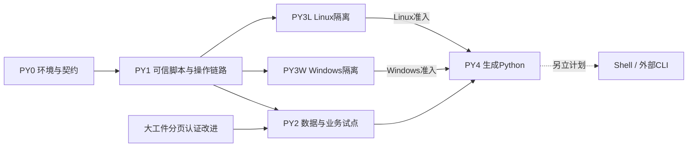

# 受控 Python Agent 环境实施计划

日期：2026-11-14。源码基线：master `3d499a61`（#942）。
状态：**PY0、PY1 已实现并完成本地编译/测试/门禁验收，等待各批实现 PR 合入；PY2–PY4 尚未在本分支交付**。
实际契约和证据见 [PY0 记录](../progress/controlled-python-py0-20261114.md)与
[PY1 记录](../progress/controlled-python-py1-20261114.md)；其余条目仍是拟议契约。
每批完成编译、测试和源码门禁后分别提 PR，不以计划条目推定功能已可用。

本计划扩展[原子能力与 Agent 契约](../architecture/ATOMIC_CAPABILITIES_AND_AGENT.md)，
复用已合入的 [W0–W6 操作与宿主链路](AGENT_CALL_READINESS_PLAN.md)，并遵守
[架构](../PALEO_QGIS_PLAN.md)、[C++ 主线边界](../CPP_PRIMARY_BOUNDARY.md)、
[数据接口](../architecture/FILE_MODEL_IO_CONTRACTS.md)及[仓库规则](../../AGENTS.md)。
需求状态由 [TODOS](../../TODOS.md) 管理，完成证据随各批写入 `docs/progress/`。

## 1. 目标、范围与已有设施

交付可选、进程外的 Python 计算能力：先支持宿主登记的可信脚本，再在操作系统隔离
验收通过的平台支持 Agent 生成代码。可选 Agent Python 环境缺失/未启用时，在开发工具链
满足现有要求的前提下主程序仍能构建；产品仍可启动并使用不依赖该环境的原生能力。
构建/测试/源码门禁现有的 Python 工具链要求保持，不能把可选运行时与工具链混为一谈。
Shell、任意 CLI、环境安装命令、通用 SQL、HTTP 执行服务、持久 REPL 和新任务调度器
不在本计划范围；已有用户控制台/REPL/MAMCL 的使用方式保持独立。

| 已有设施 | 可复用部分 | 尚不能直接用于自动 Agent 执行的原因 |
|---|---|---|
| `PythonEnvService` | 环境目录、解释器/venv 操作经验 | 当前允许 PATH/环境变量发现，未提供 Agent 专用锁版身份、供货与准入 |
| `ScriptRunnerService` / `PythonReplSession` | QProcess、排队、日志、超时/取消经验 | 明确无沙箱、继承系统环境；Windows 终止主进程不能证明后代均回收 |
| `PythonConsoleController` / `scriptprotocol` | 进度/错误展示协议经验 | 脚本自报结果路径仅供人工使用，不能成为自动发布权限或可信成果证明 |
| `CapabilityHost` / `CapabilityRecovery` | 宿主冻结、caller scope、epoch、幂等、恢复、提交事实核对 | 需增加脚本与运行时身份、执行授权及 worker 恢复器 |
| `OperationWorker` / 输出集 | attempt 私有目录、端口、输入校验、完整 SHA、成组登记 | 需适配进程、类型化输入物化与不可信输出验收 |
| `PaleoTaskService` / 结果工具 | 既有调度、取消、operation 查询、结果引用/分页、保留关系 | 需接入日志与资源预算，不能把 stdout 直接当最终领域结果 |

首批业务示范限定为：井曲线缺失/异常统计、有限样本的多属性相关性与冗余报告。
它们提供诊断与建议，不自动修改原始资料、替换正式属性优选/融合算法或接受地质解释。

成功条件：同一请求重传只对应一个操作；相同冻结输入可追溯；计算不直接修改 Catalog；
成果由宿主校验和发布；取消/崩溃可核对真实状态；越权、预算或环境缺项均可解释。

## 2. 批次、依赖与 PR 顺序

下表每行是一个独立实现 PR；PY3W/PY3L 可在共同后端契约稳定后并行。
S 仅登记后续方向，不是 PY0–PY4 的完成条件。规模为相对工程量，不是完成日期承诺。

| 批次 | 范围/规模 | 前置 | 可对外暴露的能力 | 完成出口 |
|---|---|---|---|---|
| PY0 环境与执行契约 | M：锁版可选环境、供货清单、策略/权限、readiness | master #942 | 仅环境状态查询；没有新代码执行入口 | 环境身份可验证，缺失/损坏拒绝，默认安装无 Python 必需依赖 |
| PY1 可信脚本 worker | L：固定脚本、进程生命周期、日志、操作/输出/恢复接线 | PY0 | 内部验收能力；不开放自由代码 | 真实进程贯通 prepare/compute/publish，取消与崩溃矩阵通过 |
| PY2 数据与业务试点 | M：SDK 有界取数、两项可信分析、生产工具接线 | PY1；大结果验收前含 #943 或等价实现 | 已登记的可信分析能力 | 真输入→脚本→成果→分页读取，权限/语义/成本实测通过 |
| PY3W Windows 隔离 | L：AppContainer 候选、Job Object、文件/网络/资源隔离 | PY1 | 仅隔离后端探测；不独立开放自由代码 | Windows 原生实测隔离矩阵，部署与失效行为可复现 |
| PY3L Linux 隔离 | L：受限挂载/命名空间、系统调用及资源边界 | PY1；可与 PY3W 并行 | 同上 | Linux 原生实测隔离矩阵，WSL 证据单独注明 |
| PY4 Agent 生成 Python | M：有界代码入口、平台准入、恢复/发布及打包回归 | PY2＋当前平台已验收的 PY3 后端 | 隔离可用平台上的生成代码计算 | 生成代码端到端及负向矩阵通过，平台支持表准确 |
| S Shell / 外部 CLI | 后置、另立计划 | PY4 后按真实需求评估 | 本计划不新增 | 固定 CLI 优先；任意 Shell 另定威胁模型与验收 |

计划形成时 [#943](https://github.com/WindWang2/paleo_workstation/pull/943) 尚未合入。
用户随后明确要求先合并 #943/#944，现均已合入，实施基线为 master `17bdfd0f`。
PY2 复用 #943 的认证分页接口，不复制其代码或绕过完整性检查。
PY4 按平台准入：一个平台通过不能代表另一平台已支持；整个计划完成须两平台均取得
相应验收证据，缺后端的平台明确 unavailable，不能退回普通 QProcess 执行生成代码。

## 3. 共用契约、权限与所有权

### 3.1 执行身份

- 拟议 `PythonRuntimeManifest` 记录运行时/profile ID、契约版本、OS/架构、解释器版本、
  包/本地依赖闭包、锁文件及内容摘要、供货来源/许可、探测协议。环境 ID 由宿主解析到
  已验证目录，Agent 不指定解释器路径、PATH、命令行启动选项或 package index。
- 冻结计划记录脚本内容及 SHA、可信 script ID/版本或 generated 标志、runtime manifest
  摘要、policy 版本/实际预算、输入版本/语义/物化摘要、输出 schema、来源依赖及发布意图。
  使用内容身份，不把绝对解释器路径、mtime 或可编辑的 manifest 自报值作为信任根。
- 可信脚本允许的内容由宿主发布清单锁定；Agent 参数、输入表格或结果文本不能新增脚本、
  import 路径、插件、任意表达式或执行片段。生成代码从 PY4 才进入独立模式。
- 环境与脚本执行时只读，升级生成新身份；准备后若内容变化，启动/恢复拒绝。运行中所用
  版本被引用保留，不能原地替换或因清理正在使用的环境而混合版本。

### 3.2 授权与预算

- 在现有宿主效果模型中补本地执行授权及 profile 策略，默认不授予；能力的宿主定义参与
  效果计算，不能仅由 `publish_intent=compute-only` 推导执行权限。权限要求贯穿 prepare、
  start、resume 及最终提交；恢复过程同样不能绕开当时的宿主策略。
- 调用者/会话/文档身份及授权来自宿主。环境管理、网络、宿主文件写入、CatalogPublish、
  Presentation 分别核验；进程执行或 PrivateStage 不隐含授权其中任何一项。
- 计算需要私有暂存权限；只读工程遵循现有宿主规则，受理前报告限制，不为运行脚本偷写
  工程/补身份。已授权范围内不逐次弹确认，新增效果返回结构化缺项。
- PY0 冻结首个 profile 的候选上限：代码 256 KiB、输入总量 256 MiB、输出 64 MiB、
  stdout/stderr 各 1 MiB、工作区总量 512 MiB、内存 512 MiB、CPU 时间 60 秒、
  墙钟 120 秒。默认单任务单计算线程、并发 1，宿主可收紧，模型不能调大。
  数字是待实测的产品限额；更改须版本化并有测试，不能靠增大阈值掩盖失控。
- 清理继承环境，只传必需白名单；不传模型服务密钥、认证代理、用户 HOME 配置或继承
  的敏感句柄。按实际数值库限制线程；`-I/-u/-B` 和 UTF-8 启动配置属于卫生措施，
  venv、cwd、禁 import、AST 检查、Python audit hook 均不宣称是沙箱。

### 3.3 数据与成果

- SDK/DocumentSession 冻结精确对象、版本、单位、采样轴、空值、窗口和来源关系。输入
  以只读文件/数组交付，按窗/块提取；不把整井/整地震体塞入聊天或全量读入后伪装分页。
  无法保持版本一致、缺语义或超过输入预算时拒绝；不默默采样、换单位或跟随最新 head。
  读取使用 SDK 的一致性边界/ReadCut 或等价冻结证据；持有同一文件句柄不自动构成快照。
- 首批冻结一种简单、严格可验证的数值交换格式：类型/shape/轴/单位/空值元数据＋有界
  数组载荷；JSON 用于小控制信息。只支持所需数值类型，拒绝对象数组、pickle、路径型
  外部引用。NumPy 格式如被选用须关闭 pickle 并校验 header/shape/长度。
- 宿主分配输入/输出槽位和文件名；子进程只写 attempt 工作区，接收的路径不暴露给模型。
  不向脚本提供 Catalog/SQL 连接、Qgs 对象、工程写锁或可更新文档的 IPC 能力。
- stdout/stderr 是不可信日志；进度协议有独立预算。脚本声称成功、SHA 或结果路径均不
  直接授权发布。日志/脚本文本返回模型时标明数据来源，不能伪装系统指令或执行批准。
- 进程树结束、可写入口关闭并稳定接管成果后，宿主检查必需端口、声明文件集合、格式、
  单位、shape、字节预算与 SHA；
  拒绝目录穿越、链接/重解析点、别名指向宿主文件及未声明输出。避免“检查路径 A 后
  重开得到 B”的竞争；未经校验文件不进入正式版本，失败不留下可发布的部分结果。
- 发布沿用输出集、目标 CAS、父版本、凭证和呈现协调；prepare/compute-only 零正式
  版本、零图层声明，publish 才按独立授权提交。结果使用 operation/port 引用与有界页。

### 3.4 生命周期、恢复与回收

- `OperationWorker` 当前是池线程内同步函数，现有 ScriptRunner 是 owner 线程异步
  QObject。PY1 在 worker 所属线程创建独立进程适配，有限时等待并检查取消；不得跨
  线程操纵现有控制台 runner、阻塞 GUI 事件循环或另建任务队列。若实测需要全异步，
  再单独扩展明确接缝；不用远端 externalRequest 流程伪装本地作业。
- Windows 在用户代码运行前完成进程树约束；Linux 后端同样先设约束再 exec。超时、
  取消、文档关闭/epoch 变化、宿主退出与崩溃均需收敛后代进程，不能仅杀主 PID。
- restorer 从持久冻结计划核验环境、脚本和输入后重建 worker。运行中纯计算因崩溃成为
  interrupted；resume 可在新 attempt 重跑，不承诺恢复 Python 内存、随机状态或断点。
  同请求幂等不等于数值必然可复现；记录所用随机种子/库版本及确定性限制。
- 已 computed 且成果完整时复用结果；已 committed 时只修复凭证/呈现，不再启动 Python。
  不完整暂存不能当作成功；输入或环境不可重建时返回具体缺项，不换版本继续运行。
- 存量 Catalog 事实核对只覆盖正式成果提交，不能消除任意脚本对宿主文件或网络造成的
  副作用；因此本计划的自动重跑范围只含受控纯计算。
- operation 引用、在途 attempt 和 runtime 使用引用共同决定保留；发布/读取沿用既有
  OperationRetention。新增脚本/环境/输入快照若在原保留范围外，显式登记 GC 根和回收
  时点，不长期占用独占 purge lease。取消/失败后按保留策略清理，完成进程回收后再删。

## 4. PY0：环境、供货与执行准入

范围：在 `src/services` 定义值类型、环境注册/核验和策略；`src/workflow` 接 readiness；
`src/app` 提供受信任配置。复用现有环境基础，不改控制台解释器发现的人工使用契约。

交付：

1. 首个 `analysis-core` profile 只含 CPython 与试点必需的 NumPy；版本、平台依赖与摘要
   在本批锁定。其他分析/绘图库按未来实际需求增配，不默认引入 PyQGIS/GDAL/PyQt。
2. 可选离线运行时包与严格清单，校验固定来源的包/轮子及依赖闭包，临时解包后核验、
   原子启用；失败保留旧环境。Agent 执行路径不调用 pip 或动态下载代码。
3. 默认安装和 `src/` 不新增 Python 应用源码；可选包经明确清单单独准备/运行时解包，
   遵循现有 MAMCL 可选供货模式。不能通过压缩文件隐藏未登记脚本或绕过安装边界；
   清单含代码、依赖、许可和摘要，包内容纳入构建/供货校验。
4. readiness 返回精确原因：未准备、平台不支持、摘要不符、依赖缺失、权限不足等；
   已就绪状态绑定所探测环境与策略身份，变化后失效。无环境不回退 PATH 偷跑。

验收：真实环境启动/import 探测；离线重建和搬迁后在目标位置重建；坏包、缺包、错误
架构/ABI、同大小篡改、并发准备/中断/回滚、环境使用中升级/GC 均有反例。
不继承宿主 Python 配置；关闭可选环境的完整主程序构建/启动仍通过。
同步 optional scripting/安装边界说明和能力清单；不放宽 `cpp_mainline` 或任何基线。

## 5. PY1：可信脚本与既有操作/成果链路

范围：仅宿主锁定脚本＋类型化参数，不接受自由代码、任意脚本路径或表达式参数。
先以合成输入完成内部纵向链路，PY2 才将业务工具标为 Callable。

交付：

1. 新增进程适配/worker，接入既有任务服务、attempt、operation 事件和取消；复用统一
   Registry/Spec 默认值，脚本注册引用现有能力，不复制一套算法/任务注册表。
   当前 `CapabilityHost::prepare` 固定调用仅支持原生能力的 `freezeNativeOperation`；本批
   增加宿主拥有的脚本冻结/恢复 adapter 分派，维持同一授权路径，不由聊天直调 runner。
2. prepare 冻结脚本/环境/输入/预算；compute 只产生私有端口；publish 经过既有提交链。
   stdout 有界落盘/摘要并可按引用读取，输出洪水不能阻塞 owner 或无限积攒内存。
3. 补执行器 restorer、epoch/调用者复核和使用中环境/脚本/输入快照保留。
   最小进程树管理及可执行预算在本批落地，但不宣称已有文件/网络安全沙箱。
4. 可信模板经内容锁定与审查，禁止用户输入进入 eval/exec、启动参数、动态 import 或
   插件发现。进程可用资源与可信模式的剩余 OS 权限在工具/诊断中明确标注。

验收：真实子进程成功、非零退出、启动失败、崩溃、挂死、海量/无换行输出、取消排队/
运行项、子孙进程回收；缺端口/坏格式/越界/链接/错误 SHA/超预算输出均拒绝。
同步信号重入、订阅者销毁/跨线程、文档关闭/epoch 切换不晚交付或晚发布。
崩溃注入覆盖受理后、计算中、结果固化后、提交前后/回执丢失：重传不重复受理，
resume 的新 attempt 可追溯，已 committed 的恢复启动计数和版本数均不增加。

## 6. PY2：真实取数与两项可信分析

范围：井曲线质检、有限样本属性相关/冗余分析；生产调用只选已登记脚本。

交付：

1. app/provider 从精确模型版本物化输入；统一单位、采样轴、深度/时间基准和空值，
   缺失语义明确拒绝。跨输入对齐须声明策略，不能用行号碰巧相同当作采样一致。
2. 脚本输出类型化指标、覆盖率/样本量、建议与报告，记录父版本和实际消费范围。
   抽样必须显式提供方法、种子、数量及适用限制，不能把样本结论冒充全体统计。
3. UI/批处理/Agent 走同一能力入口；Agent 可查 readiness、运行固定分析、查看状态、
   取消、恢复、列出成果和续页。工具 schema 不接受路径、效果批准或运行时任意覆盖。
4. 大数组由宿主与子进程交换，聊天仅接收小摘要与 resultRef；#943 或等价改进就绪后
   验收大报告分页的完整性和实际 I/O，失败页不交付部分内容。

验收：真实小工程样例＋独立参考结果核对，覆盖空表/全空/常量、NaN/Inf、错轴/错单位、
版本变化/历史不可读/调用者隔离、缺环境/权限。输入/输出超过预算明确失败。
大输入用 SDK 访问计数、峰值内存/磁盘和实际读取字节验证有界；限额以内不重复全量
取数。prepare/compute 无正式成果，publish 一组登记、幂等重试不增版本。
完整演示“质检/相关分析→报告引用→分页→篡改拒绝→重启查询/恢复”。

## 7. PY3W / PY3L：操作系统隔离后端

共同要求：可信模板与生成代码使用同一后端契约；生成代码的文件/网络/进程及资源限制
须由 OS 强制。后端能力检测与执行参数由宿主决定，模型不能选择更弱的 backend。
这一阶段先通过探测/测试暴露后端状态，PY4 才开放生成代码。

### PY3W：Windows

- 首选验证 AppContainer 的文件/注册表/网络权限隔离，并用 Job Object 控制进程树、
  内存、CPU/进程数量和宿主退出回收。先以真实 CPython/NumPy 做最小可运行验证，
  把 ABI、原生扩展加载、临时目录与可部署性结果写入支持表。
- 用户代码执行前完成限制，防止创建/分配 Job 之间逃逸；关闭 breakaway，限制继承句柄。
  只授予运行时/输入只读、独立工作区写入，不授予项目目录、凭据、网络/loopback 或
  宿主进程访问。Job Object 单独使用不算文件/网络沙箱。
- 磁盘上限须有容量受限工作区/配额或等效强制后端；定时统计目录大小不算硬限额。
  实施若无法在普通受支持账户/系统上满足限制，保留具体 unavailable 原因，不自动
  提权、不改全机策略、不改成无沙箱生成代码；同等后端替换须重跑全部矩阵并记裁决。

### PY3L：Linux

- 验证受限 user/mount/PID/network namespace、只读运行时/输入挂载、独立工作区、
  no-new-privileges、系统调用约束及 cgroup v2 等资源控制的组合；辅助程序同样钉版。
- 不暴露宿主 HOME、环境密钥、宿主 `/proc`、桌面/SSH/DBus/Docker socket、网络或
  可写共享运行时。进程/线程/内存/CPU、磁盘/临时区均有可执行上限与退出回收证据。
- user namespace、cgroup 委派或其他必要功能缺失时按能力检测拒绝；WSL 作为单独环境
  记录，其挂载/内核/权限结果不替代发行目标 Linux 的验证。

两批各自验收：尝试读/写哨兵文件、环境密钥、跨工作区、宿主/本地网络、IPC、symlink/
hardlink/Windows reparse、子孙进程/脱组、CPU/内存/磁盘/日志耗尽及宿主崩溃回收。
断言宿主文件哈希、网络/哨兵服务计数和残留 PID，不能只断言 Python 异常或工具返回码。
同时验证合法 NumPy 任务仍可完成；记录资源超限的实际峰值、容许 OS 误差与总并发额度。
平台隔离测试是所宣称平台的必过项，不能 QSKIP 后把该平台标为支持。

## 8. PY4：Agent 生成 Python 与端到端收口

范围：新增拟议 `paleo.python_compute` 能力，只接受有界代码、已登记 runtime/profile、
精确输入引用、输出端口和请求 ID；按现有阶段契约 prepare/compute-only/publish。

交付：

1. 源码作为独立私有输入工件持久化，冻结内容 SHA；同请求 ID 改代码/输入/预算拒绝。
   生成代码不得冒用可信 script ID；无隔离后端的系统只保留已验收可信工具。
2. 每次任务新建进程和工作区，文件作为状态；不共享 REPL 内存、变量、模块缓存或秘密。
   Python 内启动 Shell/子进程同受后端限制，不因没有 Shell 工具而漏检查。
3. 代码/环境/输入引用与恢复、日志和成果链路贯通；输出校验执行 PY1/PY2 同一规则。
   发布仍只认可宿主验证的类型化输出，生成代码不能自授效果或绕开领域约束。
4. 更新能力迁移清单、Optional Scripting 说明、平台/打包支持表、运行诊断与 progress；
   C++ 主程序、PyQGIS 禁入和默认安装边界继续通过。已有控制台行为不因新环境改变。

验收：实际 Agent 工具调用生成一段分析代码，经过冻结、计算、报告分页、授权发布与
重启恢复；错误代码、恶意代码、伪造日志/路径/摘要、身份/epoch/版本变更、隔离后端
启动前后失效、缺环境/依赖和所有预算边界均覆盖。宿主文件和网络哨兵没有意外副作用。
运行时缺失、隔离不可用、ORT 缺席均分别报告真实能力；不依赖相应组件的原生查询与
计算继续可用，依赖该组件的能力明确报告限制。

## 9. 每批编译、测试、源码门禁与 PR 出口

PY0–PY4 每批都执行以下流程，全部通过后提对应 PR；不将本地历史绿或计划状态当作
本批证据。依赖批合入后重新基于 master 验证；未合依赖在 PR 中写明栈关系。

1. 独立 `codex/` 分支、worktree 和 build，保护主 checkout 的改动、未跟踪文件和 stash。
   按 BUILDING 接共享 vendor/Office，显式锁版 QGIS/Qt，避免 ABI 混载。
2. 开 PR 前 `git fetch origin`，再 `git rebase origin/master`；冲突或代码变化后重跑
   受影响编译/测试，且一律在最终基底重跑完整 Source gates，基线只缩不涨。
3. 编译完整 `paleo` 和本批最小链接测试。默认与 no-ORT 配置都验收宿主/工具降级；
   新执行环境同时覆盖已准备与未准备状态。编译总并行不超过 8，Windows 测试串行。
   仅 QtCore 的 native reader/runner 小壳不能冒充完整 Windows 应用验证。
4. 新测试统一 `add_paleo_test(name LIBS ...)`。至少运行本批回归及受影响既有用例：
   `tst_pythonenv`、`tst_scriptrunner`、`tst_scriptprotocol`、`tst_pythonrepl`、
   `tst_pythonconsole`，以及 capability host/recovery、输出集、操作幂等、保留/清理、
   chat 小结果/分页、DocumentSession/生产 app 接线相关用例。按实际改动选取，不复制
   实现细节的空测试；PY3 所属平台与 PY4 宣称平台须另跑真实原生隔离测试。
5. 以当时 `.github/workflows/ci.yml` 的 Source gates 为完整清单，显式 `QGIS_PREFIX`
   检查 transitive 的全部指标；包含 layering 严格/自检/符号/Qgs/传递、qgis spread、
   file/UI budget、i18n/tokens/invariants、QGIS versions、docs drift、CI scripts/known
   reds、C++ mainline 与 extra manifest 等已登记检查。现有基线为 29 条 CI 命令，
   附加 qgis-spread 自检、known-reds 校验/自检、atomic-kernels 共 33 项；以后以实际
   CI 注册变化为准，不为维持数字删检查。新增运行时清单/隔离门禁同批接入及自检。
6. 各批在 `docs/progress/` 保存源/SDK/运行时/policy 身份、编译器与依赖、完整命令、
   测试数/失败/跳过、日志位置、资源/I/O 计数、故障注入及未覆盖平台/场景。明确区分
   配置成功、编译成功、功能测试、原生隔离和完整应用验证。必要验收缺失时不标完成。
7. 更新 TODOS 与能力迁移清单，推工作分支并提 PR。PR 写明行为变化、依赖、验证和
   限制；本计划没有自动合并授权，Shell 或扩大运行权限须另列具体范围与验收。

计划文档 PR 与实现批次区分：文档提交只改变计划和入口链接，校验文档/链接及适用
源码门禁；若另外执行编译或回归，单独报告实际证据，不声称因此实现了运行时能力。

## 10. 风险、取舍与后置事项

- 可选独立环境增加下载体积和维护面，但避免依赖用户 PATH 与污染主程序 Qt/QGIS 闭包。
  环境/脚本清单属于供货信任边界，来自宿主受信任发布，不接受模型提供摘要自证可信。
- 首批可信模板可以先产生业务价值；不把其受审代码假设推广到 Agent 生成代码。安全
  后端具备真实资源/权限边界后才扩展，平台差异在 readiness 和支持表中显式表达。
- 先物化有界输入，避免先建设通用 RPC/Python SDK。若后续业务确需大体流式访问，另批
  设计每次调用重新授权的只读窗口桥及背压，继续复用 SDK，不让脚本直读业务数据库。
- 图形/交互、GPU、多进程并行、在线包安装、持久 REPL、任意宿主文件访问和网络请求均
  后置；需要时新增 profile、效果与验收，不能放宽既有 profile 偷渡。
- Shell 后续优先讨论固定 CLI ID＋严格 argv/schema/输出槽，禁止模型选择任意可执行
  文件/危险参数。任意 Shell 是独立能力，其代码、网络与文件副作用不能靠 Catalog
  幂等兜底，不纳入本计划的纯计算恢复承诺。

设计核对依据：Python 官方 [venv](https://docs.python.org/3/library/venv.html) 与
[`-I`](https://docs.python.org/3/using/cmdline.html#cmdoption-I) 说明；Microsoft
[Job Objects](https://learn.microsoft.com/en-us/windows/win32/procthread/job-objects) 与
[AppContainer](https://learn.microsoft.com/en-us/windows/win32/secauthz/appcontainer-isolation)
说明。具体版本、后端可部署性与强制限额由对应批次实测钉定，不能由文档推定已满足。
