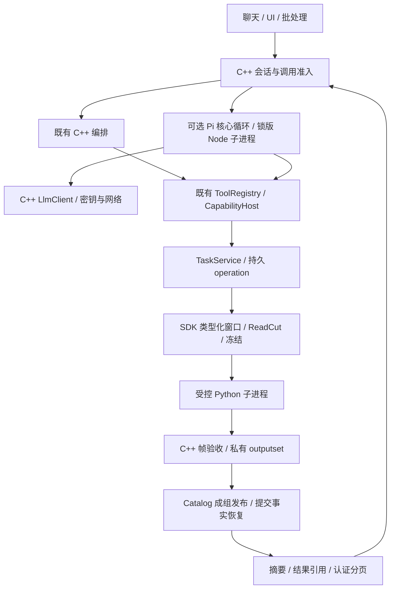

# Python 环境交付、数据成果扩展与 Pi Agent 实施计划

计划日期：2026-11-15；代码基线：master `3e104063`。**本文仅为待实施计划**，不表示
供货界面、新输入输出或 Pi 已可用。已有受控 Python SDK #21、PY0–PY4 与合并后整理
分别见[原计划](CONTROLLED_PYTHON_AGENT_PLAN.md)和[复查记录](../progress/python-platform-review-20261115.md)。
先补齐 Python 的供货、配置、启用和诊断，再扩展输入与成果；Pi 作为可选编排后端接入。
每个实施批次单独编译、测试、跑源码门禁并提 PR；Shell 继续后置。

遵循[主架构](../PALEO_QGIS_PLAN.md)、[原子能力契约](../architecture/ATOMIC_CAPABILITIES_AND_AGENT.md)、
[文件与模型接口](../architecture/FILE_MODEL_IO_CONTRACTS.md)、[C++ 主线边界](../CPP_PRIMARY_BOUNDARY.md)
及[分层规则](../../AGENTS.md)。需求状态维护在 [TODOS](../../TODOS.md)，逐批证据写入 `docs/progress/`。

## 1. 现状与本轮边界

| 已有能力 | 本轮复用 | 尚待完善 |
|---|---|---|
| `vendor/agent-python`、离线 preparer | 锁版、完整 SHA、不可变 generation、原子 current、失败保留旧版 | 可分发包与产品安装接线、宿主持久配置和诊断闭环 |
| `PythonRuntimeProvider`、可信与生成权限 | 宿主信任锚、代次/租约、独立准入；生成路径核验不启动解释器 | 明确激活、升级、回滚、历史身份与撤销语义 |
| 受控计算 | CPython 3.14.10 / NumPy 2.5.4；可信分析和生成 REPORT | 类型化表格、有限地震道输入；表格和图片成果 |
| Windows / Linux 强隔离 | 现有平台探针、配额、取消和回收；不回退普通进程 | 新协议逐平台重新验收；不外推未验证平台支持 |
| Host / TaskService / operation / outputset / Catalog | 输入冻结、私有暂存、成组发布、幂等、恢复、结果引用及认证分页 | 新输入适配器、输出端口和协议版本 |
| C++ 聊天与工具链 | 模型配置/密钥、工具 schema、调用准入、上下文和轮次预算 | 抽出共享编排边界；可选 Pi 适配，避免两套调度 |

当前输入为同一井最多 16 条曲线、每条 8192 样点，要求明确 MD 轴、单位和精确对齐；
生成代码上限 16 KiB，REPORT 上限 256 KiB。现有子进程不写磁盘、不联网、不启动其他
进程；结果数值未由宿主独立重算。新批次不得将诊断建议变成自动地质解释或修改原始数据。

“已安装”“完整性通过”“已启用”“当前可执行”分别报告。Windows 现有证据是原生
Core Host/SDK/LPAC 链路，不等于完整 GUI 构建通过；当前 WSL 缺 CPU controller 时必须
拒绝生成执行。线程数未独立硬限制时如实报告，不用单核 CPU 配额冒充线程限制。支持口径
始终以[平台支持表](../../vendor/agent-python/SANDBOX_SUPPORT.md)和新增实测为准。

本轮不加入 Shell、任意 CLI/SQL/HTTP 工具、在线 pip/npm、生成 JavaScript、持久 REPL、
GPU 或通用文件系统访问。既有人工控制台、REPL、MAMCL 保持独立，不成为 Agent 的回退环境。
不另建任务服务、成果库、恢复数据库或第二套工具目录；默认应用仍不依赖 Python/Node 运行时。

## 2. 目标链路与职责

C++ 是配置、权限、会话和提交事实的唯一权威；Pi 只持有内存中的编排投影。
Python 接收有界数值帧，回传有界报告/数组；宿主负责 CSV/PNG 编码、路径、SHA 和登记。
SDK 公共接口保持标准 C++ 值类型，视图只发信号，工作流负责编排，数据服务不依赖 QtWidgets。
供货/探针放服务与进程边界，接线在 app；设置和状态沿用现有交互及 [DESIGN](../../DESIGN.md)，
不另造控制台或诊断任务队列。

## 3. 分批范围、依赖与退出条件

以下每行是一批主仓 PR；I1 先补独立 SDK 契约 PR，I2 如需新契约同样先合 SDK 再更新 gitlink。
所有“通过”均还须满足第 7 节共同验收，不能只凭单元测试或工具登记关闭批次。

| 批次 | 范围与交付 | 依赖 | 本批可审查的验收标准 |
|---|---|---|---|
| E1 — Python 供货 | 供货端复用 preparer 制包，客户端 C++ 校验安装；锁版离线包、许可证/清单与可选入口 | 现有 PY0–PY4 | 无系统 Python 的 Windows/Linux 机器可离线安装；确认分发许可；重复安装、缺包、篡改、解包中断均可判定；失败不改变旧 active；默认安装不携带运行时 |
| E2 — 配置与激活 | 宿主持久配置、来源优先级、验证后激活、兼容升级/回滚、独立可信/生成开关 | E1 | 重启配置一致；root+SHA 不混源；未信任/不兼容版本拒绝；运行中版本固定；历史恢复和撤销行为可重现；失败保留旧配置和代次 |
| E3 — 启用与诊断 | 复用设置/状态/TaskService，接通安装指引、核验、强隔离探针、诊断导出与修复指引 | E2 | 无阻塞 UI；未装/未启用/核验失败/隔离不足/可执行明确区分；生成专用核验不普通启动解释器；关闭、切工程、取消后无过时代次回写；导出脱敏 |
| A1 — Pi 供货与边界 | vendor Pi 核心依赖和 Node 离线闭包；可选子进程/有界 IPC；声明并约束可选 JS 运行边界 | E2；优先完成 E3 | 全 commit/依赖/Node 平台包可复现；许可证齐全；无全局 npm/PATH 发现；默认无 Node 仍能编译启动；损坏、退出、超限帧均拒绝并诊断 |
| A2 — Pi 编排接线 | 自定义模型流桥接既有 LlmClient；工具调用、会话、取消和幂等接回 C++ | A1、E3 | 同一会话只有一个编排器；工具与原生入口同权限/效果/预算；重复调用不重复提交；中途取消补全工具结果；退出/切上下文/重启可按既有 operation 恢复 |
| I1 — 数值表输入 | 首种来源限定既有 `source_tables` 的显式数值投影；先补类型/单位/null 与有界读取契约，再接输入冻结 | E3、SDK 前置 PR | 最多 16 列（含轴）、8192 行；限定 SourceRef/表/投影修订/列/窗口；静态参数/scope/预算在载荷 I/O 前拒绝；读取校验失败无部分数值交付，消费版本及 ReadCut 可核对 |
| I2 — 地震道输入 | 单一体的一条有界地震道及采样轴；必要时先补 SDK 精确窗口接口 | I1、SDK 前置 PR（如需） | 最多 8192 样点；物理轴/单位/参考明确；按窗 I/O 和冻结可计量；版本漂移、错误道键/单位拒绝；不整卷加载，不以句柄或 mtime 充当快照 |
| O1 — 表格成果 | 新版本 capability/spec/冻结 schema、帧协议与表输出端口；宿主编码 CSV，走既有成组发布 | I1 | 单表最多 16 列（含轴）、8192 行，CSV ≤4 MiB；v1 操作仍可恢复；有限值/null 语义一致；截流/超限/端口错误使整组失败；发布/恢复/认证分页通过 |
| O2 — 图片与联合收口 | 单张 RGBA 数组由宿主编码 PNG；表格+报告+图片成组输出；完成端到端示范 | O1；最终收口需 I2、A2 | 最多 1024×1024 像素、PNG ≤4 MiB；尺寸/长度/溢出检查先于分配；混合成果同一提交；Pi→Host→真实 Python/SDK→发布→分页/重启恢复证据完整 |

推荐顺序：**E1 → E2 → E3 → A1 → A2 → I1 → I2 → O1 → O2**。
E3 后 Pi 与数据适配可并行开发，但逐批 rebase/门禁，按上表依赖合入；任一轨道阻塞
不阻止另一轨道独立交付。最终联合验收归入最后一批实现 PR，不另开空的“宣布完成”PR。
本次计划 PR 只提交文档，不改变功能状态；后续是否合并实施 PR 按用户当次指令执行。

## 4. E1–E3：先把环境交付闭环做实

**供货与信任。** 沿用 [Agent Python 清单](../../vendor/agent-python/README.md)和
[构建说明](../../BUILDING.md#可选-agent-python-环境)；供货端复用已有准备器，客户端
安装适配遵守同一清单、校验与原子代次契约。
包包含固定版本运行时、模板、许可证、来源与校验闭包；信任锚由可信宿主发行配置提供，
不能接受包内自报 SHA 为授权。下载只允许明确的部署/维护操作，Agent 工具不能安装环境。
供应链/安装验证不等于操作系统隔离就绪。

现有 preparer 需要操作者 Python，因此在供货端运行；客户端以 C++ 校验并安装已准备
包，不要求用户预装 Python、设置 PATH 或运行 pip。当前模板
[许可状态](../../vendor/agent-python/scripts.README.md)为 `notice-only`，仓库 LICENSE
尚未定稿；E1 须确认模板及运行时闭包的可分发条件并补齐材料，未确认前不对外供货，
不把现有 notice 当成已完成分发授权。

**配置来源。** 形成完整 identity（canonical root、runtime/template manifest SHA、policy、
宿主兼容契约、配置代次），原子选择与保存，不拼接不同来源的 root/SHA。
部署策略是权限上限，显式禁用始终有效；保留旧环境变量兼容入口并给出确定优先级和来源
诊断，不能让项目文件、模型输出或 Pi 修改信任/启用配置。可信脚本与生成代码分别授权。
安装路径变化须重新核验，参数修复只能给出可操作原因，不自动放宽策略或切换系统 Python。

**升级与回滚。** 先核验暂存 generation 和宿主编译期兼容锚，再原子激活；current 指针
本身不是执行授权。当前宿主不支持的解释器、模板或 profile 必须另经代码/供货 PR，不能
靠替换目录升级。新请求绑定新 active；在途操作保留已冻结且仍获授权的旧身份。恢复只
允许宿主认可的历史身份，不信任 operation 文件自报版本。安全撤销通过既有取消/中断
处理，不更改已提交事实；回滚也只选当前宿主兼容的已核验版本。

**保留与空间。** 现有 preparer 保留旧 generation，尚无 GC。本轮继续保留；安装前计量
暂存/解包空间并在不足时拒绝，不删旧版凑空间。active、回滚、provider/进程租约、持久
operation 引用都属于保留依据；锁文件不存在不能证明可删，未打开工程中的引用也不能
被忽略。自动 GC 另立后续批次，不在本计划顺带实现。

**诊断。** 后台执行完整性核验与探针，UI 只读有代次的快照。至少列出安装/来源/兼容性、
运行时与模板身份、可信/生成开关、平台与隔离后端、实际 CPU/内存/时限能力、最近失败
阶段和修复路径。生成专用 readiness 不走普通解释器 import；生成执行证明只由强隔离
后端产生，失败即 unavailable。可信模板继续复用
`TrustedReadinessProvider`，必须覆盖 `allowTrusted=true / allowGenerated=false` 的
正向场景，不能为了探针提升权限。探针复用 TaskService，不在 GUI 线程散列整个运行时。
诊断导出默认去除密钥、模型请求、井曲线、生成源码和完整用户路径，保留稳定原因码。

## 5. A1–A2：vendor Pi，但权限与提交仍在宿主

### 5.1 上游选择与供货

本次核对的官方 [Pi 仓库](https://github.com/earendil-works/pi)由旧 `badlogic/pi-mono`
地址重定向而来；当前仓库尚未 vendor Pi。采用 `pi-agent-core` 的核心循环及必要依赖
（包括 `pi-ai` / `pi-schema`），不接入 coding-agent CLI/RPC 或 `createAgentSession` 的
默认资源装载、文件/Shell 工具、扩展、MCP、技能及包发现。

审阅候选为完整 commit `c3cc91632d0a1950fb122605b190233f2aa0006e`，其
[包清单](https://github.com/earendil-works/pi/blob/c3cc91632d0a1950fb122605b190233f2aa0006e/packages/agent/package.json)
标记 1.5.2、MIT、Node ≥22.19.0。该 commit 的
[变更记录](https://github.com/earendil-works/pi/blob/c3cc91632d0a1950fb122605b190233f2aa0006e/packages/agent/CHANGELOG.md)
另含未发布的 #9986：中途 abort 时补齐同批剩余 toolResult；因此不能只写“1.5.2”并假定
与 release tag 行为一致。A1 要锁定包含该修复的精确 commit，或 release 加审阅补丁，
记录差异并对拍；上述候选尚未经过本项目构建/供货准入。

Node 选择满足上游下限的确切受支持平台版本，验证官方发行签名/哈希和许可证。
完整锁定 Pi 源码、补丁、依赖锁、包归档完整性、构建工具链和最终交付文件 SHA，支持离线
重建；不跟随 main、不运行启动时 npm。Node 使用显式交付路径、固定工作目录及最小
环境，清除 `NODE_OPTIONS` / `NODE_PATH` 和外部认证/代理等隐式配置入口，不扫描工程目录。

Pi 是可信的可选编排组件，**不是安全沙箱**。不执行生成 JS，不加载项目脚本/插件；
移除默认工具不等于 OS 隔离。Node 的线程/JIT 与 Python profile 不同，不套用 Python
隔离策略或虚报强隔离；进程加固、后代回收和资源约束按实际能力独立验收。缺失/损坏时
原生后端仍可独立使用；已选择 Pi 的会话报明确不可用，不自动切换并重放未定操作。

A1 同步更新 C++ 主线边界、可选安装清单和相应门禁，明确有源 JS 运行时的有限例外；
不能把可执行 JS 当静态资源绕过边界。地质逻辑、权限和持久状态仍只在 C++。

### 5.2 模型、工具与会话桥

利用上游[自定义 streamFn](https://github.com/earendil-works/pi/blob/c3cc91632d0a1950fb122605b190233f2aa0006e/packages/agent/src/stream-fn.ts)
和[工具契约](https://github.com/earendil-works/pi/blob/c3cc91632d0a1950fb122605b190233f2aa0006e/packages/agent/src/types.ts)，
通过有界、版本化 IPC 调用现有 C++ `LlmClient`；不另建模型设置、鉴权库或网络客户端。
密钥留在宿主，沿用现有 HTTPS/明确回环例外、超时与错误分类。Node 不接收 provider 密钥。
IPC 校验长度、版本、会话/代次/调用 ID、合法状态转换和背压；日志与协议分通道。

共享既有工具 schema、参数字节上限、Host scope、效果声明和 ToolResultProtocol。
上游默认并行执行工具，适配必须显式选择 sequential；原生入口当前的轮次/工具预算
（5 轮、每响应 8 调用、每轮用户请求 16 调用）和历史预算继续由宿主执行，不能因换
引擎自动放宽。现有历史预算是字符估算而非精确 tokenizer，迁移时明确其口径。

宿主在 dispatch 前持久绑定 `(sessionId, hostTurnId, toolCallId)` → 稳定
`clientRequestId` → operation；重试先查询原 operation/提交事实，不重新创建发布。
Pi 不生成 callerScope、授权、工件路径或提交凭据。`commit_uncertain` 沿用既有核对
协调；Node 退出不代表操作回滚，Pi 内存状态不取代 operation 日志。

每会话仅一个活动引擎。先抽出共享会话/准入边界，再让 C++ 与 Pi 分别适配，不保留两套
循环同时调度。用户取消走既有取消；关闭/切工程走中断与代次失效。按上游
[生命周期](https://github.com/earendil-works/pi/blob/c3cc91632d0a1950fb122605b190233f2aa0006e/packages/agent/src/agent.ts)
处理 abort / waitForIdle，超时终止进程并回收；丢弃旧代次晚到帧，补齐已发起工具调用的
终态或未执行错误，使模型历史配对，不把取消后的缺项当成功结果。

A2 验收包含真实 Pi 进程与真实 Host 工具执行。模型传输可用受控 HTTP/SSE 夹具稳定
覆盖分片、错误和取消；这不替代 Python/SDK/提交链路，也不宣称所有外部模型已适配。
实际供应商 smoke 单独记录已测配置；未配置模型时如实诊断，不依赖新增用户密钥通过测试。

## 6. I1–O2：扩展输入和成果，保持受控边界

**输入。** 使用类型化 SourceRef、模型修订、列/道键和有界窗口，冻结 ReadCut 与实际
消费证据；不接受任意 CSV 路径、SQL、数据库句柄或 Python 自行取数。I1 先支持数值/
布尔/null，明确行序轴或物理轴、单位和 null mask；无隐式 join、重采样、单位换算或
跨井对齐。I2 的时/深采样轴不得与 MD 混用；不是整卷算法、属性融合或任意空间切片。
缺稳定窗口/修订证据的 SDK 能力先补 SDK PR，不能退化为全量读取后截取。

当前 SDK `DataTable` 全为字符串，`readTable(offset, limit)` 不是上述类型化读口。
I1 以既有 `source_tables.id`（`DataEntry.kind == "tables"`）为来源，SDK 前置新增
拟议 `numeric_table.v1` 显式数值投影；现有 `DataObjectKind` 没有 `Table`，不能假定
已存在类型化表对象。最小引用为 SourceRef + tableId + projectionRevision，仅支持
单表已登记投影的列窗口。SDK PR 明确持久列类型、单位、null mask、稳定行序、
修订/ReadCut 与字段字节预算，再冻结公共 DTO/读口；这些新增契约目前尚不存在。
旧 string-only、无投影修订或缺语义的表拒绝，不从展示字符串/Qt 表模型猜测类型，
不另建通用表存储。

载荷读取前完成纯参数、scope、静态预算校验并预留输入与冻结缓冲；目标修订、轴/单位
与非有限值在相应元数据/载荷读取时校验，失败终止且不交付部分数值。统计真实字节、
范围和消费身份。读取中漂移、取消、无效单位与上下文失效必须拒绝/中断；不得对每样点
重开文件或整文件 SHA。准确冻结和有界 I/O 同时成立，不能为了性能省略完整性证据。

**输出协议。** 新增版本化二进制帧与清单，保持 REPORT-only v1 可识别、可恢复；
旧操作不静默升级。从 I1 起新增输入形态，以及 O1/O2 的输出形态，必须冻结各自
capability/spec 身份、plan-schema 与协议/profile 版本，按持久记录分派执行与恢复。
现有目录不能同时承载同 ID 多版本时使用独立 ID，保留 v1 Spec/restorer 和旧记录验证，
不以新 Spec 或严格 `checkRecord` 拒绝历史合法操作。宿主冻结预期端口、类型、协议/
编码器版本和预算。子进程保持零磁盘
写入，只输出声明的 REPORT/表数组/RGBA；stderr 和失败 stdout 为有界私有诊断。
宿主不接受子进程自报路径或 MIME，也不解码其任意 PNG/SVG/HTML/PDF。

O1 使用固定 ASCII 列 ID，原始标签/单位留在受验元数据；CSV 只编码数值、布尔及显式
null，不允许自由文本/公式，避免将表标签变成电子表格公式。NaN/Inf 拒绝，缺失通过
mask 表示，空值与零不混淆。O2 校验 RGBA 精确字节数和乘法溢出后，由宿主编码 PNG；
第一版不新增绘图库。图片是非空间报告成果，不自动成为 GIS 图层或已接受地质解释。

首版候选总帧/输出预算 ≤12 MiB，并同时服从既有进程与协议硬上限；表/图上限不保证
可同时取满。宿主另计暂存、编码和冻结缓冲，不把子进程 RSS 当总成本。代码 16 KiB、
REPORT 256 KiB 及既有并发/时限不自动放宽；内存峰值不满足时缩业务范围，不调大闸值
凑通过。新协议/profile 逐原生平台验证后才启用，未通过平台保持 unavailable。

验收后的文件进入既有私有 outputset，按完整 SHA、端口/组校验、Catalog CAS/凭据
一次成组发布；prepare/compute 不创建正式版本。重启核对既有事实，不自动重跑原代码。
绑定源码/运行时/输入/编码器 provenance，保留“生成数值未经宿主独立重算”的说明。
成果读取复用现有认证分页：首次建立完整性锚，后续按返回范围认证，不能重新引入每页
整文件 SHA。取消、同长篡改、替换、回收与保留引用均纳入测试。

## 7. 每批验证、PR 与完成标准

1. 独立 worktree/build，保留主 checkout 改动，构建并行度 ≤8，Windows 测试串行。
   按 [BUILDING](../../BUILDING.md) 接好 vendored 依赖与 Office 编辑组件；不能带缺组件
   警告交付。每个实现批次完成主程序编译、受影响测试及相关回归，包含默认/无 ORT 路径。
2. 有执行/协议变化的批次跑真实隔离进程与资源/取消负例。Windows 完整 GUI 构建、
   Linux 原生隔离、Core 夹具分别记证据；WSL 拒绝或薄 Host 通过不替代前两者。若完整
   构建或必要平台验收失败，先修复并复跑，不把失败包装为整批完成。
3. E 类覆盖离线/损坏/无空间/中断、归档越界/链接/重复条目、信任与兼容、重启/撤销/
   回滚/在途引用；A 类覆盖
   超长/非法/重复/晚到 IPC、流错误、取消半批工具、子进程退出和重复提交；I/O 类覆盖
   版本漂移、轴/单位、NaN/null、预算/分配溢出、截流/洪泛、错端口与部分成果失败。
4. 使用 `add_paleo_test(... LIBS ...)` 给必要新测试最小链接集；测试验证契约与失败边界，
   不镜像实现。每批记录 prepare/compute 零正式版本、publish 恰一次、commit_uncertain
   核对、重启恢复和分页实际字节等适用证据。
5. 开 PR 前 `git fetch`、`git rebase origin/master`，随后重跑 CI Source gates 全套，
   包含严格 layering/file_budget、QGIS spread、带明确锁版 QGIS_PREFIX 的 transitive、
   UI/i18n/docs、C++ 主线等现行项目；新供货/边界需要的检查同批登记。所有基线只缩不涨。
6. 每批 PR 写清范围、依赖/SDK SHA、构建配置、测试与门禁结果、平台证据和剩余限制；
   更新 progress/支持表/需求状态后再提 PR。未通过的必需验收先修复，不沿用 rebase 前的绿。

本次只有计划与索引改动：检查文档链接、差异格式和 rebase 后完整源码门禁，不以文档
PR 声称运行时编译/执行已验收。后续实现 PR 必须逐批执行上述编译、测试与门禁流程。
最终完成需要 E1–E3 交付闭环、A2 可选 Pi、I2 新输入、O2 成组成果都各有实际证据，
默认无 Python/Node 仍可使用原生应用，Shell 仍未开放。
