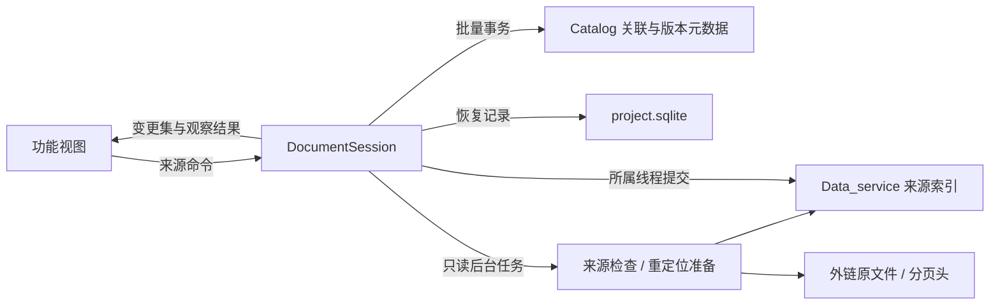

# 文档来源第一批（2026-11-05）

本批为统一文档补上来源身份、关联、状态和命令，接入工程会话与预览重定位入口。
QGIS 继续负责 GIS；Data_service 继续保存类型化地质对象。这里的文档是工程模型，
不是把所有文件内容装进内存的 Office 文档。既有业务视图尚未全部迁移。

## 数据与会话边界

- `SourceRef` = documentId + modelStoreId + sourceId + fileRevisionId。
  来源编号只在模型库内有效；文件名、井名和裸 sourceId 均不是全局身份。
  sourceId 与 revision 用十进制字符串序列化，避免 JSON 数值精度损失。
  没有模型库的旧资产使用 `catalog:<assetId>`，未校验版本显式标为 unverified。
- `SourceBinding` 把资源、角色、用途 scope 连接到 SourceRef，保留内部定位、
  身份声明、证据和裁定理由。定位支持文件、工作表、记录组、SEG-Y 窗口、
  包成员、包关系及图像配准修订；本批定义定位契约，未实现所有格式的读取器。
- 文件可用性、身份校验、类型化模型可用性、分页派生状态分别维护。
  原文件缺失不意味着已导入模型不可读；分页头完成不等于页面 CRC 校验通过。

## 命令与持久化

统一入口 `DocumentSession::execute`，支持 RegisterBinding、ConfirmBinding、
SelectPrimary、RemoveBinding、Inspect、Relocate。命令带会话 epoch 与目录 revision；
工程关闭/切换、目录发生变化后旧命令拒绝提交。只读会话允许观察，不允许改关联或位置。
Inspect/Relocate 返回 pending，最终结果由 operationId 对应的 commandFinished 返回。

候选关联不会自动成为主来源；冲突保留所有身份声明，确认必须写明理由。
同井同角色可以保留多个来源。主来源以 resource + role + scope 为范围，最多一个。
文件内部定位的主选必须指定用途 scope，避免把不同工作表强塞进旧文件主选语义。

关联保存在 CatalogVersion.extra.documentSourceBindings；默认 scope 的文件主选与
既有 EntityAssetLink.isPrimary 在同一 Catalog BatchSave 中提交，避免双重事实。
删除默认文件关联同时将旧链接退回未决，保留资产和井实体。已有链接被投影为关联，
无需打开原文件或迁移整库。单关联说明上限 64 KiB，单版本关联集合上限 1 MiB。
当前文件改为不同内容版本时，已保存的关联保留原 SourceRef 并退回未决，
不把用户此前确认的来源静默指向新内容；同内容重定位则保留来源身份。

project.sqlite 仅增补 document_source_meta 与 document_source_operations，记录稳定
文档身份和最多 256 项未完成操作。查询不会创建状态文件；未来格式或身份不符拒绝写入。
状态观察是有界会话缓存，关闭会话后丢弃；关联裁定和未完成重定位则持久保存。

重定位流程：后台只读核验候选 → 保存操作意图 → 所属线程提交模型路径 →
追加同内容 Catalog 版本 → 清理意图。旧版本路径和原始内容保留。
Data_service 与 Catalog 是两个数据库，不声称跨库原子提交：模型更新后若目录提交
失败，保留恢复记录，使用同一来源和候选路径重试。尚未恢复时拒绝改投其他路径。
准备结果不可由调用方伪造；提交检查工程、来源行和候选文件元数据，拒绝陈旧结果。

AppContext 负责绑定/关闭 DocumentSession，DataPreviewTabs 通过注入回调转发
重定位意图。结果只回到原预览页；页面关闭或工程切换后不回写其他页面。
旧同步重定位入口拒绝 quick 指纹，生产入口走后台命令。

## 地震性能边界

- 绑定、来源投影、关联查询均不读原文件。目录变化后才重建一次投影，按资源索引查询。
- 模型来源按主键读取 SourceIndexEntry，避免每次检查枚举全部来源。
- `quick:` 延续既有 SEG-Y 快速指纹（前 64 KiB + 文件大小 + 修改时间），
  按记录的指纹类型校验，不按重命名后的扩展名切换算法；它不是全文件完整性证明。
  缺少对应模型身份时拒绝快速校验，不回退到全体振幅读取。
- 普通 SHA-256 核验在后台分块执行并可取消；提交阶段只检查元数据，不重复算哈希。
- SF3P 使用 metadata-only reader，主机先检查头长度，预算 1 MiB；不加载页目录或
  振幅页，不枚举页 CRC。`.partial` 即使头有完成标志也保持 Incomplete。
  payloadVerified 始终为 false，直到未来显式的页面校验任务完成。
- 检查与重定位各自只接收一个在途作业，通过既有任务池运行，不新建无限线程。

## 验证入口

合成夹具覆盖引用隔离/序列化、同井多来源、身份冲突、只读、提交失败、离线原文件、
快速指纹、SHA 来源、重命名、候选漂移、跨工程准备结果、关闭会话和恢复重定位。
预览测试覆盖异步错误呈现与关闭页面后丢弃回调。SDK prepared_import 合约直接在宿主
编译运行，覆盖只读准备、提交限制和来源行 CAS。

可选外部验证 `tst_document_sources_hy` 从 `PALEO_HY_SOURCE_ROOT` 接收目录：
缺少变量时跳过，不把用户数据纳入仓库或 CI。所有输出放临时工程，重定位只操作副本，
前后核对输入文件清单/大小/修改时间，并对所用 LAS 原件复核完整 SHA-256。
实际运行：11 项相关 CTest 全通过（Windows / Qt 6.11.2，串行 78.42 秒），
另补测删除关联同步旧链接与超大分页头预算两项，通过。28 项 Source gates 通过，
所有规模/分层基线均未上调。应用目标构建成功，Office 编辑组件接线就绪。

HY 验证 6 passed / 0 failed / 0 skipped（含初始化与清理），输入 2,051 文件、
381,389,185,015 字节，前后文件清单、大小与修改时间一致：

| 场景 | 结果 |
|---|---|
| 同井多来源 | 两套时深文件，9 口井各保留两来源；切换主来源后仍保留另一来源 |
| 身份冲突 | 文件名 HZ19-6-12 / 表内井号 HZ19-6-1d，保留冲突且不自动确认 |
| 重定位 | 真实 LAS 的私有副本迁移，SHA 核验 1,737,889 字节；原件 SHA 不变 |
| 分页状态 | 一份头完成、一份未完成；合计读取 8,256 字节，payloadVerified=false |
| 地震快速身份 | 单次校验读取 65,536 字节；未读全体振幅 |

分页检查与 SEG-Y 校验合计约 135 ms（本机观察，受文件缓存影响；字节预算才是回归断言）。
没有执行全体地震页面 CRC 或全文件地震 SHA，也没有批量重导入全部 381 GB 样本。
配套 SDK 改动：[Data_service PR #12](https://github.com/changyanyanchang/Data_service/pull/12)。

## 后续迁移

1. 井曲线、时深、综合柱状图和地震业务视图逐批改读会话投影，替代各自的来源选择缓存。
2. 将工作表/记录组自动提取的身份声明送入候选关联流程，并补上人工裁定视图。
3. 增补分页父来源指纹/布局修订匹配、显式页 CRC 任务及可取消的恢复/构建命令。
4. 对旧同步调用面和原始文件读取接口继续收口；保留各自数据版本与撤销语义。
