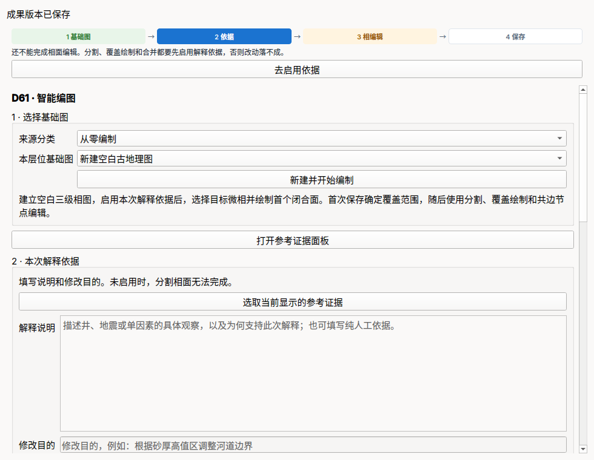
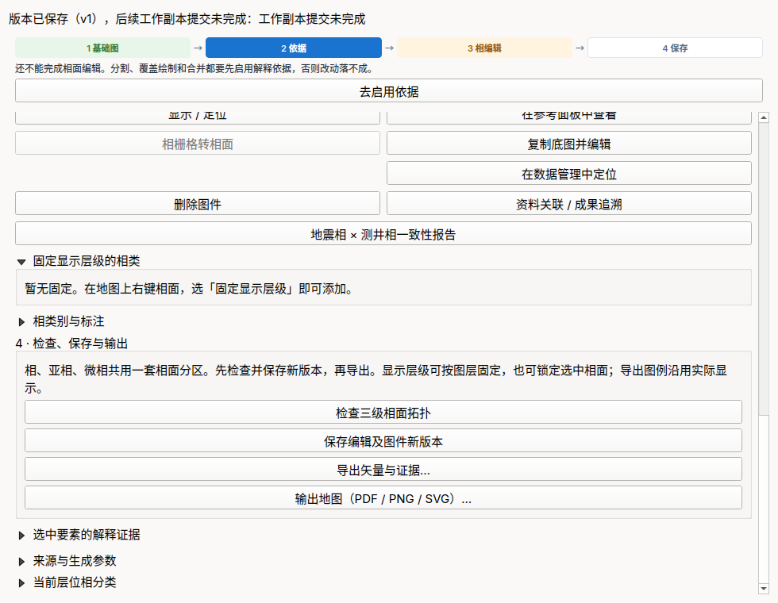
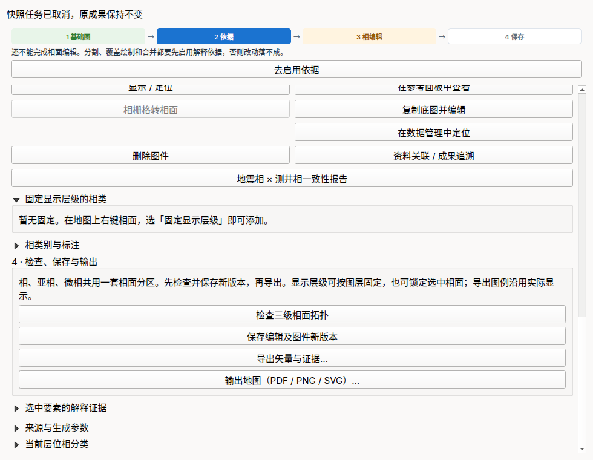

# P6 地图版本保存保护与长历史快照

执行日 2026-11-21。工作树 `codex/paleo-p6-map-save-20261119`，起点 `08ca3e52`，合入前变基到 `e3f2863e`。CMakeLists 只保留 P1/P4 新增清单行并加上本分支的 `extra-p6-map-save.cmake`。主机 CachyOS，Linux 7.3.4-1-cachyos x86_64。依赖前缀 `/home/kevin/projects/paleo-deb-prefix-20261119`，未改共享前缀、未重下 deb。

## 行为

同步 `saveVersion` 与异步 `startSaveVersion` 共用同一条不可逆边界：校验、冻结编辑视图、准备与哈希都在版本行写入之前。版本行写入成功之后，工作副本 `commitChanges` 失败不再伪装成整次失败。状态写成「版本已保存（vN），后续工作副本提交未完成」，并写出已提交与未提交的声明号。编辑缓冲和原生撤销栈留在未提交的层上。同一 `save_attempt_id` 再次保存不新增版本行，只补做工作副本提交。

取消、校验失败、导出失败、哈希失败、SQL 失败发生在版本行之前时，不新增版本，不删外部文件，原生撤销仍在。项目关闭、更换工程库或更换编辑服务会提升会话世代，旧任务不能给新会话解锁，也不能续写新会话。

新版本只写本批 `spatial_edit_events`，并用 `spatial_edit_history`（`paleo_spatial_edit_delta_v1`）指向父版本。旧的累计数组不改写。`spatial_edit_history` 与 `spatial_edit_events` 一样列入目录冻结键，也排除在科学参数哈希之外。读取按父版本回放，单页默认 50、上限 200，游标 `v1|<versionId>|<index|end>`。缺父版本、循环、同标识不同内容、空标识都给出诊断，不合并冲突事件。

未改动且非编辑中的来源，在内容哈希一致时复用已有不可变快照，不硬链可变工作库。编辑中的图层在主线程先复制编辑视图、丢掉 `fid`，并用 `setCrs` 保留原坐标系（局部网格没有 authid），同步 `vectorSnapshot` 和异步 `startSaveVersion` 都从这份视图取要素。

共享目录改动只有一处：`src/catalog/datacatalog_versions.cpp` 把 `spatial_edit_history` 加入冻结来源键。

## 阶段计数

`tst_p6_mapsave::repeatedSaveReusesUnchangedSource`，1 万个面，2026-11-20 23:41 二进制：

| 阶段 | 耗时 | 提供者导出 | 复用 | 复制字节 | 源哈希 | 目标哈希 |
|---|---|---|---|---|---|---|
| 首次保存 | 250 ms | 1 | 0 |  |  |  |
| 未改再保存 | 86 ms | 0 | 1 | 3092480 | 2 | 2 |
| 提交 1 个新面后再保存 |  | 1 |  |  |  |  |

同尺寸篡改与出版中断恢复仍在 `tst_versions` 全套里，46 项通过。

## 实窗

`DISPLAY=:0`，`XDG_RUNTIME_DIR=/run/user/1000`。窗口标题「P6 图件保存」，内容是产品里的 `MappingWorkbenchPage` 和与主窗相同的状态句。抓图：

- 保存后事件 `ef939d36-9ede-4a5d-84e2-c656bbb96bef`，父版本 `ver-1`，旧版本 extra 字节不变。历史框文本以「图件空间编辑历史 · 本页 1 条」开头。页大小 1 时游标 `v1|ver-1|end`，下一页 0 条且 complete。界面默认每页 50，所以「更早」按钮保持禁用。
- 工作副本提交失败：状态「版本已保存（v1），后续工作副本提交未完成：工作副本提交未完成」，撤销栈 1，图层仍可编辑。重试后版本仍是 1，撤销栈 0。
- 持久化前取消：状态「快照任务已取消，原成果保持不变」，`canUndo` 为真，并执行了 undo/redo。

这次实窗不是把整个 `paleo` 主壳逐项点完。第二次几何提交被已冻结的覆盖范围拒绝，删除/合并的诊断由 `tst_p6_mapsave` 的历史读取用例覆盖。

## 验证

- `tst_p6_mapsave` 9 通过，1848 ms。
- `tst_versions` 46 通过，4082 ms。
- 源码闸：`check_file_budget.py --strict`、`check_ui_size.py --strict`、`check_layering.py --strict`、`check_qgis_spread.py --strict`、`check_layering.py --qgs-audit --strict`、`check_i18n.py`、`check_ui_tokens.py`、`check_ui_invariants.py`、`check_docs_drift.py`、`cmake -P cmake/verify-cpp-mainline.cmake`、`check_layering.py --transitive --strict --qgis-include <prefix>/usr/include/qgis`。`mappingworkbenchpage.cpp` 保持 1188 行。基线未加行。
