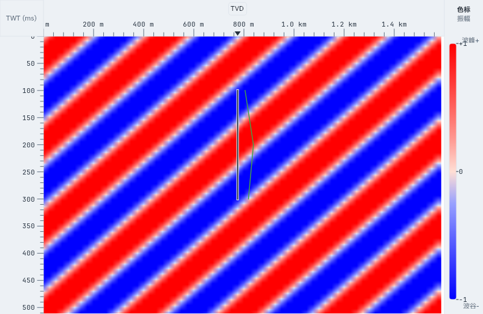
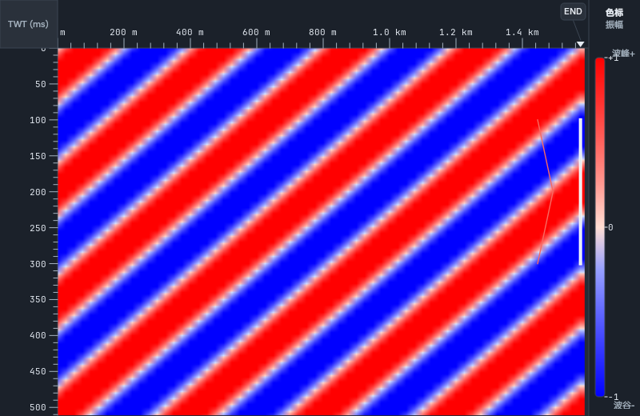

# 阶段性多维审查（2026-11-05）

## 范围与方法

基线为 `origin/master` 的 `28c432f2`。审查和构建位于独立 worktree，未纳入主 checkout
尚未提交的地震属性融合改动。本次是全仓机械检查与关键链路人工深查，不表示逐行审完全部源码。

- **代码与架构**：对照 `AGENTS.md`、`docs/PALEO_QGIS_PLAN.md`、`docs/UI_LAYER_PLAN.md`，
  检查分层、QGIS 依赖、公共入口、作业状态、取消、成果登记及来源失效处理。
- **UI 与应用**：对照 `DESIGN.md`，检查工作流工具页、井震剖面、曲线选择、合成道、
  缺资料提示、浅深主题及端点可见性。使用本次 Qt 实际渲染取证；桌面窗口采集受阻，见下文。
- **数据与功能**：检查 DataService 地震读取、时深/轨迹、预测缺测掩膜、单因素、
  临时成果及版本发布；用微型真实格式 SEG-Y、井数据和工程夹具回归。
- **安全与性能**：抽查 Office 本地服务的路径/请求限制、来源 SHA、后台取消和有界读取；
  检查现有线程、缓存及流式输出契约。未进行外部服务调用或大工区性能基准。

人工深查的代表入口：

| 链路 | 代表文件 | 关注点 |
|---|---|---|
| 地震取数与轨迹 | `src/services/seismicdataaccess.cpp`、`seismicwelltrace.cpp`、`seismiclinecache.cpp`、`seismicunitinput.cpp`、`sectionwellgeometry.cpp` | 工区/来源身份、坐标时间单位、缺测区、缓存失效、有界读取 |
| 预测与单因素 | `src/workflow/mappingworkbench_predict.cpp`、`mockseismicinputs.cpp`、`constraintwellfactors.cpp` | 冻结层段、过期输入、远端响应校验、NoData 掩膜、真实解释覆盖 |
| 作业与成果 | `src/workflow/inversionworkflow.cpp`、`inversionnative.cpp`、`inversionnativestream.cpp`、`derivedassets.cpp` | 取消/失败、流式体、临时文件、输入与父版本验证、发布条件 |
| Office 与任务 | `src/workflow/officepreviewsession.cpp`、`src/services/futuretask.h`、`paleotaskservice.cpp` | 私有副本、SHA、路径穿越边界、迟到结果、任务生命周期 |
| 显示与组装 | `src/ui/seismicsection/seismicsection_welltracks.cpp`、`seismicsectioncanvas.cpp`、`src/ui/paleomainwindow_workbench.cpp` | 原生井身份、单曲线规则、端点排布、提示、工具与视图职责 |

## 已确认的问题

| 编号 | 等级 / 维度 | 触发与影响 | 修复及回归 |
|---|---|---|---|
| R1 | P1 / 成果正确性 | 成功的子波或反演作业再次计算，提前取消或未 prepare 时，旧 `ok=true` 未清除；发布入口仍可能接受上一轮成果 | 两类 compute 入口先撤销成功状态、清空旧错误；回归以实际成功作业复算取消，并确认不能再发布 |
| R2 | P2 / 稳定性 | 两类 compute 虽检查空指针，失败分支仍求值 `&job->error`，空作业调用会崩溃 | 先拒绝空指针；两个入口直接调用回归 |
| R3 | P2 / 科学显示 | 原生井仅有 TVD 时深关系与真实 Survey 时没有 `mdTimeDepth`；显示端因此跳过单曲线规则，GR、DEN 等不同量纲仍叠入同一道 | 按原生空间井身份执行单条有效 GR 优先、无 GR 时可用曲线回退；实际图像不因增加第二种量纲而变化 |
| R4 | P2 / 失败可解释性 | 缺 AC/DEN 或时深时合成记录的时间数组为空；绘制端先跳过空数组，失败原因未进入井名提示 | 原因进入既有井名提示，保持图体不被诊断文字遮挡；检查真实 tooltip 文本与画面不变 |
| R5 | P2 / 端点可见性 | 合成道始终位于井右侧，剖面右端井的整条合成波形落在裁切区之外 | 右端合成道向图体内排布；浅深主题实际渲染确认端点波形可见 |

R1 的修前证据：`unsuccessfulRecomputeCannotPublishOldSuccess` 在实际成功的子波作业
取消复算后，`!wavelet.ok` 断言失败。R2 由两个入口的空指针解引用路径直接确认；
没有通过故意让应用崩溃来获取证据。

另修正三项**测试契约缺失**：

- `tst_sectiontrajectory::sectionWellCarriesTrajectory` 的旧夹具
只有 Survey，没有时深关系，却期待时间域井轨迹。基线实际失败为 0 点/期望 3 点。
现复用已有时深夹具补齐正向前置条件，并增加缺时深时不生成轨迹、曲线或伪 TWT 的反向断言；
生产代码没有恢复常速兜底。该套件修后 7 项通过。
- `tst_mappingworkbench::predictionWellWithoutLogFallsBackToMockDepth` 仍要求无曲线的井
  生成 `depth_mock`。完整套件实际在该断言失败。现改为
  `predictionWellWithoutLogIsRejected`，验证明确拒绝、原因包含测井曲线、不进入忙碌状态、
  不生成测井预测成果；不把合成深度兜底加回生产入口。
- `tst_shell_chrome::importCommandsAreGatedUntilProjectOpens` 把预测命令列为打开工程后
  必须启用的自由动作，忽略了工作流仍无预测输入。现归入由功能 owner 管理使能的动作，
  同时保留工程门与 owner 状态的 AND 合成断言；完整套件修后 21 项通过。

## 其他审查结论

| 维度 | 评价 | 证据和限度 |
|---|---|---|
| 分层与架构 | 闸门通过；存量耦合仍需分批收敛 | 功能层传递 QtWidgets 违规 0；视图边记录 4；重头出闸边 49，涉及 38 个重头、48 个 TU。Qgs 直连冻结 136 文件，QGIS 散布冻结 170 文件；本次未补增任何基线 |
| 安全性 | 抽查未确认新增缺陷 | Office 服务已有路径规范化、规范路径边界、会话 token、私有原件副本及 SHA 校验；不是渗透测试或完整安全认证 |
| 并发与性能 | 关键既有契约保持 | 地震读取线程为 1/2/4，保留取消与缓存验证；本次不改变算法或并发上限，未声称大体切片、全体反演性能提升 |
| 可维护性 | 本次修复保持既有层次 | 业务状态修复位于 workflow；视图只调整显示与提示；未将数据读取、计算或发布放入 UI |
| 设计一致性 | 沿用既有规范 | 不增加字体、颜色、间距 token 或新面板；以实际曲线与合成道的可读性和状态解释为目标 |

Office 预览取消曾作为候选问题检查，但 `futuretask` 的取消状态及 session generation
已阻止迟到结果启动；未将这一候选计作缺陷。

## 验证记录与界面证据

独立 Windows/MSVC 构建，构建并行度不超过 8、CTest 串行；Office 编辑页 configure 正常接入。
运行自检通过：17 个 provider，OGR、srs.db、GPKG 读取及非空地图渲染正常。
fetch/rebase `origin/master` 后重新运行 CI Source gates 中的 28 条检查命令，全部通过，
包含带 QGIS 头目录的传递依赖检查与 C++ 主线自检；基线未上调。

### 受影响视图步骤

以下均为本次运行中 800×520 的原生 `SeismicSectionCanvas` 实际渲染，使用微型合成地震体，
不是设计稿或旧截图。图片保持原样；tooltip 的独立浮层未采集，由真实 `QHelpEvent`
和 `QToolTip::text()` 断言验证。

1. **原生 TVD 井 + GR/DEN：已修复。** 修前添加 DEN 使画面多出 478 个差异像素；
   修后画面与仅 GR 一致，且 GR 相对无曲线的画面确实可见。

   
   

2. **缺密度曲线的合成记录：已修复。** 无时间数组的失败结果仍可从井名提示读到原因；
   增加诊断不改变图体像素。独立 tooltip 浮层截图缺失，不把图体截图当作提示文本的证据。

3. **右端井合成道：已修复。** 修前只见端点井身，合成道被图体边缘裁掉；
   修后合成波形向内排布。

   
   

4. **深色主题复核：通过。** 端点波形保持可见，UI chrome 使用现有深色主题，未增加新配色。

   

5. **真实桌面主窗口逐步体验：受采集工具阻断。** Windows 工具和备用入口均返回
   `failed to activate captured window`；后续图像为墙纸或被遮挡内容，已拒绝，未作为证据保存。
   因此本次不声称完成了五个工作流工具页的人工端到端体验或桌面高 DPI 验收。

专项修后回归 `nativeTvdTracksKeepOneCurve`、
`syntheticFailureIsExplainedAndRightEndpointVisible` 全部通过，覆盖浅深主题。
完整套件的最终汇总见下方验证表。

### 功能和回归汇总

共构建并运行 18 个完整测试套件，其中 16 个最终通过、2 个在 300 秒预算内未完成。
没有延长超时、跳过失败用例或修改闸门基线。表内“通过”指完整套件退出成功，
不把单个专项通过计为完整套件通过。

| 范围 | 最终结果 | 覆盖与限制 |
|---|---|---|
| `tst_catalog`、`tst_seismic_reads`、`tst_futuretask`、`tst_derivedassets`、`tst_mkprojectfixture`、`tst_errorhub`、`tst_areamodel`、`tst_sections_alignment`、`tst_inversion_native`、`tst_sectiontrajectory` | 10/10 套件通过，46.91 秒 | 目录、地震读口、后台任务、来源失效、真实文件格式工程往返、时深和轨迹、原生反演及本次状态回归；真实资料可选项仍有跳过 |
| `tst_factorworkflow` | 通过，139.46 秒 | 52 项通过、2 项真实资料可选项跳过；包括单因素计算、NoData 与成果注册 |
| `tst_officepreview`、`tst_uxtheme`、`tst_seismic_sectionui`、`tst_seismic_3dui`、`tst_shell_chrome` | 5/5 套件通过 | Office 编辑组件、主题、二维/三维显示、窗口命令门控；字体 QA、部分 offscreen/真实资料可选项仍有跳过 |
| `tst_mappingworkbench` | 完整运行超时，300.53 秒 | 超时前记录 102 项通过、1 项旧契约失败（无曲线井要求 mock 深度）。修正该契约后，与后续后台多边形取消用例一起单独运行通过（含初始化/清理共 4 项，5.69 秒）；未声称完整套件转绿 |
| `tst_datapreview` | 完整运行超时，300.32 秒 | 初始化与空态用例通过后未获得后续完成记录；尚无调用栈证据，不能把历史 QSettings/QGIS 故障直接当作本次根因 |
| CI Source gates + C++ 主线自检 | 28/28 命令通过 | 更新 `origin/master` 并 rebase 后执行；QGIS 传递头检查启用，分层、规模、token、i18n、文档漂移等基线未增长 |

两个超时套件及桌面逐步体验缺口已在 `TODOS.md` 记录。完整套件复核入口为
`ctest --test-dir build -R '^(tst_mappingworkbench|tst_datapreview)$' --output-on-failure`，
应先按 `BUILDING.md` 接好本地 QGIS、Qt 和 Office 组件环境，并保持 Windows 串行执行。
PR 用于继续 CI 验证；本地结果不等于所有平台全绿。

## 未覆盖范围

未运行真实远端预测服务、真实模型全体推理、百 GB 级工区全量反演、打印设备或完整屏幕阅读器验收。
截图不能证明完整无障碍合规。既有 `TODOS.md` 中的 DataService 事务统一、QGIS 依赖收敛和
大套件历史环境问题仍按原计划跟踪，不在本次报告中宣称完成。
