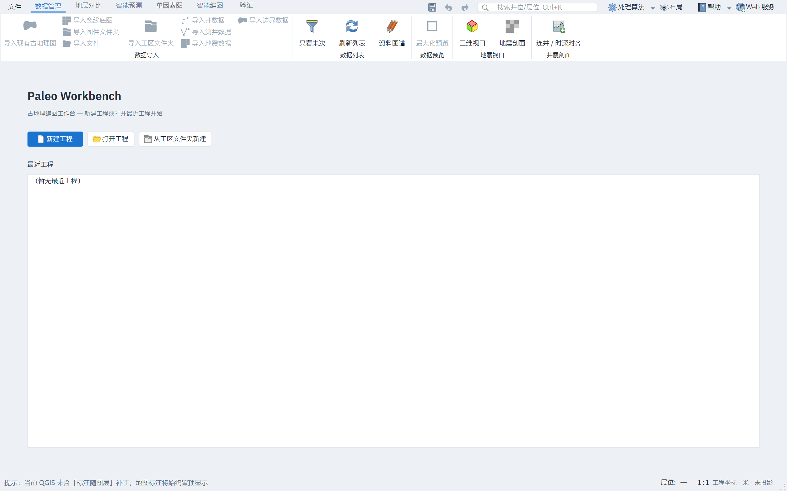
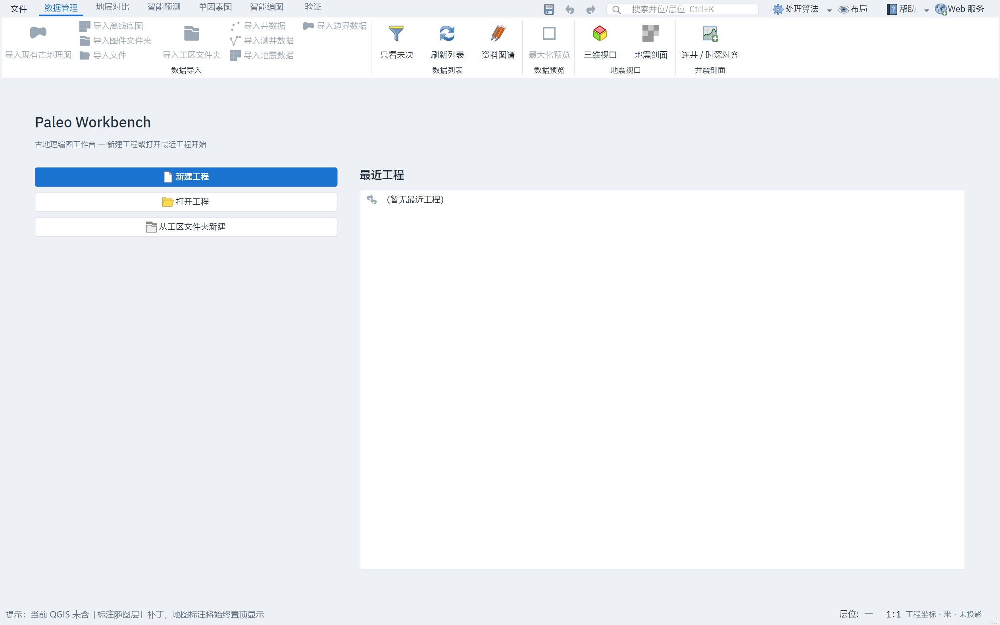

# 界面美观优化与视觉评审报告

日期：2026-10-27
分支：`codex/ui-visual-polish-20261027`
评审基线：`1908a6c816d0b083eb163c2b89f48561d4a0fba5`
视觉证据：[清单与 SHA-256](../evidence/ui-beauty-20261027/manifest.json)

## 1. 目标与边界

本轮先评审当前界面，再实施美观与图标优化。设计权威仍是 `DESIGN.md`：保留六步工作流、QGIS/Qt 原生控件、IBM Plex Sans SC、既有色板和 spacing token、专业 GIS 工具密度及浅/深双主题。

不换肤，不增加渐变、装饰性卡片、第三方图标库或第二套签名 chrome；不改变 `objectName`、信号、快捷键、业务门控、地图及地质数据符号色。`DESIGN.md` 无需修改。

## 2. 评审方法与覆盖

- 阅读设计规范、主题/图标实现、主窗和页面构建代码。
- 使用生产控件的 `workflowAuditSnapshots` 捕获启动页、数据管理、智能预测、单因素图、智能编图和验证；使用 `secondarySurfaceAuditSnapshots` 捕获导入、连井设置、地震剖面、断层、图件设计器、单井、图道配置和属性建模。
- Windows 原生 QPA：主窗 1440×900 逻辑尺寸，本机输出 2520×1575 物理像素，浅/深主题逐图检查。
- 高 DPI：离屏 `QT_SCALE_FACTOR=2`，主窗输出 2880×1800 物理像素，复核关键页面。
- 每次捕获均从临时工程和独立注册表 hive 开始，不使用真实工程或应用偏好。

地层对比独立 Web 服务、外部预测服务、真实工区全流程和算法结果正确性不在本轮视觉验收范围内。高 DPI 结果不等同于另一台 Windows 100%/150% 设备的实测；本报告不作全局 WCAG 合规声明。

## 3. 基线评审结论

### 已健康、应保留的部分

- 六步工作流与当前步蓝色下划线清晰，Ribbon 分组和原生 QGIS 图标具有专业工具的一致性。
- 浅/深主题 token、禁用原因提示、焦点环和主/次按钮层级完整。
- 单因素固定主操作栏在窄侧栏仍可达；地图、测井纸面、相色标和地震色标不随 UI 主题错误改写。
- 深色设计器和测井图标细节可辨，无需重写过时的图标提亮算法。

### 本轮确定处理的问题

| 编号 | 级别 | 观察 | 优化决策 |
|---|---|---|---|
| V01 | P2 | 首页采用单列“标题—按钮—超大最近工程列表”，宽屏留白失衡；最近工程标题层级弱，页标题使用 Bold 而设计 display 为 500 | 改原生双栏，恢复 display 字重，强化最近工程区层级，保留原三入口与列表行为 |
| V02 | P2 | 预测、单因素、编图等页面主命令主要依赖文字，与 Ribbon 和首页的图标表达不一致 | 集中补齐 QGIS 图标，优先主操作、导航、输入与输出，不给所有窄长按钮机械加图标 |
| V03 | P3 | 同类命令在 Ribbon 与页面可使用不同图形语义 | 一键成图统一 `processingModel`，井点获取统一点图层图标，综合编图统一处理算法图标 |

高级工具密度、二级窗口中仍存在的文字/符号混用、以及业务状态机问题不纳入这次纯视觉批次，避免借“美化”改变任务行为。

## 4. 已实施的优化

### 4.1 首页信息层级

落点：`src/ui/paleomainwindow_docks.cpp`

- 左侧按 1 份宽度放“新建工程 / 打开工程 / 从工区文件夹新建”，右侧按 2 份宽度放最近工程；栏间距使用既有 `spacing.xl = 32px`，页面边距保持 `spacing.2xl = 48px`。
- 页标题保持 15pt，字重由 Bold 改为设计规定的 Medium 500；“最近工程”使用既有 12pt / 600 区块标题样式。
- 三个工程按钮和最近工程图标统一为 `PaleoIcons::toolbarSize()`（18×18）；空最近工程使用历史图标，原空态文字和禁用行为不变。
- 最近工程顺序、完整路径提示、双击打开及三个按钮的点击路径均未改变。

### 4.2 命令图标统一注册

落点：`src/ui/paleoicons.{h,cpp}`

新增 49 个稳定命令 ID 的 QGIS 图标映射，以及 `applyCommandIcons()`：

- 只补空图标；已有专门图标及其尺寸不被覆盖。
- 重复调用返回 0，不反复替换图标；未知命令不制造图标。
- 继续复用既有主题重着色、禁用态和 DPR 引擎，不增加第三方依赖。

| 语义 | 资源与代表命令 |
|---|---|
| 运行 / 开始 | `mActionStart`：`baseMapStart`、`workbench.predict`、`runButton`、`generateFactorButton` |
| 一键成图 | `processingModel`：`factorOneClickButton`、`workbench.factor` |
| 综合计算 / 外部算法 | `processingAlgorithm`：`workbench.compose`、`mamclButton` |
| 井点输入 | `mIconPointLayer`：`extractWellFactorsButton` |
| 取消 | `mActionCancelEdits`：`cancelRunButton`、`factorCancelButton`、`workbench.cancel` |
| 显示 / 定位 / 参考 | `mActionShowAllLayers`、`mActionZoomToSelected`：`baseMapShow`、`workbench.referencePanel`、`workbench.show`、`factorNextStepButton` |
| 数据导入 | 文件、文件夹、井点、测井、栅格、边界等既有 QGIS 资源：`importAddData`、`importWells`、`importWellLogs`、`importSeismic`、`importBoundary` 等 |
| 任务 / 输出 / 编辑 | `mActionHistory`、`mActionSaveAsPDF`、`mActionSharingExport`、`mActionOpenTable`、`mActionUndo`、`mActionRedo`、`mActionEditCopy`、`mActionDeleteSelected` 等 |

接入点为 `DataListPanel`、`PredictPage`、`ConstraintPage`、`ValidatePage` 和 `PaleoMainWindow::attachWorkbench`。规模受限的 `mappingworkbenchpage.cpp` 未修改；`DataListPanel` 与 `attachWorkbench` 的冻结函数行数未增长，任何 baseline 均未上调。

## 5. 视觉复验

### 首页前后对比

| 优化前 | 优化后 |
|---|---|
|  |  |

双栏在 Windows 原生和 2× 下均保持稳定；[深色首页](../evidence/ui-beauty-20261027/after/native/00-startup-dark.png) 的标题、按钮与最近工程区也完整，无新增裁切。

### 高频命令图标

- [单因素浅主题](../evidence/ui-beauty-20261027/after/native/03-constraint-light.png)：主按钮的一键成图图标清晰，井点获取、定位与任务中心图标完整。
- [单因素深主题](../evidence/ui-beauty-20261027/after/native/03-constraint-dark.png)：主按钮与禁用态均可辨，未改变地质画布。
- [智能编图浅主题](../evidence/ui-beauty-20261027/after/native/04-compose-light.png)：开始编制和参考证据入口已有明确图形语义。
- [智能编图深主题 + 2×](../evidence/ui-beauty-20261027/after/highdpi/04-compose-dark.png)：图标边缘和文字无裁切。
- [智能预测深主题](../evidence/ui-beauty-20261027/after/native/02-predict-dark.png)：运行/取消的禁用图标保留可辨轮廓，未挤压双列按钮。
- [280px 窄面板](../evidence/ui-beauty-20261027/after/narrow/03-narrow-light.png)：主操作和任务中心完整，横向滚动条最大值仍为 0。
- [420px 备用流程](../evidence/ui-beauty-20261027/after/narrow/04-surfaces-light.png)：输入、提示和固定操作栏均未因新增图标溢出。

主流程浅/深与 2× 截图尺寸前后一致，未发现新增布局溢出。16 张二级界面中 15 张前后逐字节一致；`11-well-dark.png` 仅深度状态文字随既有异步刷新变化，已单独打开复核，测井纸面、曲线和控件无视觉退化。数据页看板/地图的既有异步内容差异不按本轮新增缺陷处理。

## 6. 技术验证

### 已通过

- 完整构建：1594/1594 个目标成功，ONNX Runtime 1.30 已 staging；`tst_ui`、`tst_uxtheme` 均成功链接。
- `tst_uxtheme`：通过；49 个命令资源均有效，覆盖未知命令、已有图标保留和重复应用。
- 原生截图：`initTestCase + workflowAuditSnapshots + secondarySurfaceAuditSnapshots + cleanupTestCase`，4 passed / 0 failed。
- 2× 截图：`initTestCase + workflowAuditSnapshots + cleanupTestCase`，3 passed / 0 failed。
- 整个 `tst_mappingpages` 退出 0；280px 窄面板横向滚动条最大值为 0。
- `layering --strict`、`ui_tokens`、`ui_invariants`、`check_i18n`、`docs_drift`、`file_budget --strict`、`ui_size --strict`、`git diff --check`：全部通过。
- 8 个修改过的 UI 源文件逐项对照：翻译源串与信号连接均未改变。

### 全量 CTest 与失败分类（不隐藏）

串行执行先在 `tst_perf_regress` 达到一小时上限，随后用 `-I 333,484` 续跑完成，因此 484 项均取得执行结果：**460 项通过、24 项失败，不能宣称全绿**。初次 `-j8` 的 Windows 并行尝试已作废，未用于验收。

| 分类 | 数量 | 项目与证据 |
|---|---:|---|
| 宿主性能 / 计时 | 6 | `singlefactor_perf`、`startup_trace`、`perfbudget`、`correlation_async`、`cache_las`、`perf_segyindex`；属于算力、缓存或计时敏感性，非本轮 UI 功能改动 |
| 基线已有功能 / 测试基础设施问题 | 16 | 未修改主线均复现：`singlefactor_store`、`previewmap_assets`、`versions`、`wellfacies`、`derivationgraph`、`impactrecompute`、`seismic_sectionui`、`shell_chrome`、`welllog_ui`、`wellcomposite_a11y`、`metadata_atomicfile`、`assetops`、`ui_blocking`；外部工区 `testSimultaneousWellsAndSurveyAreaVisibility`；两个 PowerShell 自检漏提取 `Get-UpstreamVersion` |
| 外部工区状态不稳定 | 1 | `sections_alignment`：主线曾通过，但 `/home/kevin/projects/paleo_data` 随后被移动或删除，不能作为稳定回归判据；停止继续访问该真实目录 |
| 会话状态污染 | 1 | `wellcomposite_framework`：旧 QSettings 会话使辅助曲线重新可见；同一二进制在全新沙箱中以 GR、SP、RLLD 通过，非本轮代码回归 |

基线对照使用未修改的主线 UI 库和测试对象，其他依赖保持当前 worktree 一致；临时诊断源码已全部还原并重新链接。[逐项对照记录](../evidence/ui-beauty-20261027/baseline-failure.txt)。

这些结果不掩盖基线测试债，也不要求本 PR 顺带修复全部历史问题；本 PR 的视觉改动及新增断言均通过。

## 7. 文件清单

| 文件 | 内容 |
|---|---|
| `src/ui/paleomainwindow_docks.cpp` | 首页双栏、标题层级、图标档位与空态图标 |
| `src/ui/paleoicons.{h,cpp}` | 49 个命令映射与只补空图标的应用助手 |
| `src/ui/pages/{datalist,predictpage,constraintpage,validatepage}.cpp` | 页面构建完成后的图标接入 |
| `src/ui/paleomainwindow_workbench.cpp` | 工作台页面装配后的图标接入 |
| `tests/tst_ui.cpp` | 首页标题字重和图标档位断言 |
| `tests/tst_uxtheme.cpp` | 49 个资源、未知命令、保留已有图标及幂等断言 |
| `docs/evidence/ui-beauty-20261027/` | 37 张已评审原图及尺寸/哈希清单 |
| `docs/progress/ui-beauty-optimization-20261027.md` | 本报告 |

## 8. 后续建议

- 高级工具和二级窗口的进一步任务减法应单独立项，先明确默认展开和交互契约，不用缩小字体或删除地质语义换取“简洁”。
- 剩余文字/符号混用的二级按钮可逐批映射到同一 QGIS 图标出口，但应先做窄窗评估。
- 外部工区红项应独立修复或提供可移植的标准夹具，避免本机路径和工区状态影响全量测试结论。
- 真实工区、外部预测、地层对比 Web 全流程及 Windows 100%/150% 设备仍需专项验收。
